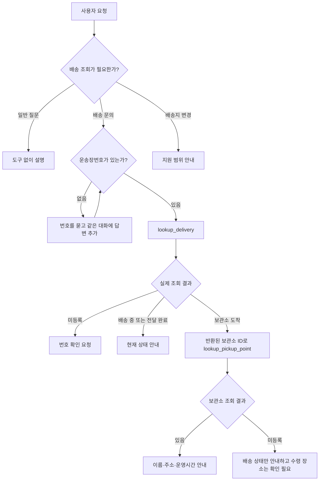

# Practice · 배송 상태·수령 장소 안내 도우미

**설계도를 보고 작은 앱을 새로 만든다.** 사용자의 배송 문의를 읽고, 필요한 번호를 질문하거나 도구를 조회해 현재 상태와 수령 장소를 안내한다. 수업에서 완성한 비품 상담 코드를 Codex에 참고 자료로 주고, 도구 선택·보충 질문·후속 실행·결과 분기를 다른 상황에 적용한다.

## 1. 만들 상황과 제공 자료

사용자는 택배가 어디에 있는지, 보관소에 도착했다면 어디에서 받을 수 있는지 묻는다. 도우미는 배송 상태를 조회하고 **보관소에 도착한 배송에만** 수령 장소를 추가 조회한다. 번호가 없으면 먼저 묻고, 등록되지 않은 번호라면 번호 확인을 요청한다. 배송지 변경은 지원하지 않는다.

| 제공 자료 | 내용 |
| --- | --- |
| [data/deliveries.json](data/deliveries.json) | 배송 4건: D100 배송 중, D200 보관소 도착, D300 전달 완료, D400 다른 보관소 도착 |
| [data/pickup_points.json](data/pickup_points.json) | 보관소 2곳: S001 한빛 수령소, S002 새봄 수령소의 주소·운영시간 |

번호·배송 상태·주소·운영시간은 모두 실습용 가상 데이터다. JSON은 고정된 조회 자료이며 실제 택배사에 접속하거나 실시간 배송을 확인하지 않는다. `updated_at`은 자료의 기준 시각이며, 현재 시각으로 바꾸거나 실시간 정보라고 표현하지 않는다.

## 2. 설계도

모델은 요청의 의미와 필요한 도구를 선택한다. Python은 실제 JSON 조회, 입력·반환 검사, 조회 결과에 따른 도구 공개·실행 조건을 맡는다. 보관소 조회에는 **현재 문의의 성공한 배송 조회에서 얻은 ID**를 사용한다. 번호를 추측하거나 이전 배송 문의의 보관소 ID를 그대로 사용하지 않는다.

## 3. 도구 명세

도구 이름과 입력 이름은 아래대로 구현한다. 각 입력은 공백을 제거한 비어 있지 않은 문자열이다. 누락된 번호는 모델이 사용자에게 질문해 받은 뒤 호출한다.

| 도구 | 입력 | 하는 일 |
| --- | --- | --- |
| `lookup_delivery` | `tracking_number: str` | `deliveries.json`에서 운송장번호와 일치하는 배송 1건을 찾는다. |
| `lookup_pickup_point` | `pickup_point_id: str` | 현재 배송 결과의 보관소 ID로 `pickup_points.json`에서 보관소 1곳을 찾는다. |

`lookup_delivery`의 반환 항목은 다음과 같다.

| 항목 | 타입과 의미 |
| --- | --- |
| `found` | `bool`. 해당 운송장번호가 등록되어 있는지 나타낸다. |
| `tracking_number` | `str`. 조회한 운송장번호다. |
| `status` | `"in_transit"`, `"ready_for_pickup"`, `"delivered"` 중 하나. 각각 배송 중·보관소 도착·전달 완료이며, 미등록이면 `null`이다. |
| `status_note` | `str` 또는 `null`. 데이터에 있는 현재 상황 설명이다. |
| `pickup_point_id` | `str` 또는 `null`. 보관소 도착 상태에만 실제 보관소 ID가 있고, 나머지 상태와 미등록은 `null`이다. |
| `updated_at` | `str` 또는 `null`. 데이터에 기록된 기준 시각이다. |

`lookup_pickup_point`는 `found: bool`, `pickup_point_id: str`, `name`, `address`, `opening_hours`를 반환한다. 이름·주소·운영시간은 등록된 보관소의 문자열이며, 미등록이면 세 항목 모두 `null`이다.

미등록은 **조회가 정상 수행된 결과**다. `found=false`와 요청한 번호를 반환하고 나머지 항목은 `null`로 둔다. JSON 읽기 실패 같은 실행 오류를 `found=false`로 바꾸지 않는다. 보관소가 미등록이면 배송 상태는 유지하되 주소와 운영시간을 만들어 내지 않는다.

## 4. 수업 코드를 참고해 Codex로 구현하기

1. **예상 동작을 먼저 적는다.** 아래 검증 요청에서 어떤 도구가 필요한지, 무엇을 질문할지, 언제 후속 조회를 할지 정한다.
2. **수업에서 자신이 완성한 코드를 참고 자료로 준다.** 대화·모델 호출은 `app.py`, 도구 공개·분기는 `routing.py`, 실제 결과 반영은 `progress.py`, 호출·같은 ID의 ToolMessage 연결은 `execution.py`, 도구 정의·검사는 `tools.py`와 `contracts.py`, 템플릿은 `prompts.py`를 참고하게 한다. 실제 파일을 선택하거나 경로를 지정해 읽게 한다.
3. **이 README와 두 JSON을 주고 구현 계획부터 검토한다.** Codex가 제안한 계획에서 두 도구의 역할, 보충 답변의 대화 연결, 보관소 ID의 출처를 확인한 뒤 구현을 진행한다.
4. **이 Practice 안에 `delivery_assistant` 폴더를 새로 만든다.** 수업 파일은 참고만 하고 덮어쓰지 않는다. 앱은 이 폴더의 `app.py`를 Run해서 시작한다. 모델 준비·호출 반복·검사 방식은 필요한 부분을 재사용하고, 연결할 도구는 두 로컬 조회 도구로 구성한다.
5. **기존 가상환경과 `.env`의 모델 설정을 사용한다.** 환경 파일이나 키를 새 과제 폴더에 복사하지 않는다. 제공 JSON은 파일 위치를 기준으로 찾아 읽거나 새 앱의 `data`에 복사해 사용한다.
6. **실행 결과로 수정한다.** Codex에 실제 호출 이름·인자·반환과 최종 안내를 함께 보여 주고, 잘못된 도구 선택·누락된 대화·분기 조건을 고친다.

파일은 `app.py`에 대화와 실행 반복, `tools.py`에 두 조회 함수, `prompts.py`에 지시와 템플릿, `contracts.py`에 입력·반환 검사를 두는 정도로 나누면 충분하다. 수업에서 사용한 ChatPromptTemplate·MessagesPlaceholder를 활용하고, 원래 AIMessage와 같은 호출 ID의 ToolMessage를 유지한다. StrOutputParser는 호출 없는 안내나 최종 답변을 읽는 데 사용한다.

한 사용자 요청에서 도구 실행은 최대 4회로 제한하고, 한도에 도달하면 확인된 내용과 미완료 부분을 안내한다. 번호를 물을 때는 터미널에서 답을 받아 원래 요청·질문과 같은 대화를 이어 간다. 새 배송 문의를 시작하면 이전 문의에서 얻은 보관소 ID를 다음 문의에 재사용하지 않도록 상태를 정리한다. 이번 과제의 완성 범위는 터미널 대화와 두 조회 도구다.

## 5. 검증 요청

각 행은 새 대화에서 시작한다. 첫 행의 `D100`만 앞선 질문에 이어 답한다. 모델의 문장 표현보다 **실제 호출 경로와 반환 자료**를 확인한다.

| 요청 | 기대하는 실행 | 확인할 안내 |
| --- | --- | --- |
| “내 택배 어디까지 왔어?” → 번호 질문에 “D100” | 번호를 받기 전 도구 0회 → 받은 뒤 `lookup_delivery` | 앞선 배송 문의를 이어서 배송 중 상태를 안내한다. |
| “D100 배송 상태 알려 줘.” | `lookup_delivery`만 실행 | 배송 중. 보관소 주소를 추가 조회하거나 수령 완료로 말하지 않는다. |
| “D200 어디서 받아?” | 배송 조회 → 반환된 S001로 보관소 조회 | 한빛 수령소, 가상시 한빛구 예시로 10, 1층, 평일 09:00~18:00. |
| “D300 배송 상태 알려 줘.” | `lookup_delivery`만 실행 | 전달 완료. 보관소 도착으로 바꾸지 않는다. |
| “D999 조회해 줘.” | `lookup_delivery`에서 `found=false` | 등록된 배송이 없어 번호 확인이 필요하다고 안내한다. 실행 장애로 설명하지 않는다. |
| “배송 중이랑 배송 완료는 무슨 차이야?” | 도구 0회 | 일반적인 의미를 설명한다. 특정 배송을 확인했다고 말하지 않는다. |
| “D200 배송지를 바꿔 줘.” | 도구 0회 | 이 앱은 배송 조회·수령 장소 안내를 제공한다고 설명한다. 변경 완료로 말하지 않는다. |
| “D400 어디서 받아?” | 배송 조회 → 반환된 S002로 보관소 조회 | 새봄 수령소, 가상시 새봄구 실습로 25, 2층, 매일 10:00~20:00. S001로 고정하지 않는다. |

추가로 **같은 대화에서** D200의 수령 장소를 확인한 뒤 “그럼 D100은?”을 물어본다. D100을 새로 조회하고 배송 중 상태만 안내해야 한다. 이전 S001로 보관소를 다시 조회하면 현재 문의의 상태 연결을 수정한다.

## 6. 완료 기준

- 두 JSON을 실제로 읽어 결과를 반환하며, 배송별 답변을 프롬프트에 하드코딩하지 않는다.
- 도구 선택·추가 질문·후속 조회·미등록 분기가 위 검증 요청과 맞는다.
- 보관소 ID는 현재 배송의 실제 반환에서 가져오고, 일반 설명과 지원 범위 안내에는 불필요한 도구를 호출하지 않는다.
- **요청 → 예상 경로 → 실제 호출 이름·인자·반환 → 최종 안내**를 기록한다. 모델의 호출 요청과 Python의 실제 실행을 구별할 수 있어야 한다.
- Codex가 작성한 코드에서 모델이 판단하는 부분과 Python이 보장하는 조건을 각각 짚어 설명한다. 잘못된 동작을 발견했다면 수정 전후의 차이도 남긴다.

제출물은 새 앱 코드와 검증 기록이다. 최종 안내 문장이 같을 필요는 없으며, 데이터의 상태·주소·운영시간과 실제 도구 실행 근거가 일치해야 한다.
