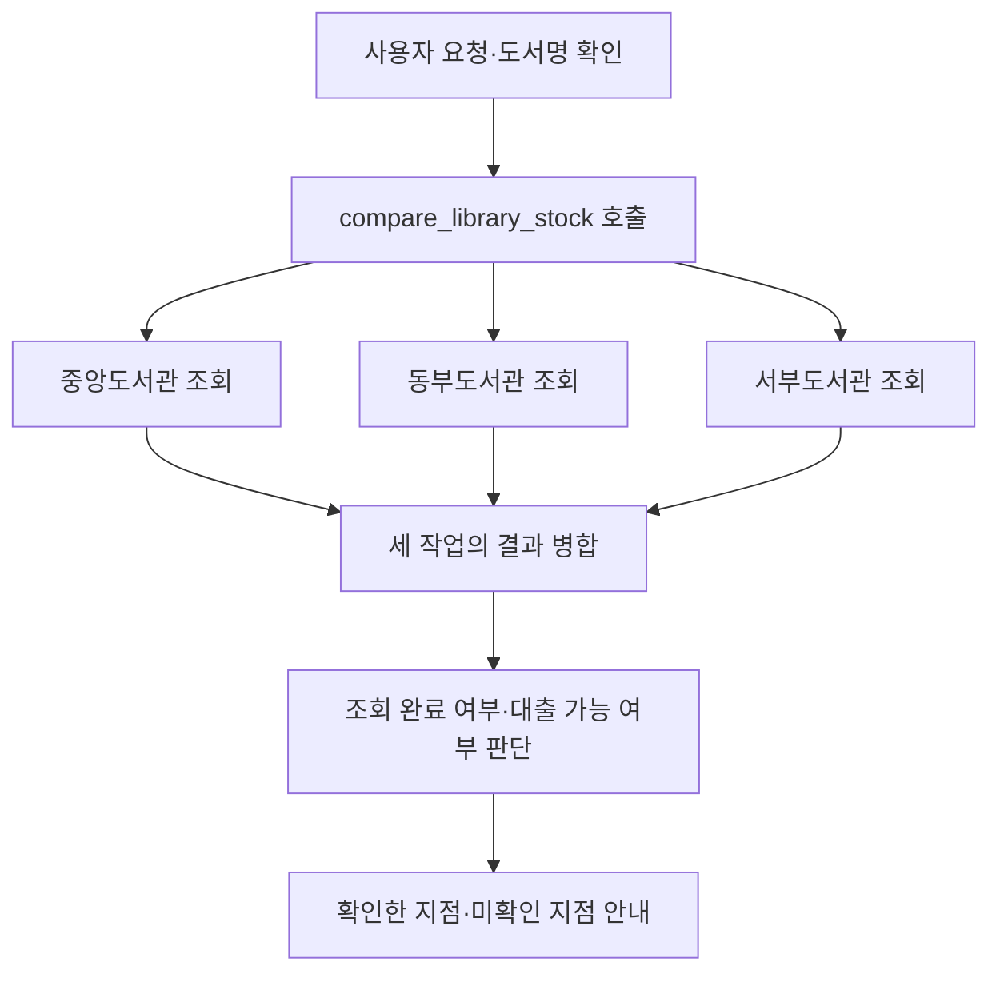

# Practice · 도서관 세 지점의 대출 가능 도서 비교

**설계도를 보고 작은 앱을 새로 만든다.** 같은 책을 세 도서관에서 독립적으로 조회하고, 응답을 모아 빌릴 수 있는 지점과 확인하지 못한 지점을 안내한다. 수업에서 완성한 코드를 Codex에 참고 자료로 주고 병렬 실행·동시 상한·결과 병합을 다른 상황에 적용한다.

## 1. 만들 상황과 제공 자료

사용자가 “『파이썬 첫걸음』을 빌릴 수 있는 지점을 알려 줘”라고 물으면 중앙·동부·서부 도서관을 조회한다. 한 지점의 결과가 다른 지점 조회의 입력이 되지 않으므로 세 작업은 함께 실행할 수 있다. 제목이 없으면 먼저 질문하고, 일반 용어는 조회 없이 설명한다. 예약 요청에는 이 앱의 조회·안내 범위를 설명한다.

| 제공 자료 | 내용 |
| --- | --- |
| [data/central.json](data/central.json) | 중앙도서관의 책 제목·대출 가능 권수 |
| [data/east.json](data/east.json) | 동부도서관의 책 제목·대출 가능 권수 |
| [data/west.json](data/west.json) | 서부도서관의 책 제목·대출 가능 권수 |
| [data/scenarios.json](data/scenarios.json) | 지점별 가상 응답 지연과 오류를 재현할 조건 |

도서관·제목·권수는 고정된 가상 자료다. 실제 도서관에 접속하지 않으며, 지연·오류도 외부 서비스를 흉내 낸 실습 조건이다. 각 자료의 `updated_at`을 기준 시각으로 유지하고 실시간 대출 정보라고 표현하지 않는다.

## 2. 설계도

Python이 세 작업을 만들고 `asyncio.gather`로 기다리되, `Semaphore`로 **동시에 실행하는 작업은 최대 2개**로 제한한다. 완료 순서가 달라도 지점 ID와 해당 반환·오류·실행 구간을 한 기록으로 유지한다. 공유 결과와 최종 안내는 작업들이 합류한 뒤 구성한다.

이 설계의 단위는 **모델 도구 호출 1개 → 내부 조회 작업 3개 → ToolMessage 1개**다. 내부 작업에 가짜 모델 호출 ID를 만들지 않고, 원래 모델 호출 ID에 병합한 실제 결과를 전달한다.

## 3. 도구와 병합 결과 명세

모델에 공개할 도구는 `compare_library_stock(title: str)` 하나다. 입력은 양끝 공백을 제거한 비어 있지 않은 책 제목이며, 각 JSON의 `title`과 정확히 일치하는 책을 찾는다. 비교 대상은 중앙·동부·서부 세 지점으로 앱에서 정한다. 지연·오류 조건과 동시 상한은 모델 인자가 아니다.

각 지점의 정상 조회 반환에는 `branch_id`, `name`, `title`, `found`, `available_count`, `updated_at`을 담는다. 등록된 책은 `found=true`와 0 이상의 정수 권수, 미등록 책은 `found=false`와 `available_count=null`이다. **등록된 책의 0권과 도서 미등록은 다른 결과**다.

각 작업 기록에는 다음 항목을 둔다.

| 항목 | 의미 |
| --- | --- |
| `branch_id`, `name` | 조회한 지점의 식별자와 이름 |
| `status` | 정상 반환은 `ok`, 실행 오류는 `error`. 미등록도 정상 반환이다. |
| `result`, `error` | 정상 조회 자료와 오류 원인을 구분한다. 오류 작업의 `result`는 `null`이다. |
| `started_at`, `finished_at`, `elapsed_seconds` | 동시 실행 구간에 들어간 뒤의 시작·종료·소요 시간. 상한 때문에 기다린 시간은 전체 실행 시간에 포함한다. |

모든 작업이 합류하면 다음 정보를 반환한다.

| 항목 | 판단 기준 |
| --- | --- |
| `title` | 이번에 조회한 책 제목 |
| `collection_status` | 세 지점 모두 정상 반환이면 `complete`, 일부 오류면 `partial`, 전부 오류면 `failed` |
| `available_branches` | 등록된 책의 대출 가능 권수가 1권 이상인 지점 |
| `unavailable_branches` | 책이 등록되어 있지만 대출 가능 권수가 0인 지점 |
| `not_found_branches` | 도서가 미등록인 지점 |
| `errors` | 확인하지 못한 지점의 `branch_id`, `name`, `error` |
| `jobs` | 입력 지점 순서에 대응하는 원래 작업 기록 3개 |
| `elapsed_seconds`, `peak_active` | 전체 실행 시간과 관찰한 최대 동시 실행 수 |

`complete`는 세 지점의 조회를 마쳤다는 뜻이다. 모두 0권이거나 미등록이어도 조회는 완료될 수 있다. `partial`에서는 성공한 자료를 유지하고 실패한 지점을 미확인으로 안내한다. 실패를 0권·미등록으로 바꾸거나, 일부 지점만 확인한 채 모든 지점에 책이 없다고 결론 내리지 않는다. 일반 오류는 해당 작업에 기록하고 호출자의 취소는 상위로 전달한다.

## 4. 수업 코드를 참고해 Codex로 구현하기

1. **예상 결과를 먼저 적는다.** 아래 요청에서 세 지점의 결과와 병합 판정이 무엇이어야 하는지 정한다.
2. **자신이 완성한 수업 코드를 참고 자료로 준다.** `batch.py`의 실제 작업 실행·기록·상한·병합, `app.py`와 `execution.py`의 호출 결과 전달, `prompts.py`의 템플릿과 메시지 이력을 읽게 한다. 실제 파일을 선택하거나 경로를 지정해 읽게 한다.
3. **이 README와 네 JSON을 주고 구현 계획을 검토한다.** 독립 작업의 범위, 결과와 지점의 연결, 부분 실패 때 보존할 자료를 확인한 뒤 구현한다.
4. **이 Practice 안에 `library_assistant` 폴더를 새로 만든다.** 수업 파일은 참고만 하고 덮어쓰지 않는다. `batch.py`에 실행·병합, `tools.py`에 JSON 조회·도구 정의, `contracts.py`에 검사, `prompts.py`에 지시, `app.py`에 대화를 두는 정도로 구성한다.
5. **모델 없는 비교부터 실행한다.** `compare_execution.py`에서 같은 책·세 지점·시나리오를 순차와 병렬로 각각 실행한다. 결과·오류·지점 연결이 같고 실행 구간이 겹치는지 본다. 상한을 1과 2로 바꾸어 최대 동시 실행 수도 확인한다.
6. **모델에 연결해 Run한다.** `app.py`에서 제목 질문과 답변을 같은 대화에 유지하고 실제 병합 결과로 안내한다. ChatPromptTemplate·MessagesPlaceholder, 원래 AIMessage와 같은 ID의 ToolMessage를 활용한다. StrOutputParser는 호출 없는 안내나 최종 답변에 사용한다.

기존 가상환경과 `.env`의 모델 설정을 사용하고 키나 환경 파일을 새 과제에 복사하지 않는다. JSON은 파일 위치를 기준으로 찾아 읽거나 새 앱의 `data`에 복사한다. 새로운 제목을 물으면 세 지점을 다시 조회하고, 앞선 책의 권수를 현재 책의 정보로 재사용하지 않는다.

## 5. 시나리오와 검증 요청

완성할 앱에서는 `tools.py`의 `SCENARIO`로 가상 조회 조건을 선택하고 `MAX_CONCURRENCY`의 기본값을 2로 둔다. 모델 없는 비교 파일에는 `TITLE`·`SCENARIO`를 두어 같은 조건을 지정한다. 설정을 바꾸면 새로 Run한다.

| 시나리오 | 재현할 조건 |
| --- | --- |
| `normal` | 세 지점 모두 정상 조회. 지연은 중앙 0.3초·동부 0.1초·서부 0.2초로 설정한다. |
| `east_error` | 동부도서관만 조회 오류. 중앙·서부의 성공 결과를 유지한다. |
| `all_error` | 세 지점 모두 조회 오류. 확인된 대출 정보가 없다고 안내한다. |

각 행은 새 대화에서 시작한다. 제목 질문 뒤의 답변만 같은 대화에 이어 붙인다.

| 요청·조건 | 기대하는 결과 |
| --- | --- |
| `normal` · “파이썬 첫걸음을 빌릴 수 있는 지점을 알려 줘.” | `complete`. 중앙 2권·서부 1권을 안내하고 동부는 0권으로 구분한다. |
| `normal` · “데이터 분석 입문을 빌릴 수 있어?” | `complete`. 세 지점 모두 등록되어 있으나 대출 가능 0권이다. |
| `normal` · “비동기 프로그래밍은 어디서 빌려?” | `complete`. 중앙 1권·서부 0권·동부 미등록을 구별한다. |
| `normal` · “우주 항해 입문을 찾아 줘.” | `complete`. 세 지점 모두 미등록이다. 오류나 대출 중으로 바꾸지 않는다. |
| `east_error` · “파이썬 첫걸음을 빌릴 수 있는 지점을 알려 줘.” | `partial`. 중앙 2권·서부 1권은 안내하고 동부는 미확인이라고 밝힌다. |
| `all_error` · 같은 책의 대출 가능 여부 요청 | `failed`. 세 지점 모두 미확인이며 대출 가능한 책이 없다고 단정하지 않는다. |
| `normal` · “책을 빌릴 수 있는 지점을 알려 줘.” → 제목 질문에 “파이썬 첫걸음” | 제목을 받기 전 도구 0회 → 받은 뒤 비교 도구 1회. 앞선 문의를 이어서 안내한다. |
| `normal` · “대출 가능 0권과 도서 미등록은 무슨 차이야?” | 도구 0회로 일반적인 의미를 설명한다. |
| `normal` · “파이썬 첫걸음을 예약해 줘.” | 도구 0회로 조회·안내 범위를 설명하고 예약했다고 말하지 않는다. |

추가로 같은 대화에서 “파이썬 첫걸음”을 확인한 뒤 “그럼 데이터 분석 입문은?”을 묻는다. 현재 제목으로 세 작업을 새로 실행하고, 앞선 책의 중앙 2권·서부 1권을 재사용하지 않는지 본다.

## 6. 완료 기준

- 같은 세 조회를 순차·병렬로 실행하고, 지점·자료·오류가 정확히 연결되는지 비교한다.
- 병렬 실행의 작업 구간이 겹치며 설정한 동시 상한을 넘지 않는다. 총시간은 관찰값으로 기록하고 모든 환경에서의 속도 향상을 보장하지 않는다.
- 0권·미등록·실패와 전체 완료·부분 완료를 구별하고 성공 자료를 보존한다.
- **요청 → 예상 판정 → 실제 작업·실행 구간 → 병합 결과 → 최종 안내**를 기록한다. 모델 호출 수와 내부 작업 수를 구분한다.
- Codex가 작성한 코드에서 병렬로 실행되는 부분, 합류 후 판단하는 부분, 모델에 결과를 돌려주는 부분을 각각 짚어 설명한다.

제출물은 새 앱 코드와 검증 기록이다. 최종 안내 문장이 같을 필요는 없으며, 실제 JSON의 책·지점·권수와 확인한 범위가 일치해야 한다.
