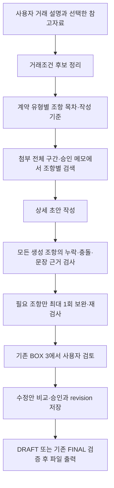

# KE KOREA AI 문서·계약서 에이전트 — 발표용 README

> 현재 동작은 원격 코드 `f335e9e` 기준으로 대조했습니다. 문서 끝의 「2026-11-10 코드·README 대조 결과」를 우선 참고하세요. 이전 날짜의 테스트·패치 기록은 당시 상태이며 현재 운영 성공을 뜻하지 않습니다.

기준일: **2026-11-10**. 실제 저장소 구현을 기준으로 설명합니다. 최신 코드의 로컬 자동 테스트와 실제 모델 품질·운영 배포는 구분합니다. 상세 구현/설정은 [팀 README](../Team/README.md)에 있습니다.

## 발표자가 먼저 확인할 것

- **설명 대상:** 기술을 처음 보는 팀원도 이해하는 5분 발표. 아래 기술 표 → 업무 흐름 → 가상 계약 수정 → 기록/RAG → 검증 한계 순서로 진행한다.
- **그대로 읽을 자료:** [5분 발표 대본](presentation_script_ko.md). 코드 변경 이력 표는 질의응답용이며 발표 중 전부 읽지 않는다.
- **기본 시연:** 미리 준비한 `[TEST]` 가상 계약의 조건·본문·수정안 비교를 보여준다. 제한 시간 안에 AI 생성 완료를 보장할 수 없어 신규 생성은 선택 시연이다.
- **발표 전 확인:** 로그인, 준비 계약 열기, 승인 메모 검색 가능 여부, 검토용 PDF/DOCX 열기. 실데이터·직인·FINAL 출력은 기본 시연에 포함하지 않는다.
- **자료 준비 상태:** 문서와 대본은 준비되어 있다. 시연 계약·캡처·출력 파일의 현재 준비 및 운영 화면 성공은 별도로 확인해야 한다.

## 1. 핵심 메시지

> 거래 설명과 참고자료를 구조화하고, 회사의 승인된 조항을 검색해 초안을 작성한 뒤, 사람이 조건과 수정안을 검토·승인하는 문서 지원 시스템입니다.

가격 계산·필수조건·수정 이력은 코드와 DB가 관리하고, AI는 추출·작성·검토를 담당합니다. 실제 계약 서명·발주·송신·결제까지 자동 실행하는 서비스로 소개하지 않습니다.

## 2. 기능과 실제 구현 기술

| 발표 주제 | 실제로 구현한 방식 | 설명 시 구분할 점 |
| --- | --- | --- |
| 에이전트 화면 | Streamlit, BOX 1 대화 / BOX 2 조건 / BOX 3 본문 | 기존 UI·승인 흐름 유지 |
| 거래정보 이해 | OpenAI Responses API 구조화 추출 + 조건 키 정규화 | 추출한 후보는 사용자 확정 전 미승인 |
| LangGraph | 계약 분석 및 신규 초안의 처리 순서·검증 노드 연결 | DB 저장·승인이나 영속 기억을 대신하지 않음 |
| LangChain | 미사용. Python으로 추출·검색·검사 연결 | LangChain 기반이라고 발표하지 않음 |
| MCP | 앱에 MCP 서버/클라이언트 미구현 | DB는 서버에서 REST/RPC로 호출. 개발 도구의 MCP와 구분 |
| 장기기억 저장소 | Supabase PostgreSQL 계약/대화/revision + 비공개 파일 Storage | 영속 저장이며 모델의 자동학습이 아님 |
| 공통 지식/RAG | 관리자가 승인한 익명화 참고 메모 검색 → 모델 입력 | 원본을 업로드했다고 즉시 모든 계약에 재사용하지 않음 |
| 임베딩 검색 | 기본 512차원 벡터를 JSONB에 저장하고 Python에서 유사도 계산 | pgvector·FAISS 등 전용 벡터 인덱스 없음 |
| 조항별 품질 개선 | 작성 기준 → 주제별 검색 → 상세 작성 → 누락/충돌 검사 → 1회 보완 | 단순히 글자 수를 늘리는 기능이 아님 |
| 사람이 통제하는 수정 | 문장 메모·위험 추천 → 비교 → 승인 → 새 revision | 미리보기와 저장 승인은 별개 |
| 문서 출력 | 계약 PDF/DOCX, 무역 PDF/Excel | DRAFT와 FINAL의 검증 경로 구분 |

## 3. 계약서가 만들어지는 과정



- 매매계약 13개, 커미션 계약 12개 기본 주제의 작성 기준을 사용합니다. 명시적 제외 결정은 존중합니다.
- 불가항력 예시: **발생 요건 → 통지 → 영향 완화 → 이행 재개 → 장기화 시 처리**를 확인합니다. 임의의 통지일수·해지기간을 합의된 사실처럼 채우지 않습니다.
- 참고 문서의 앞부분뿐 아니라 뒤쪽 조항도 검색합니다. 인접 문단/페이지를 연결해 제목과 실제 의무를 함께 가져옵니다. 모델에는 선택된 발췌문을 제한해 전달합니다.
- 신규 초안은 생성→품질검토→필요 시 1회 보완→재검토 순서입니다. 각 검토에서 잘못된 인용만 1회 재검증할 수 있어 생성/검사 API는 통상 2회, 최대 6회입니다. 요청별 소켓 타임아웃은 최대 150초, 내부 파이프라인 경과시간 예산은 600초입니다. 별도의 거래조건 분석은 180초이며 검색·임베딩 호출은 이 횟수에서 제외합니다. 이는 즉시 취소를 보장하는 UI 타이머가 아닙니다. 모델·품질검증을 자동 완화하지 않습니다.
- 이미 저장된 계약서는 이 기능으로 자동 덮어쓰지 않습니다. 실패한 중간 결과는 초안으로 저장하지 않습니다.

## 4. 장기기억/RAG 설명용 그림

```text
계약별 기록                           회사 공통 참고 지식
────────────                         ────────────────────
계약·대화·조건·본문                    비공개 원본 등록
       ↓                                      ↓
Supabase revision 저장                관리자 익명화 메모 검토·승인
       ↓                                      ↓
계약을 다시 열어 조회·복구              승인·활성·계약 유형 필터 검색
                                              ↓
                                      참고 근거와 함께 새 초안 작성
```

발표 멘트: “모델이 회사의 계약서를 스스로 학습하는 구조가 아니라, 승인된 참고 지식을 저장해 필요한 순간에 찾아 제공하는 구조입니다.”

기존 공통 검색은 임베딩·키워드를 혼합하고, 새 초안의 조항별 추가 검색은 키워드를 사용합니다. 상품/SKU 매칭은 별도의 규칙·문자열 유사도 방식입니다. 이 세 가지 검색을 같은 기능으로 설명하지 않습니다.

## 5. 무역 문서 기능도 함께 구현

| 기능 | 사용 가치 | 적용한 통제 |
| --- | --- | --- |
| PO/PI/CI/PL 텍스트·이미지·PDF 입력 | 반복 입력과 문서 전환 작업 감소 | 문서별 입력/작업 상태 분리 |
| 제품·가격 조회 | SKU·용량에 맞는 가격 근거 확인 | 유사 후보 사용자 확인, PO/PI/CI 가격 역할 분리 |
| 수량·금액·행사·샘플 | 수기 계산 오류 감소 | Decimal 계산, 명시적 0 유지, FOC/유상 구분 |
| 첨부 PI → CI | 실제 거래가격 재사용 | 카탈로그로 덮어쓰지 않음, 은행정보 제외 |
| PL 합계·PDF 페이지 | 포장 합계와 출력 안정성 | 원본 보존·수정 승인·단위 분리·하단 묶음 보존 |

자동 발주·전자 송장 발행·재고/배송 시스템 연동·이메일 발송은 구현 범위가 아닙니다.

## 6. 5분 발표 순서

| 시간 | 내용 | 화면/자료 |
| --- | --- | --- |
| 0:00–0:40 | 반복 입력, 짧고 불완전한 조항, 수정 이력 관리 문제 | 문제 사례; 실제 고객 자료 대신 합성 예제 |
| 0:40–1:30 | 기능별 구현 기술과 저장소 | 이 문서 2·4절의 기술 표/그림 |
| 1:30–3:20 | 준비한 계약의 조건 후보·본문·수정안 확인 | BOX 1·2·3. 신규 생성 완료를 기다리지 않고 준비 화면 사용 |
| 3:20–4:10 | 불가항력 구성요소와 수정 승인 | 요건·통지·완화·재개 확인, 메모/비교/승인 |
| 4:10–4:40 | 무역 문서의 가격·수량 통제 | 가상 주문의 검토 화면과 PDF/Excel |
| 4:40–5:00 | 테스트 결과와 현재 한계 | 구현·검증·운영 반영을 구분 |

## 7. 임시 화면에서 시연하기

아래는 **http://127.0.0.1:8502**에서 로컬 화면을 실행하는 예시입니다. 현재 서버가 실행 중임을 뜻하지 않습니다. 저장소 루트에서 실행하고 로그인·계약 열기까지 직접 확인한 뒤 사용하세요. 로컬 작업본이 원격 코드와 다르면 발표에서 사용한 커밋도 기록하세요.

```powershell
uv run --with-requirements .\Quotation_KEKOREA\requirements.txt python -m streamlit run .\Quotation_KEKOREA\app.py --server.address 127.0.0.1 --server.port 8502 --server.headless true --browser.gatherUsageStats false
```

**현재 로컬 화면은 사용자가 선택한 기존 Supabase DB를 공유합니다.** 임시 주소라고 데이터까지 분리된 것은 아닙니다. 테스트 계약 제목은 `[TEST]`로 시작하고 합성 데이터만 사용하세요. 기존 계약을 수정·삭제하거나 실제 고객 파일을 전송하는 시연은 하지 않습니다. 별도 팀 공개 시연은 인증된 테스트 환경과 독립 DB를 준비하는 것이 적합합니다.

준비할 합성 예제:

- 계약 제목: `[TEST] 샘플 물품공급계약`.
- 가상 회사 A/B, 실제 계좌·연락처 없는 물품·수량·가격 조건.
- 불가항력·검수·해지 문단이 있는 공개 사용 가능/자체 작성 참고자료.
- 미합의 기한은 비워 두고 확인 표시가 남는 모습을 보여줍니다.
- 기존 승인 자료를 공통 검색에 쓰려면 샘플 관리 설정과 승인 상태를 담당자가 확인합니다. 업로드만으로 RAG 등록 완료라고 설명하지 않습니다.

### 가상 계약 시연 순서와 기대 결과

준비용 예시(실제 거래가 아님): 제목 `[TEST] 가상 물품공급계약`, 매도인 `KE KOREA CO. LTD`, 매수인 `Example Buyer Ltd`, 제품 `Sample Widget`, 수량 `100 PCS`, 단가 `USD 2/PCS`, 인도조건 `EXW Demo Warehouse`. 주소·대표자·계좌·직인을 임의로 채우지 않는다. 준비자가 이 가상 입력의 AI 전송에 동의한 테스트 환경에서만 신규 생성을 요청한다.

| 순서 | 보여줄 화면/행동 | 설명할 결과 |
| --- | --- | --- |
| 1 | 준비된 `[TEST]` 계약 열기 | 조건표와 본문이 따로 저장되며 원문/제안 상태를 검토할 수 있음 |
| 2 | 수량·단가·인도조건 확인 | AI가 추출한 값은 자동 확정되지 않으며 브랜드·결제조건도 임의 생성하지 않음 |
| 3 | 문장 메모에 표현 수정 요청 | 메모 입력만으로 저장 본문이 바뀌지 않음 |
| 4 | 준비된 수정안 비교 화면 표시 | 변경 전후 및 적용할 문장을 확인. 실제 승인 시연은 격리된 가상 계약에서만 실행 |
| 5 | 준비된 검토용 파일 열기 | DRAFT는 검토용. FINAL 승인·직인과 구분하며 시연 중 날인하지 않음 |

메모/수정안 준비가 안 된 경우 화면 예시나 자체 캡처로 설명한다. 없는 데이터가 이미 준비됐다고 말하지 않는다. RAG는 승인·활성 참고 메모가 실제 있을 때만 검색을 시연하고, 없으면 4절 도식으로 설명한다.

AI가 늦거나 실패하면: “현재 응답 대기 중이며 기존 저장 계약은 유지됩니다. 준비된 가상 계약으로 검토·승인 과정을 이어서 보여드리겠습니다.”라고 말한다. 180초 분석 제한과 생성·검토의 600초 내부 예산 때문에 5분 발표를 실시간 생성 완료에 의존하지 않는다.

### 자주 나올 질문

| 질문 | 답변 |
| --- | --- |
| LangGraph가 장기기억인가요? | 처리 순서를 연결합니다. 영속 기록은 Supabase에 저장하며 두 역할은 다릅니다. |
| MCP도 사용했나요? | 운영 앱에는 미구현입니다. 개발 환경의 MCP 도구를 운영 기능으로 소개하지 않습니다. |
| 계약을 저장하면 AI가 학습하나요? | 모델 가중치를 학습하지 않습니다. 계약별 조회와 관리자 승인 참고 지식의 검색 재사용을 구분합니다. |
| AI가 수정하면 바로 반영되나요? | 미리보기와 수정안 비교 뒤 사용자가 승인해야 새 revision에 저장됩니다. |
| 테스트가 통과하면 법적 효력도 보장하나요? | 자동 검사는 코드 동작의 근거입니다. 실제 모델 품질·운영 검증·법률 검토는 별도입니다. |

## 8. 실제 확인한 것과 아직 확인하지 않은 것

| 항목 | 상태 |
| --- | --- |
| 커밋별 전체 테스트 기록 | `987fd16`: 498개, `97a6199`: 501개 통과. 이후 코드 전체를 이 수치로 검증했다고 발표하지 않음 |
| 대조 기준 코드의 자동 검사 | `f335e9e` GitHub Actions 성공, 실행 `42749663125`. 운영 화면 성공과 별개 |
| 새 품질 파이프라인 테스트 | 가상 API 응답 기반 핵심 15개 포함 |
| 코드 공백 검사 | `git diff --check` 통과한 기록 있음 |
| 시연 서버와 자료 | 발표 직전 로그인·준비 계약·검토용 파일을 직접 확인해야 함. 현재 가동/준비 완료로 표시하지 않음 |
| 실제 모델의 상세 조항 품질 | 대표 계약/조항으로 별도 검증 필요. 자동 테스트 통과와 동일하지 않음 |
| Render·Streamlit 운영 반영 | 이번 변경의 실제 운영 배포·생성 결과 미확인 |
| 새 기술 도입 | 계약 분석·검토 초안에 LangGraph 사용. MCP·fine-tuning 및 LangChain 기반 검색은 미구현 |

근거: [테스트 로그](../../logs/tests/drafting_quality_2026-11-09.log), [품질 테스트](../tests/test_contract_drafting.py), [앱 연결 테스트](../tests/test_contract_library_ui.py). 기존 경고는 남아 있으며 과거 실패 로그는 당시 코드의 실행 기록입니다.

## 9. 발표에서 반드시 설명할 한계

- 앱 전체의 관리자 로그인과 12시간 서명 세션은 구현되어 있습니다. 사용자별 계약 권한 분리·조직용 인증까지 구현한 것은 아니며, 로그인 쿠키는 HttpOnly가 아닙니다.
- AI의 완성도·충돌 판단과 참고자료의 적합성을 법적 유효성 보증으로 소개하지 않습니다. FINAL 검증 통과는 전자서명이나 법률 검토 완료가 아닙니다.
- 참고 계약 OCR은 상단 78%를 처리하므로 하단 조항이 누락될 수 있습니다. OCR·추출의 완전성을 주장하지 않습니다.
- 장기 기록과 공통 승인 메모는 저장되지만, 세션 작업 상태의 재시작 복구나 모든 대화의 전역 자동 기억은 보장하지 않습니다.
- 승인 샘플 수·다양성, 검색 정확도, 실제 모델 누락률·비용·지연·동시 사용자 성능은 이번 테스트로 측정하지 않았습니다.
- 운영 배포·독립 staging DB·인증·모니터링·백업/복구는 구현/운영 담당자의 별도 확인 대상입니다.

## 10. 마무리 멘트와 참고 위치

“AI가 초안과 검토 근거를 만들고, 코드가 계산과 변경 경계를 지키며, 사람이 최종 조건과 수정안을 결정합니다.”

- 구현 설명/실행/설정: [팀 README](../Team/README.md)
- 계약 상세 및 변경 기록: [README_CONTRACTS](../README_CONTRACTS.md), [프로젝트 README](../README.md)
- 실제 코드: [drafting.py](../contracts/drafting.py), [library.py](../contracts/library.py), [repository.py](../contracts/repository.py)
- 과거 수정본/백업 위치: [보관함 안내](../../archive/README.md)
- [현재 5분 발표 대본](presentation_script_ko.md)은 가상 계약과 사전 준비 화면을 기준으로 사용합니다.


### 2026-11-09 계약 PDF 출력 정책 개선 (로컬 패치, 배포 미확인)
- 계약서 DRAFT PDF/DOCX는 BOX 3에서 저장한 제목·조항을 출력하며, 검토용 워터마크/머리글은 유지하지만 자동 `[확인 필요]` 접두사, 미확정 부록, AI 검토 원문은 출력하지 않는다. 원래 조항 자체에 작성자가 적은 미확정 문구는 임의 삭제하지 않는다.
- FINAL은 현재 저장 revision의 본문 승인과 직인 권한·원본 SHA-256 검증을 요구합니다. 임시 확인 문구는 기본 차단하지만, 사용자가 미확정 본문 그대로 내보내기에 별도로 동의하면 문구를 보존해 출력할 수 있습니다. 이 동의는 거래조건 확정이나 법률 검증을 뜻하지 않으며, 미반영 조건 변경·본문 부재·KE KOREA 및 매매 당사자 누락 검증은 유지합니다. BOX 2 전 항목 확정이나 AI 위험 추천안 전부 선택은 필수가 아닙니다.
- FINAL에는 검증된 회사 직인을 KE KOREA 서명란에만 넣는다. Streamlit Secrets의 `CONTRACT_FINAL_SEAL_PASSWORD` 관리자 암호가 필요하며 원본 이미지는 기존 비공개 Supabase 저장소 또는 SHA-256이 같은 로컬 이미지에서 읽는다. 이미지·비밀번호는 코드나 저장소에 기록하지 않는다. DRAFT에는 직인을 넣지 않는다.
- 코드 패치가 전체 테스트나 운영 Streamlit 검증을 의미하지 않는다. 적용 후 테스트 및 실제 PDF 시각 검증이 필요하다.


### 2026-11-09 조건표 중복 및 계약 PDF 회귀 수정 (로컬 패치·운영 미확인)
- BOX 2 buyer/seller 등 당사자 역할을 조건표에서 중복 표시하지 않고 `parties` 표만 원본으로 사용한다. 수량 행에 KG/월 등이 명시된 경우 `unit`에 KG 후보를 보여주며 사용자 승인 전에는 확정하지 않는다. 매매계약의 `payment_trigger` 표시는 `매매대금 지급 조건`으로 바꾼다. `$`를 USD로 자동 확정하지 않는다.
- 계약서 DRAFT PDF/DOCX의 자동 미확정 부록·검토 원문 출력은 폐지된 정책이므로 관련 회귀 테스트의 기대값을 변경한다. 내부 검토 이력은 DB/앱에 보존한다.
- FINAL UI 테스트는 현재 revision 승인, 관리자 직인 사용 암호, KE KOREA 서명 당사자를 준비한 뒤 생성 경로를 검증한다. 실제 직인/Streamlit 배포 검증과는 별도다.
- 기존 계약/조건표/메모/직인 원본은 수정하지 않는다. 모든 테스트를 통과하기 전에는 배포하지 않는다.


### 2026-11-09 BOX 2·계약파일 한 번 다운로드 경로 보완 (로컬 패치, 배포 미확인)
- Buyer/Seller 등 역할은 `parties` 표에서만 표시하고 조건표에 빈 중복 행을 생성하지 않는다. `quantity.unit`의 KG/월에서 `unit`의 KG를 미확정 후보로 제안하며 사용자 확인 없이 확정하지 않는다. 매매계약 지급조건 명칭을 수수료 지급 트리거와 구별한다. `$` 표기만으로 통화를 USD로 확정하지 않는다.
- 검토용 DRAFT PDF/DOCX는 현재 저장된 BOX 3 제목·조항만 포함해 서버 업로드 없이 한 번 클릭으로 내려받는다. Supabase Storage 400은 DRAFT 다운로드에 영향을 미치지 않는다. revision·본문이 달라지면 다운로드 데이터를 재생성한다. 검토 이력은 화면에 보존한다.
- FINAL은 BOX 3 현재 revision 확인, 관리자 직인 사용 인증, 명시적 본문 미확정 표시 및 당사자 검증에 따라 출력한다. BOX 2의 모든 빈칸을 억지로 채우게 강제하지 않지만, 가격·인도장소 차이 등 실제 위험은 사용자 검토를 필요로 한다. PDF 자동 날인은 비공개 SHA-256 검증 이미지만 사용한다.
- 기존 PO/PI/CI/PL, RAG/메모/revision 기능을 변경하지 않는다. 새 직접 다운로드 흐름에 맞춰 관련 구식 업로드 테스트를 수정했다. 사용자 PC의 전체 테스트 및 운영 환경에서의 PDF 시각 검증은 별도 수행이 필요하다.


### 2026-11-09 최신 대화 명령과 계약 revision 동기화 (로컬 통합 패치, 배포 미검증)
- 서명용 계약의 원본은 마지막으로 **승인 후 저장된 revision**이다. 기존 계약서가 있을 때 최근 사용자의 명시적 수정 요청만 현재 revision과 비교한다. 과거 대화 전체의 조건을 뒤섞어 부산/서울 등의 인도장소를 다시 덮어쓰지 않는다.
- 대화 요청은 즉시 계약서를 변경하지 않는다. 변경값을 확인하고 '선택 후보로 본문 영향 수정안 만들기'→'선택한 변경을 하나의 revision으로 적용'으로 저장한다. 이 승인 후 해시가 revision에 기록되어 페이지를 다시 열어도 이전 명령의 중복 경고를 최소화한다.
- 페이지를 다시 열었을 때 아직 승인되지 않은 최근 명시적 수정 요청이 있으면 재검토·재적용 기능을 제공한다. 사용자의 직전 발언이 임의로 법적 효력을 가지지 않으며, 저장된 계약 본문과 상충하면 사용자가 비교·승인한다.
- 기존 DRAFT 직접 다운로드, BOX 2 중복 행 제거, FINAL 직인 인증, PO/PI/CI/PL은 이전 기능 그대로 보존한다. 이 패치에 대한 실제 DB/웹 배포와 전체 회귀 테스트는 별도 검증이 필요하다.


### 2026-11-09 계약서 동일조건 복사·한국어/영어 전체 번역 (로컬 패치, 배포 미확인)
- 저장·복사·언어 버전 메뉴의 복사 기능은 마지막 저장된 revision의 거래조건, 당사자, 본문 조항을 새 계약에 복제한다. 원본 계약과 자료는 변경되지 않으며, 원본 계약에 귀속된 참고자료 인용은 복사하지 않는다.
- 한국어/영어 새 버전 만들기는 사용자가 AI 전송에 명시 동의했을 때 현재 계약 조항과 설명형 조건을 번역하고, 숫자/금액/표준단위/Incoterms 코드 변화가 발생하면 새 계약 생성을 중지한다. 변환 직후 BOX 3에서 본문을 검토·수정할 수 있다.
- 회사 법인명·품목코드·원본 출처를 추측하거나 변조하지 않는다. 실제 사용/최종 날인 전 양국어 법률 문구를 사용자/전문가가 대조해야 한다. DB 연결/전체 회귀 테스트/운영 배포는 별도 검증 필요.

## Contract PDF and FINAL export integration (2026-11-09)

- DRAFT PDF/DOCX exports use the saved BOX 3 contract clauses without automatically adding unresolved-item appendices.
- DRAFT files are review copies, separate from FINAL contracts.
- FINAL export uses dedicated checks in contracts/final_policy.py rather than requiring all BOX 2 fields to be confirmed.
- FINAL export requires explicit approval and authorized KE KOREA company-seal verification.
- PDF/DOCX changes are implemented in contracts/draft_exports.py and contracts/exports.py.
- Regression tests cover draft formatting, final authorization, and export behavior.
- Rendered contracts must be reviewed before signing.

## 2026-11-09 AI contract note review format recovery

- In `contracts/service.py`, AI issue lists containing plain nonempty text are normalized into explicit, unconfirmed review issues; invalid/empty content fails closed rather than disappearing.
- In `contracts/workspace.py`, the model receives clearer issue-structure instructions. Original sentence validation, conflict detection, and atomic revision approval remain unchanged.
- The BOX 3 final-revision-request error path explains that the contract has not changed and existing note drafts remain available.
- `tests/test_contract_review_issue_recovery.py` checks mixed/invalid issues, unmodified snapshots on failure, and correct proposal creation. FINAL still requires current-revision approval and existing placeholder/seal-authority checks.

## 2026-11-09 BOX 3 note revision preview reliability

- `contracts/service.py`: preserve nonempty free-text AI review issues as unconfirmed review items, while rejecting malformed/empty issue data without accepting or discarding risks.
- `contracts/workspace.py`: explicitly request structured AI issue objects; keep the revision and user notes unchanged until review/approval.
- `contracts/ui.py`: display entire proposed contract in the existing revision-comparison panel, and the full saved contract immediately after approval. Keep approval/commit and FINAL seal authorization separate; display a helpful message on proposal errors.
- `tests/test_contract_issue_preview_recovery.py`: cover recoverable AI issues, invalid issues, proposal preview integrity and unchanged source revision.

## Auth and contract review integration (2026-11-09)

- Auth/gate.py protects the entire Streamlit UI before sidebar, database and AI use. Streamlit Secrets configure one admin login; a signed cookie expires 12 hours after initial login, even across refresh.
- Auth/session.py provides HMAC-signed time-limited tokens. The CookieController is a JavaScript-cookie component (not HttpOnly), appropriate only for a limited demo; production access needs stronger authentication and rate limiting.
- BOX 3 AI review issue objects and text issues normalize into explicit unconfirmed review items. Unknown AI issue structures fail safely without changing existing contract text or notes.
- Proposed revisions require human comparison/approval and atomic revision saving. The UI provides the full approved preview and displays all remaining FINAL blockers.
- Logged-in admin no longer retypes the FINAL seal password. Direct standalone contract module retains a legacy password fallback for compatibility; explicit final approval and verified seal still apply.
- Dependencies: streamlit-cookies-controller==0.0.4. Credentials and session signing secret belong in private Streamlit Secrets, never in Git.
- The uploaded four Python files were the direct source for this repair, rather than a historical GitHub or ZIP patch version.

## Authenticated UI test isolation and AI review issue schema (2026-11-09)
- Existing Streamlit AppTest suites simulate a signed-in test session **only within each test method**; production login remains mandatory.
- The server-side Auth gate is unchanged, and separate authentication/security tests continue to test real 12-hour signed-token validation.
- AI review issues provided as text remain unconfirmed, while malformed opaque issues fail closed and preserve user notes.
- Legacy error messages retain the original invalid severity for audit and compatibility.
- Run full regressions before deployment; no login bypass environment variable is introduced.

### 2026-11-09 번역 숫자 검증 오탐 보정
- 한국어/영어 계약서 버전 번역 시 `30일`처럼 한글에 붙은 숫자도 추출합니다. `1,000`/`1000`/`1000.00` 등 값이 같은 표기만 정규화하고 비율(`30%`/`30`) 및 실제 금액·기한의 불일치는 계속 차단합니다. 불일치가 있으면 조항 위치, 숫자 차이, 원문·번역문을 알려주고 원본은 보존합니다. 새 계약서가 정상 생성된 것은 번역의 법률적 정확성까지 보증하지 않습니다.

### 2026-11-09 영어 계약서 날짜 번역 숫자 검증 보완

- 한국어 `2026년 11월 10일`과 영어 `November 10, 2026`의 달 표기를 같은 값으로 비교합니다. 날짜 맥락의 영어 월 이름/약어만 숫자로 정규화합니다.
- 원래 금액·수량·비율·날짜의 실제 값 변경은 계속 차단하고, 불일치 시 원문/번역문과 차이를 보여줍니다. 원본 계약은 보존됩니다.
- 회귀 테스트: `Quotation_KEKOREA/tests/test_contract_translation_month_names.py`. 실모델 응답·운영 Streamlit은 별도 검증이 필요합니다.

### 2026-11-10 Source-reference deployment repair

- Fixed a Python string quoting error in the analysis citation instructions introduced by `5f5e0e6`; the service can import again. No other runtime behavior was changed by this repair.
- Source-reference recovery retains the upstream handling of null/single-object/prose citations and continues to reject fabricated quotes. Existing transaction, pricing, translation, export and authentication behavior is unchanged.
- Verification: 18 source-reference/service tests and all 498 tests in the full suite passed (130.277 s, no skips) with app requirements installed and the existing local private catalog fixture available. Compile checks and git diff --check passed. The initial minimal-dependency run failed because python-docx/pydantic and the private fixture were absent; no application code was changed to address those setup failures. Production health returned HTTP 200; deployed contract-analysis behavior remains unverified.

### 2026-11-10 Contract analysis timeout handling

- Trade-condition analysis now allows a 180-second socket timeout instead of 90 seconds. The reported approximately 90-second failure matches the previous limit; production transport logs were unavailable, so the underlying server/network delay is not confirmed.
- Direct timeouts and URL-wrapped timeouts now display a distinct timeout message with the request limit. Connection errors retain their existing message. Other operations keep their existing timeout values; model selection, business terms, translation, pricing, exports and authentication were not changed.
- Tests cover the analysis timeout, unchanged input snapshot, unchanged default for other calls, and safe timeout/connection messages. Existing citation validation remains enabled. Verification: all 501 tests passed in 139.103 seconds with app requirements and the existing local catalog fixture, no skips. Compile and diff checks passed. A synthetic analysis using local configured API credentials succeeded in 19.41 seconds; that does not validate production credentials or latency. Production contract-analysis verification remains pending.

## 2026-11-10 코드·README 대조 결과

**대조 기준:** 원격 `main`의 `f335e9e`. 이번 점검에서 `97a6199` 이후 코드 변경 16개가 다섯 README에 기록되지 않은 것을 확인해 보완했다. 아래는 코드 확인 결과이며, 운영 화면 검증 완료를 뜻하지 않는다.

| 근거 커밋 | 구현과 사용자에게 보이는 동작 |
| --- | --- |
| `c173bac` | 계약 초안 생성·품질검토 요청 제한을 호출당 최대 150초, 파이프라인 예산 600초로 조정. 중간 미검증 초안은 저장하지 않음. |
| `c06cd2c` | AI가 같은 조건을 다국어 키로 반복 추출하면 키를 정규화하고 충돌을 미확정 검토 항목으로 남김. |
| `b359cd4` | 계약 분석·검토 초안만 LangGraph의 추출/생성·검증 노드로 실행. 기존 중복 키 계약은 미리보기 후 사용자 승인으로 새 revision에 복구하며 열기만으로 쓰지 않음. `langgraph>=1.0,<2` 의존성 추가. |
| `a317bdc` | 계약 생성·검사·보완 단계를 화면에 표시. |
| `fbbdc16` | 무조건적인 문장 전체 확인 표시를 줄이고 실제 누락 사실에만 표시하도록 작성 지침 보완. 미확정 문구를 보존한 FINAL 출력은 별도 사용자 동의로 허용하며 기존 승인·직인·당사자 검증 유지. |
| `fd20d88` | 선택적인 AI 일괄 문장 정리: 문장 전체 확인 포장 문구만 수정 후보로 제안. 숫자·실제 미확정 사실·보호 문장은 보존하고, 위험 검토·메모 편집을 대체하거나 자동 저장하지 않음. |
| `0e353b1` | 품질검토의 인용이 실제 문장과 맞지 않을 때 동일 초안으로 1회 재검증. 그 외 검증은 완화하지 않음. |
| `11fa92b` | 번역의 통화·단위·Incoterms 등 보호 코드 불일치 문장만 1회 재번역하고 숫자·코드 검증 재수행. 계속 불일치하면 원본 보존. |
| `39bb6eb` | 계약 AI 완료 단계별 소요 시간을 표시. 계약 원문·계정 비밀을 시간 표시 데이터에 넣지 않음. |
| `8beb6c7` | `제3자`/`third party`를 수량 3과 구분하되 법률 표현의 출현 횟수를 별도로 비교해 삭제·추가를 차단. 실제 금액·기한 검증 유지. |
| `ddf4822` | 저장 계약 목록에 언어 표시 `[KR]`/`[EN]` 등을 붙이되 법적 제목은 변경하지 않음. 문장 삭제는 AI 호출 없이 수정안 생성→비교·승인→새 revision 순서이며 기본 커미션 지급 문장은 보호. |
| `da754b7` | FINAL 서명란을 한 번만 출력하고 당사자·대표자·직책·계약 날짜를 저장값에서 구성. 중복 서명 요약만 제외하며 실질 조항은 보존. 직인은 개인 서명을 대체하지 않음. |
| `321e1a7` | 한국어 중복 서명 요약 처리, 제목/조항/본문 18/12/10pt 및 비율을 유지한 10cm 폭 직인 배치. |
| `2f7825e` | PDF/DOCX 글꼴·굵기·간격·정렬 및 서명란 페이지 배치 개선. `packages.txt`에 `fonts-nanum` 추가; 실제 사용 글꼴은 호스트 설치 상태에 따름. |
| `b59f648` | 알려진 대표자 직책만 계약 출력 언어에 맞춰 표기. 임의로 CEO를 추정하지 않고 알 수 없는 직책은 사용자 입력 보존. |
| `f335e9e` | 새 매매 초안의 당사자·브랜드·제품/수량·가격·인도·결제 명세를 저장 조건에서 구성. 제안값은 미확정 표시하고 브랜드·100% 선결제를 추정하지 않음. 품질 보완 때 고정 명세를 보존하며 기존 계약을 자동 재작성하지 않음. |

**앞선 오류 수정 기록:** 출처 형식 복구 `5f5e0e6`, 안내 문자열 문법 수정 `987fd16`, 거래조건 분석의 90→180초 제한 및 시간 초과 메시지 구분 `97a6199`도 포함한다. null/단일 객체를 처리하고 검증 불가 문자열 인용은 확인 이슈로 남기며, 허위 인용은 계속 거부한다.

**로컬 작업본과의 차이:** 이번 점검 당시 사용자 작업본 `a314818`은 원격 기준과 분기되어 있다. 사용자가 추가한 번역 약어 차이 상세 메시지는 그 로컬 커밋의 변경이며, 이 대화에서 관련 19개 테스트와 USD→KRW 차이 표시·원본 보존을 확인했다. 원격에는 이후의 보호 코드 1회 재번역 경로가 있으므로 두 동작을 같은 구현으로 설명하지 않는다. 이번 작업은 문서만 정리하며 실행 코드를 병합하거나 변경하지 않는다.

**검증 범위:** `987fd16`의 498개 및 `97a6199`의 501개 전체 테스트 통과는 각 커밋에서 수행한 과거 결과다. 현재 코드 전체 테스트를 이번 문서 점검에서 다시 실행한 것으로 기록하지 않는다. 원격 `f335e9e`의 GitHub Actions 성공은 확인했다(`42749663125`); 이는 자동 검사 결과이며 배포 완료·운영 계약 분석·최종 날인 화면 성공을 증명하지 않는다. 해당 운영 검증은 미확인이다. 이번 문서 검증은 다섯 README의 변경 범위, 코드/커밋 근거, 링크 대상 및 `git diff --check` 대조로 한정한다.

동기화 보호의 한계: `scripts/check_readme_sync.py`와 로컬 pre-commit 훅은 파일 포함 여부만 검사한다. 훅을 실행하지 않는 원격 작업의 문서 누락이나 내용의 정확성까지 보장하지 않는다. 이번 보완은 누락 이력을 현재 문서에 추가한 것이며 과거 커밋의 동시 갱신 규칙 위반을 소급해 없애지는 않는다.

### 2026-11-10 팀 설명·발표 자료 재점검

- 팀 README에 3분 입문 안내, 쉬운 기술 용어, 가상 거래의 처리 과정과 인수인계 역할을 추가했다. 발표 README에 LangGraph 설명, 준비 계약 중심 5분 시연 순서, FAQ 및 지연 시 대체 순서를 정리했다.
- 발표 대본의 문장 중간에 섞인 Git 명령을 제거하고 현재 계약·무역문서 기능 기준 5분 대본으로 교체했다. 로그인 미구현·437개가 최신 테스트라는 구식 설명 및 임시 서버 가동 주장을 바로잡았다.
- 문서만 수정했다. 발표용 계약·캡처·파일 준비, 실제 낭독 시간 및 운영 시연 성공은 미확인이다. 준비 자료: [팀 안내](../Team/README.md), [발표 안내](README.md), [발표 대본](presentation_script_ko.md).
