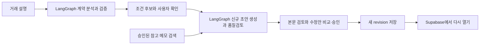
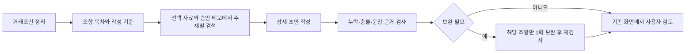

# KE KOREA — 팀 공유 및 구현 안내

> 현재 동작은 원격 코드 `f335e9e` 기준으로 대조했습니다. 문서 끝의 「2026-11-10 코드·README 대조 결과」를 우선 참고하세요. 이전 날짜의 테스트·패치 기록은 당시 상태이며 현재 운영 성공을 뜻하지 않습니다.

기준일: **2026-11-10**. 저장소 코드·SQL·의존성·로컬 테스트 기록을 기준으로 작성했습니다. 코드 구현, 실제 DB 적용, 로컬 실행, 운영 배포는 서로 구분합니다. 이 문서는 현재 구조를 설명하며 과거 변경 이력은 [프로젝트 README](../README.md)를 참고하세요.

## 처음 합류한 팀원을 위한 3분 안내

이 앱은 거래 내용을 문서로 정리하고 사람이 검토하도록 돕는다. AI가 내용을 추출·작성·검토하고, Python 코드가 숫자·출처·변경 범위를 검사하며, 사용자가 수정안을 승인한다.

읽는 순서: **아래 용어와 예시 → 3절 업무 흐름 → 4절 저장/RAG → 7절 실행 → 8절 검증 상태**. 발표 담당자는 [5분 발표 안내](../Presentation/README.md)와 [읽을 대본](../Presentation/presentation_script_ko.md)을 이어서 본다.

| 용어 | 쉬운 설명 | 이 앱에서 하는 일 |
| --- | --- | --- |
| API | 앱이 외부 기능에 요청하고 결과를 받는 통로 | OpenAI에 추출·작성·검토 요청 |
| LangGraph | 처리 단계와 순서를 연결하는 실행 도구 | 계약 분석의 추출→검증, 신규 초안의 준비→생성·검토→최종 구조 검증 |
| 장기기억 | 다시 열어 볼 수 있도록 남기는 기록 | Supabase의 계약·대화·메모·수정 이력. LangGraph 자체에 영속 기억을 둔 것은 아님 |
| RAG | 필요한 참고 지식을 찾아 AI에게 함께 제공 | 승인·활성 상태의 참고 메모를 유형에 맞춰 검색 |
| 임베딩 | 문장의 의미를 검색에 쓸 숫자로 표현 | 승인 메모의 의미 검색에 사용. 상품 가격을 생성하거나 확정하지 않음 |
| revision | 저장된 계약의 버전 번호 | 수정안 승인 후 새 버전 저장. 이전 버전과 충돌하면 적용 차단 |
| snapshot | 한 버전에 들어 있는 계약 데이터 묶음 | 당사자·조건·조항·검토사항 등을 함께 보관 |
| MCP | AI 도구 연결을 위한 별도 규약 | 이 운영 앱에는 아직 미구현. 개발 환경에서 쓰는 MCP와 구분 |

예시: 가상 물품 100 PCS, 단가 USD 2, EXW 조건을 입력하면 AI가 조건 후보를 만든다. 사용자는 BOX 2에서 확인하고 BOX 3의 초안을 검토한다. 문장 메모로 수정을 요청해도 즉시 원문은 바뀌지 않는다. 수정 전후를 비교·승인한 뒤 새 revision으로 저장된다. 다시 계약을 열 때 조회하는 기록과, 다른 계약 작성에 참고하는 승인 RAG 지식은 별도다.



이 도식은 단계 설명이다. 모든 단계를 하나의 LangGraph나 하나의 자동 저장 작업으로 묶은 것은 아니다. 거래조건 분석 그래프와 신규 초안 그래프가 따로 있으며, DB 저장·승인은 기존 애플리케이션이 담당한다.

### 팀 인수인계 때 확인할 네 가지

| 담당 역할 | 확인할 자료 | 전달할 결과 |
| --- | --- | --- |
| 기능 설명 담당 | BOX 1→2→3과 가상 계약 | 후보·미리보기·저장 승인을 구분해 설명 |
| 개발 담당 | `ai_graph.py`, `drafting.py`, `repository.py` | 호출 흐름과 revision 충돌 처리 위치 설명 |
| 데이터 담당 | 승인 참고 메모와 DB/Storage 설정 | 실제 승인 샘플 유무, 검색 가능 여부, 시연 DB 확인 |
| 발표 담당 | 발표 대본과 가상 계약·검토용 파일 | 네트워크 없이도 설명할 화면/파일 준비 |

## 1. 먼저 알아야 할 구현 현황

| 기능/기술 | 현재 구현 | 근거 및 설명 |
| --- | --- | --- |
| 사용자 화면 | Streamlit | [app.py](../app.py), [contracts/ui.py](../contracts/ui.py). React/Next.js 앱이 아님 |
| AI 추출·작성 | OpenAI Responses API 직접 호출 | Python `urllib.request`로 요청하고 JSON을 검증. [extractor.py](../agent/extractor.py), [service.py](../contracts/service.py) |
| LangChain / LangGraph | 계약 전용 LangGraph 도입 | `contracts/ai_graph.py`, `requirements.txt`. 계약 분석·초안 검증 노드만 사용하며 일반 거래문서는 기존 경로 유지 |
| MCP | 앱 런타임에 구현되지 않음 | MCP 서버/클라이언트, 도구 등록·발견 및 MCP를 통한 DB 호출 없음. 개발 환경에서 제공되는 도구와 배포 앱의 기능은 별개 |
| 에이전트 오케스트레이션 | 계약 전용 LangGraph + 기존 Python 규칙 | 상태 없는 계약 분석/작성 그래프와 기존 거래문서 작업 관리. 여러 자율 에이전트의 협업 시스템은 아님 |
| 장기 저장소 | Supabase PostgreSQL + Storage | 계약·대화·revision·메모·참고자료·출력 기록 영속 저장. 아래 저장소 표 참고 |
| 공통 지식 재사용/RAG | 승인된 참고 메모 검색 후 프롬프트에 전달 | 임베딩/키워드 혼합 검색과 신규 초안용 조항별 키워드 검색. [library.py](../contracts/library.py) |
| 벡터 저장 방식 | JSONB manifest 안의 숫자 배열 | 기본 512차원 임베딩. pgvector 인덱스·FAISS·Chroma·Pinecone 미사용 |
| 자동학습 / fine-tuning | 구현되지 않음 | 계약 저장이나 파일 업로드만으로 모델 가중치를 학습하지 않음 |
| 외부 실행 | 사용자 검토용 문서 생성 | 실제 발주·송신·이메일·전자서명·결제 자동 실행 없음 |

## 2. 기능별 폴더 지도

```text
KE_KOREA_CO_LTD/
├─ Quotation_KEKOREA/
│  ├─ app.py                 # 앱 진입점·메뉴·거래 문서 연결
│  ├─ agent/                 # PO/PI/CI/PL 추출·상품/가격·계산·PDF/Excel
│  ├─ contracts/             # 계약 작성·검색·검토·수정·저장·PDF/DOCX
│  ├─ tests/                 # 공식 회귀 테스트와 Streamlit AppTest
│  ├─ supabase/              # DB 마이그레이션·가격 SQL·적용 안내
│  ├─ scripts/               # 샘플 등록·회사 정보·직인·가격 시드 관리
│  ├─ assets/                # 공개 로고 등 문서 자산
│  ├─ private/               # Git 제외 비공개 자료·설정용 자료
│  ├─ outputs/               # Git 제외 생성물; 영속 저장소로 보장하지 않음
│  ├─ Team/                  # 이 문서
│  └─ Presentation/          # 발표용 README 및 기존 발표 스크립트
├─ archive/bugfixes/         # 과거 수정 패키지; 실행 앱과 구분
├─ archive/backups/          # 과거 소스·문서 백업
├─ logs/tests/               # 테스트 실행 기록
├─ logs/preview/             # 로컬 임시 서버 로그
├─ docs/superpowers/plans/   # 구현 계획·작업 범위 기록
├─ scripts/                 # README 동기화 검사
└─ render.yaml              # Render 배포 설정
```

과거 폴더의 이전/현재 위치는 [보관함 안내](../../archive/README.md)와 [이동 명세](../../archive/move_manifest_2026-11-09.json)에 있습니다. `archive`의 보조 테스트는 과거 수정본과 함께 보존한 기록물입니다. 현재 테스트는 `Quotation_KEKOREA/tests`에서 실행합니다. 과거 적용 스크립트는 당시 경로·코드 형태를 가정하므로 현재 소스에 재실행하지 마세요.

## 3. 계약서 에이전트 구현

### 3.1 화면과 역할

- **BOX 1:** 거래 설명·참고자료 선택·AI 전송 동의·조건 분석·초안 생성.
- **BOX 2:** 조건 및 당사자 직접 입력·상태 확인·본문 조건 후보 추출·지급조건 관리.
- **BOX 3:** 문장별 미리보기·메모·위험 검토·수정안 비교/승인·DRAFT/FINAL 다운로드.
- 계약 유형은 `sale`, `trade_commission`, `investment_commission`; 출력 언어는 한국어/영어입니다. 한국어·영어·인도네시아어 조건 이름은 표준 키로 정규화하지만 인도네시아어 계약서 출력 모드를 제공하는 것은 아닙니다.
- [flow.py](../contracts/flow.py)는 초안 요청 의도와 초기 질문 수를 제어합니다. LangGraph 상태 그래프가 아닙니다. 계약 전용 실제 LangGraph 실행은 `contracts/ai_graph.py`가 담당합니다.

### 3.2 거래조건과 본문은 별도 데이터

[models.py](../contracts/models.py)의 snapshot은 `parties`, `terms`, `clauses`, `issues`, `reference_ids`, `omissions`, `revision` 등을 보관합니다.

- 조건 상태: `suggested`는 미승인 후보, `confirmed`는 사용자 확정, `missing`은 미정입니다. AI 추출은 자동 확정하지 않습니다.
- 본문에 숫자가 있다고 조건표가 자동 확정되는 것은 아닙니다. [clause_terms.py](../contracts/clause_terms.py)로 본문 근거를 다시 추출해 후보를 채우고 사용자가 확인합니다.
- [normalize_terms.py](../contracts/normalize_terms.py)는 조건 이름의 명시적 별칭을 정규화하고 수치·통화·단위·Incoterm 문맥을 비교합니다. 단가와 총액, 수량과 단위, 인도조건과 통지/일정 문구를 구분합니다.
- 기존 값과 충돌하는 후보는 조용히 덮어쓰지 않습니다. `4`와 `5`는 다르며 `5`와 `5.00`은 같은 수치일 수 있습니다. `$`만으로 USD를 확정하지 않습니다.

### 3.3 신규 초안 품질 파이프라인



[새 drafting.py](../contracts/drafting.py)는 기존 두 생성 진입점에서 호출합니다. 화면·버튼·대화 흐름·저장/승인 절차는 유지합니다.

- 기본 작성 기준은 매매계약 13개, 커미션 계약 12개 주제입니다. 업무 범위·지급·기간·해지·책임·불가항력·비밀유지·통지·준거법·분쟁 해결·일반 조항과 유형별 인도/검수 또는 커미션 범위를 포함합니다. 명시적으로 승인된 준거법·분쟁 해결 제외 결정은 존중합니다.
- 불가항력은 사건 요건, 통지, 영향 완화, 이행 재개, 장기화 시 처리를 확인합니다. 다른 조항도 조건·의무·절차·효과를 작성하도록 지시하며 문장 길이만으로 품질을 평가하지 않습니다.
- 선택 첨부자료 전체에서 문단/페이지를 연결한 구간을 검색합니다. 주제별 최대 3개 새 구간, 발췌 합계 최대 100,000자입니다. 거래조건 분석의 기존 앞 12,000자 제한과 상세 작성용 검색은 별도입니다. 원문 전체를 모델에 무제한 전송하는 방식은 아닙니다.
- 모든 계획 주제의 구성요소와 실제 생성된 모든 조항에 검사 결과를 요구합니다. 문장 ID·인용 문구가 실제 본문에 존재하는지 확인합니다. 이 검증은 의미/법적 정당성의 결정적 증명이 아닙니다.
- 문제가 있으면 해당 조항만 1회 보완하고 다시 검사합니다. 무관한 조항·기존 문장 ID·확정 조건·보호된 커미션 지급 조항을 보존합니다. 남은 문제는 미확정 검토 항목으로 전달합니다.
- 신규 초안은 생성→품질검토→필요 시 1회 보완→재검토 순서입니다. 각 검토에서 잘못된 인용만 1회 재검증할 수 있어 생성/검사 API는 통상 2회, 최대 6회입니다. 요청별 소켓 타임아웃은 최대 150초, 내부 파이프라인 경과시간 예산은 600초입니다. 별도의 거래조건 분석은 180초이며 검색·임베딩 호출은 이 횟수에서 제외합니다. 이는 즉시 취소를 보장하는 UI 타이머가 아닙니다. 모델·품질검증을 자동 완화하지 않습니다.
- 잘못된 응답·허위 인용·범위 밖 수정·시간 초과는 중간 초안을 저장하지 않습니다. 이미 조항이 저장된 계약은 자동 재작성하지 않습니다. 모델을 자동 변경하지 않습니다.

### 3.4 수정·위험 검토·승인

| 기능 | 구현 및 경계 |
| --- | --- |
| 문장별 수정 | [editing.py](../contracts/editing.py), [service.py](../contracts/service.py): 기존 문장 ID와 원문을 기준으로 수정안을 검증 |
| 메모 일괄 수정 | [workspace.py](../contracts/workspace.py): 계약·문장·base revision이 유효한 메모만 모음 |
| AI 핵심 위험 검토 | [review.py](../contracts/review.py), [risk_review_workspace.py](../contracts/risk_review_workspace.py): 전체를 최대 10문장 단위로 검토, 묶음당 최대 5개 소견, 결과는 5건씩 표시 |
| 위험별 추천안 | 균형형·권리 보호형·보수적 협의형 3안; 편집 가능한 변수와 미리보기. 적용 버튼은 영구 저장 승인이 아님 |
| 통합 최종 수정 요청 | [final_merge.py](../contracts/final_merge.py): 메모와 위험 추천안의 같은 문장 충돌을 검사한 뒤 비교·승인 경로로 전달 |
| revision 저장 | [repository.py](../contracts/repository.py)와 DB RPC: 기대 revision 확인·행 잠금·새 snapshot 저장으로 동시 수정 충돌 방지 |
| 이전 메모 복구 | 이전 revision 메모는 자동 재적용하지 않음. 현재 계약/문장의 유효성을 확인하고 명시적으로 가져옴 |
| 지급 정책 | [commission_policy.py](../contracts/commission_policy.py): 트리거·지급기한·계좌·검토 근거를 분리. 기본 D+7 제안과 사용자가 합의한 조건을 구분하며 보호 조항은 조건표 경로로 갱신 |

새 초안의 품질 검사는 초안 생성 내부 단계이며, 사용자가 실행하는 기존 위험 검토/추천 기능과 별도입니다. 기존 `최종 수정 요청`은 법률적 FINAL 승인이나 전자서명이 아닙니다.

## 4. 장기 저장소와 RAG를 정확히 구분하기

### 4.1 저장되는 정보

| 정보 | 위치 | 지속성과 재사용 방식 |
| --- | --- | --- |
| 문서별 입력·첨부·비동기 작업 | Streamlit session + [workflow_state.py](../agent/workflow_state.py) | 브라우저 세션 상태. 서버 재시작 후 영속 복구 보장 없음 |
| 계약 기본정보 | `kekorea_contracts` | 계약 목록과 현재 revision |
| 계약 본문/조건 이력 | `kekorea_contract_revisions.snapshot` JSONB | revision별 저장·조회·복구 |
| 계약별 대화 | `kekorea_contract_messages` | DB에 저장. 현재 조회 상한 200건, AI 분석/작성은 최근 최대 30개 메시지 사용 |
| 메모·수정 제안 | `kekorea_contract_annotations` | 문장 ID·base revision·제안/적용 상태 저장 |
| 계약별 첨부·공통 샘플 | `kekorea_contract_references` + 비공개 Storage | 계약별 원본과 승인 기반 공통 재사용을 구분 |
| 승인된 선호 문구 | `kekorea_preferred_clauses` | 유형·언어·활성 여부에 맞는 문구를 생성에 전달 |
| 출력 기록/파일 | `kekorea_contract_exports` + 비공개 `kekorea-contracts` 버킷 | revision·형식·파일 해시·경로 저장 |
| 제품·가격·거래처 | `kekorea_catalog_imports`, `kekorea_products`, `kekorea_purchase_prices`, `kekorea_buyer_prices`, `kekorea_counterparties` | 거래 문서의 조회·보완 기준 데이터 |

DB 정의는 [계약 마이그레이션](../supabase/migrations/202611050001_contracts.sql), [가격 마이그레이션](../supabase/migrations/202610300001_eclado_catalog.sql), [거래처 마이그레이션](../supabase/migrations/202611030001_counterparties.sql)에 있습니다. SQL 파일 존재만으로 운영 DB에 적용됐다고 간주하지 않습니다.

### 4.2 공통 기억이 만들어지는 과정

`원본 등록 → 비공개 보관/해시 확인 → 승인 대기 → 관리자가 익명화 참고 메모 작성·검토 → 명시적 승인 → 검색 재사용`

- [library.py](../contracts/library.py)의 원본 ID는 파일 SHA-256 기반이며 같은 원본의 중복 등록을 확인합니다. 원본 파일은 `kekorea-contracts/library/sources/...`에 보관합니다.
- 공통 레코드는 `contract_id=NULL`입니다. `source_locations` JSONB의 관리용 manifest에 제목·유형·언어·활성 상태·revision·검토 시각·승인된 chunk·임베딩을 저장합니다.
- 관리자가 지정한 실제 원문 위치에 연결된 참고 메모를 승인합니다. 등록만 한 `library_pending`과 승인된 `library_approved`를 구분합니다.
- [promote_reference.py](../contracts/promote_reference.py)는 계약 소속·원본 해시를 확인하고 기존 첨부를 공통 승인 대기로 별도 등록합니다. 원본 계약에서 자동 삭제하거나 즉시 검색에 공개하지 않습니다.
- 연락처·일부 숫자/비율 패턴 차단은 보조 검사입니다. 회사명·개인정보 제거를 자동으로 완벽하게 수행하는 익명화 엔진은 아닙니다. 관리자 검토가 필요합니다.
- **계약 저장 = 장기 기록, 승인된 메모 검색 = 지식 재사용, 모델 가중치 학습 = 미구현**입니다. 모든 계약이나 모든 대화를 전역 기억으로 자동 공유하지 않습니다.

### 4.3 검색 방식 두 가지

1. **기존 공통 검색:** `search_library()`는 승인·활성·계약 유형을 필터링합니다. 기본 `text-embedding-3-small`, 512차원이며 설정상 `text-embedding-3-large`도 허용합니다. 벡터가 호환되면 Python에서 코사인 유사도 80% + 키워드 20%로 계산합니다. 기본 6개, 최대 8개 조각을 반환하며 조회 상한은 500개 레코드입니다. 임베딩 장애/불일치 시 키워드 경로와 안내를 사용합니다.
2. **신규 초안의 주제별 검색:** `search_library_topics()`는 승인 레코드를 한 번 읽고 조항별로 최대 3개를 키워드 검색합니다. 이 추가 단계는 임베딩 API를 호출하지 않습니다. 이후 선택 첨부자료와 합쳐 문맥을 발췌합니다.

청크당 참고 메모는 최대 2,500자, 샘플당 최대 64개입니다. 벡터는 JSONB의 숫자 배열이며 DB의 벡터 인덱스가 아닙니다. 소스 ID·원문 위치·라이브러리 revision과 검증된 인용을 추적하지만, 관련 계약서가 충분히 등록됐는지·검색 품질이 충분한지는 별도 평가해야 합니다. 참고자료의 금액·기한·법률·당사자를 현재 거래의 확정 사실로 상속하지 않습니다.

## 5. 무역 문서 기능

| 기능 | 주요 파일 | 구현 및 보호 규칙 |
| --- | --- | --- |
| 텍스트·이미지·PDF 추출 | [attachments.py](../agent/attachments.py), [extractor.py](../agent/extractor.py) | Responses API 구조화 추출. PyMuPDF로 텍스트/페이지 이미지 준비. 최대 5파일, 각 10 MB, 합계 20 MB |
| 상품 식별 | [product_matching.py](../agent/product_matching.py) | SKU·용량·변형 제약과 문자열 유사도. 90% 이상 호환 단일 후보도 사용자 확인, 68~90%는 후보 제시. 임베딩 매칭 아님 |
| 가격 조회 | [pricing.py](../agent/pricing.py) | PO는 검증된 ECLADO KRW 매입가, PI는 Dear Glow 판매가, CI는 첨부 PI 가격 보존. CI/PL 매칭으로 카탈로그 가격을 덮어쓰지 않음 |
| 거래처 보완 | [counterparties.py](../agent/counterparties.py) | 명시된 값/N/A 우선. 없는 주소나 배송지를 임의 추론하지 않음 |
| 금액·프로모션·샘플 | [trade_documents.py](../agent/trade_documents.py), [promotions.py](../agent/promotions.py), [samples.py](../agent/samples.py) | Decimal 계산, 명시적 수량 0 유지, 유상/FOC 구분, 샘플 수동값 보존 |
| PI → CI | [ci_import.py](../agent/ci_import.py) | PI 거래가격·수량 근거 보존, 은행/결제정보 제외. PI 없는 CI는 차단 |
| PL 합계 승인 | [packing_review.py](../agent/packing_review.py), [packing.py](../agent/packing.py) | 원본/계산값 비교·명시적 승인·단위 분리. 컨테이너 크기를 개수로 곱하지 않음 |
| 메뉴별 동시 작업 | [workflow_state.py](../agent/workflow_state.py) | 세션별 `ThreadPoolExecutor(max_workers=3)`, 작업 복사본·오래된 결과 방지. 분산 작업 큐 아님 |
| PDF/Excel·직인 | [renderers.py](../agent/renderers.py), [pi_pdf.py](../agent/pi_pdf.py), [seal_storage.py](../agent/seal_storage.py) | 실제 공간에 따른 페이지 분할, 하단 묶음 보존, 비공개 직인 SHA-256 확인 |

## 6. 입력·출력과 외부 전송 경계

- 계약 참고자료는 PDF/DOCX/HWP5, 파일당 최대 20 MB, PDF 최대 100페이지, 요청당 최대 5개입니다. 구형 `.doc`는 PDF/DOCX 변환이 필요합니다. HWP는 읽기 지원이며 HWP 출력 기능은 없습니다.
- 텍스트 PDF는 PyMuPDF, DOCX는 ZIP/XML, HWP5는 `pyhwp` subprocess로 추출합니다. 스캔 참고 PDF의 OCR은 사용자 동의 후 OpenAI로 전송합니다.
- **계약 참고 OCR은 이미지 상단 78%만 처리**합니다. 하단 22%의 조항이 빠질 수 있으며 서명·직인·수기 판독/완전성을 보장하지 않습니다. 무역 PDF 입력 전처리와 같은 경로라고 설명하면 안 됩니다.
- 계약 출력은 ReportLab PDF + `python-docx` DOCX입니다. DRAFT는 저장된 검토용 본문을 출력합니다. FINAL은 현재 revision 승인과 직인 권한 검증이 필요하며 미확정 문구 출력은 별도 동의로만 허용합니다. 렌더러 직접 호출이 승인을 뜻하지 않습니다.
- 렌더링 성공 후 비공개 저장이 실패하면 현재 세션에 직접 다운로드를 제공할 수 있습니다. 서버에 저장된 기록과 구분하며 세션 종료 후 보존을 보장하지 않습니다.
- 추출·생성·검토·임베딩/OCR 실행은 각 경로에서 관련 내용을 OpenAI에 전송할 수 있습니다. DB 영속 저장과 모델 요청은 별도 처리입니다. 민감 문서의 외부 처리 허용 여부를 먼저 확인하세요.

## 7. 실행·설정·테스트

저장소 루트에서 실행합니다. Python 기준은 [`.python-version`](../../.python-version), 패키지는 [requirements.txt](../requirements.txt)입니다.

```powershell
# 로컬 전용 화면: 같은 포트를 사용 중이면 기존 서버를 먼저 확인
uv run --with-requirements .\Quotation_KEKOREA\requirements.txt python -m streamlit run .\Quotation_KEKOREA\app.py --server.address 127.0.0.1 --server.port 8502 --server.headless true --browser.gatherUsageStats false

# 전체 회귀 테스트
uv run --with-requirements .\Quotation_KEKOREA\requirements.txt python -m unittest discover -s .\Quotation_KEKOREA\tests -v

git diff --check
```

로그 저장과 진행 표시를 함께 하려면 다음처럼 실행합니다. `*> 파일`만 쓰면 터미널에는 진행 내용이 보이지 않습니다. 실행한 테스트의 종료 코드는 `$LASTEXITCODE`로 확인합니다.

```powershell
uv run --with-requirements .\Quotation_KEKOREA\requirements.txt python -m unittest discover -s .\Quotation_KEKOREA\tests -v 2>&1 | Tee-Object -FilePath .\logs\tests\contract_test_full.log
$LASTEXITCODE
```

### 환경변수

값은 Git 제외 `.env` 또는 서버 Secrets에 보관합니다. [환경 예제](../.env.example)는 이름/형식 확인용입니다.

| 설정 | 역할 |
| --- | --- |
| `KEKOREA_AUTH_USERNAME`, `KEKOREA_AUTH_PASSWORD`, `KEKOREA_AUTH_SESSION_SECRET` | 앱 관리자 로그인과 서명된 세션; Streamlit Secrets에 보관 |
| `OPENAI_API_KEY`, `OPENAI_MODEL` | 구조화 추출 및 기본 AI 모델 |
| `CONTRACT_OPENAI_MODEL` | 계약 전용 모델 선택; 비어 있으면 기본 모델 사용 |
| `CONTRACT_LIBRARY_EMBEDDING_MODEL` | 공통 참고 메모의 임베딩 모델 |
| `SUPABASE_URL`, `SUPABASE_SECRET_KEY` | 서버 측 DB/Storage 접근. 키를 브라우저 코드에 노출하지 않음 |
| `CONTRACT_LIBRARY_ADMIN_TOKEN` | 샘플 등록·원본 열람·승인 관리 키. 앱 전체 로그인 키가 아님 |
| `KEKOREA_USD_*` 6개 항목 | PI/커미션 수취 은행정보. 실제 값은 문서·로그에 복사하지 않음 |
| `KEKOREA_COMPANY_SEAL_BASE64` | 선택적 이전 방식 대체 경로; 기본은 비공개 Storage + 해시 확인 |

샘플 관리 스크립트 [import_contract_samples.py](../scripts/import_contract_samples.py)는 검토된 로컬 manifest와 등록 결과 receipt를 사용합니다. 원본·manifest·receipt는 Git 제외 `private/contracts` 아래에 보관하고, 재색인과 DB 쓰기는 담당자가 승인된 자료로 실행하세요.

## 8. 검증·배포·운영의 현재 경계

| 항목 | 확인한 내용 | 미확인/한계 |
| --- | --- | --- |
| 커밋별 과거 전체 테스트 | `987fd16`: 498개, `97a6199`: 501개 통과 | 그 이후 코드 전체를 같은 수치로 검증했다고 설명하지 않음 |
| 대조 기준 코드의 자동 검사 | `f335e9e`의 GitHub Actions 성공, 실행 `42749663125` | CI 성공과 운영 화면/실제 모델 품질은 별개 |
| 테스트 근거 | [실행 로그](../../logs/tests/drafting_quality_2026-11-09.log), [신규 테스트](../tests/test_contract_drafting.py), [연결 테스트](../tests/test_contract_library_ui.py) | 기존 Streamlit/PyMuPDF 경고 남음 |
| 로컬 임시 화면 | `127.0.0.1:8502`는 로컬 실행 예시 | 현재 가동을 확인한 주소가 아님. 발표 직전 직접 실행·로그인·화면 확인 필요 |
| 로컬 데이터 | 사용자 선택에 따라 **기존 Supabase DB 공유** | 임시 화면에서 만든 계약도 기존 DB에 저장. `[TEST]` 제목 사용; 완전히 격리된 staging DB가 아님 |
| Render | [render.yaml](../../render.yaml)에 `main`·Python·Streamlit 실행 설정 | 이번 변경의 배포/대시보드 연결·자동 반영 여부는 미확인 |
| Streamlit 운영 | 별도 호스팅 대상 | 이번 변경의 실제 배포와 문서 생성 경로는 미확인 |

- 앱 진입 전 관리자 로그인이 구현되어 있습니다(`Auth/gate.py`, `Auth/session.py`). 서명된 세션은 최초 로그인 후 12시간 제한이며 새로고침을 지원합니다. JavaScript 쿠키는 HttpOnly가 아니며, 사용자별 계약 권한 분리와 조직용 인증까지 구현한 것으로 설명하지 않습니다.
- 샘플 관리 키는 관리 영역에만 적용됩니다. 외부 공개 시에는 앱 인증·권한·비용 제한·감사 체계를 먼저 설계해야 합니다.
- 로컬 실행은 코드 배포와 분리되지만 DB를 자동 복제하지 않습니다. 운영 데이터를 수정하는 테스트나 삭제·복구 시연을 임의로 하지 마세요.
- Render 설정 파일의 자동 배포 선언과 실제 서비스의 Git 연결 상태는 별개입니다. 실제 서비스 상태는 배포 담당자가 확인해야 합니다.
- 의존성 라이선스의 적용 범위·실제 배포 승인 기록은 팀이 별도로 보관/검토합니다. 이 문서로 법적 적정성을 확인한 것으로 취급하지 않습니다.

## 9. 팀 인수인계에서 누락되기 쉬운 항목

| 항목 | 현재 결론 / 다음 확인 |
| --- | --- |
| 장기기억의 범위 | 계약 기록과 승인된 참고 지식은 저장됨. 모든 대화의 전역 자동 기억·자동학습은 없음 |
| 프레임워크 주장 | 계약 분석·검토 초안에 LangGraph 도입. LangChain 기반 검색·MCP 런타임·fine-tuning 도입으로 확대 해석하지 않음 |
| 지식 데이터 준비 | 실제 승인 샘플 수·조항별 다양성·개인정보 제거 상태는 이번 코드 검토로 확인하지 않음 |
| 의미 품질 평가 | 불가항력 등 대표 조항의 기준 계약 세트로 누락·허위 조건·검색 적합성·비용/지연을 실모델 평가해야 함 |
| OCR 완전성 | 상단 78% 크롭 및 불명확 문자 때문에 추출 원문과 실제 PDF를 비교해야 함 |
| 지속성 | 세션 메모리, DB 저장, Storage 업로드 성공, 직접 다운로드를 구분 |
| 운영 준비 | 관리자 로그인 구현. 사용자별 계약 권한, 조직용 인증, 독립 staging DB, 백업/복구 절차, 부하/비용 측정과 운영 모니터링은 별도 확인/구축 대상 |
| 오류 대응 | `logs/tests`·`logs/preview`와 revision·source ID로 추적. API 키·원본 계약·실제 계좌를 오류 로그에 남기지 않음 |
| 변경 규칙 | [AGENTS.md](../AGENTS.md) 보호 규칙과 [README 검사](../../scripts/check_readme_sync.py) 준수. 다섯 README를 함께 점검 |

## 10. 발표·유지보수 연결

- 팀 설명: 이 문서의 구현 표 → 저장소/RAG → 실행/검증 순서로 공유합니다.
- 발표/시연: [발표용 README](../Presentation/README.md)를 사용합니다. [5분 발표 대본](../Presentation/presentation_script_ko.md)은 준비된 가상 계약을 기준으로 읽고 시연하도록 갱신했습니다. 발표 전 실제 접속과 가상 파일을 확인하세요.
- 상세 계약 기능: [README_CONTRACTS.md](../README_CONTRACTS.md). 최근 설계: [초안 품질 계획](../../docs/superpowers/plans/2026-11-09-draft-quality-pipeline.md).


### 2026-11-09 계약 PDF 출력 정책 개선 (로컬 패치, 배포 미확인)
- 계약서 DRAFT PDF/DOCX는 BOX 3에서 저장한 제목·조항을 출력하며, 검토용 워터마크/머리글은 유지하지만 자동 `[확인 필요]` 접두사, 미확정 부록, AI 검토 원문은 출력하지 않는다. 원래 조항 자체에 작성자가 적은 미확정 문구는 임의 삭제하지 않는다.
- FINAL은 현재 저장 revision의 본문 승인과 직인 권한·원본 SHA-256 검증을 요구합니다. 임시 확인 문구는 기본 차단하지만, 사용자가 미확정 본문 그대로 내보내기에 별도로 동의하면 문구를 보존해 출력할 수 있습니다. 이 동의는 거래조건 확정이나 법률 검증을 뜻하지 않으며, 미반영 조건 변경·본문 부재·KE KOREA 및 매매 당사자 누락 검증은 유지합니다. BOX 2 전 항목 확정이나 AI 위험 추천안 전부 선택은 필수가 아닙니다.
- FINAL에는 검증된 회사 직인을 KE KOREA 서명란에만 넣는다. Streamlit Secrets의 `CONTRACT_FINAL_SEAL_PASSWORD` 관리자 암호가 필요하며 원본 이미지는 기존 비공개 Supabase 저장소 또는 SHA-256이 같은 로컬 이미지에서 읽는다. 이미지·비밀번호는 코드나 저장소에 기록하지 않는다. DRAFT에는 직인을 넣지 않는다.
- 코드 패치가 전체 테스트나 운영 Streamlit 검증을 의미하지 않는다. 적용 후 테스트 및 실제 PDF 시각 검증이 필요하다.


### 2026-11-09 조건표 중복 및 계약 PDF 회귀 수정 (로컬 패치·운영 미확인)
- BOX 2 buyer/seller 등 당사자 역할을 조건표에서 중복 표시하지 않고 `parties` 표만 원본으로 사용한다. 수량 행에 KG/월 등이 명시된 경우 `unit`에 KG 후보를 보여주며 사용자 승인 전에는 확정하지 않는다. 매매계약의 `payment_trigger` 표시는 `매매대금 지급 조건`으로 바꾼다. `$`를 USD로 자동 확정하지 않는다.
- 계약서 DRAFT PDF/DOCX의 자동 미확정 부록·검토 원문 출력은 폐지된 정책이므로 관련 회귀 테스트의 기대값을 변경한다. 내부 검토 이력은 DB/앱에 보존한다.
- FINAL UI 테스트는 현재 revision 승인, 관리자 직인 사용 암호, KE KOREA 서명 당사자를 준비한 뒤 생성 경로를 검증한다. 실제 직인/Streamlit 배포 검증과는 별도다.
- 기존 계약/조건표/메모/직인 원본은 수정하지 않는다. 모든 테스트를 통과하기 전에는 배포하지 않는다.


### 2026-11-09 BOX 2·계약파일 한 번 다운로드 경로 보완 (로컬 패치, 배포 미확인)
- Buyer/Seller 등 역할은 `parties` 표에서만 표시하고 조건표에 빈 중복 행을 생성하지 않는다. `quantity.unit`의 KG/월에서 `unit`의 KG를 미확정 후보로 제안하며 사용자 확인 없이 확정하지 않는다. 매매계약 지급조건 명칭을 수수료 지급 트리거와 구별한다. `$` 표기만으로 통화를 USD로 확정하지 않는다.
- 검토용 DRAFT PDF/DOCX는 현재 저장된 BOX 3 제목·조항만 포함해 서버 업로드 없이 한 번 클릭으로 내려받는다. Supabase Storage 400은 DRAFT 다운로드에 영향을 미치지 않는다. revision·본문이 달라지면 다운로드 데이터를 재생성한다. 검토 이력은 화면에 보존한다.
- FINAL은 BOX 3 현재 revision 확인, 관리자 직인 사용 인증, 명시적 본문 미확정 표시 및 당사자 검증에 따라 출력한다. BOX 2의 모든 빈칸을 억지로 채우게 강제하지 않지만, 가격·인도장소 차이 등 실제 위험은 사용자 검토를 필요로 한다. PDF 자동 날인은 비공개 SHA-256 검증 이미지만 사용한다.
- 기존 PO/PI/CI/PL, RAG/메모/revision 기능을 변경하지 않는다. 새 직접 다운로드 흐름에 맞춰 관련 구식 업로드 테스트를 수정했다. 사용자 PC의 전체 테스트 및 운영 환경에서의 PDF 시각 검증은 별도 수행이 필요하다.


### 2026-11-09 최신 대화 명령과 계약 revision 동기화 (로컬 통합 패치, 배포 미검증)
- 서명용 계약의 원본은 마지막으로 **승인 후 저장된 revision**이다. 기존 계약서가 있을 때 최근 사용자의 명시적 수정 요청만 현재 revision과 비교한다. 과거 대화 전체의 조건을 뒤섞어 부산/서울 등의 인도장소를 다시 덮어쓰지 않는다.
- 대화 요청은 즉시 계약서를 변경하지 않는다. 변경값을 확인하고 '선택 후보로 본문 영향 수정안 만들기'→'선택한 변경을 하나의 revision으로 적용'으로 저장한다. 이 승인 후 해시가 revision에 기록되어 페이지를 다시 열어도 이전 명령의 중복 경고를 최소화한다.
- 페이지를 다시 열었을 때 아직 승인되지 않은 최근 명시적 수정 요청이 있으면 재검토·재적용 기능을 제공한다. 사용자의 직전 발언이 임의로 법적 효력을 가지지 않으며, 저장된 계약 본문과 상충하면 사용자가 비교·승인한다.
- 기존 DRAFT 직접 다운로드, BOX 2 중복 행 제거, FINAL 직인 인증, PO/PI/CI/PL은 이전 기능 그대로 보존한다. 이 패치에 대한 실제 DB/웹 배포와 전체 회귀 테스트는 별도 검증이 필요하다.


### 2026-11-09 계약서 동일조건 복사·한국어/영어 전체 번역 (로컬 패치, 배포 미확인)
- 저장·복사·언어 버전 메뉴의 복사 기능은 마지막 저장된 revision의 거래조건, 당사자, 본문 조항을 새 계약에 복제한다. 원본 계약과 자료는 변경되지 않으며, 원본 계약에 귀속된 참고자료 인용은 복사하지 않는다.
- 한국어/영어 새 버전 만들기는 사용자가 AI 전송에 명시 동의했을 때 현재 계약 조항과 설명형 조건을 번역하고, 숫자/금액/표준단위/Incoterms 코드 변화가 발생하면 새 계약 생성을 중지한다. 변환 직후 BOX 3에서 본문을 검토·수정할 수 있다.
- 회사 법인명·품목코드·원본 출처를 추측하거나 변조하지 않는다. 실제 사용/최종 날인 전 양국어 법률 문구를 사용자/전문가가 대조해야 한다. DB 연결/전체 회귀 테스트/운영 배포는 별도 검증 필요.

## Contract PDF and FINAL export integration (2026-11-09)

- DRAFT PDF/DOCX exports use the saved BOX 3 contract clauses without automatically adding unresolved-item appendices.
- DRAFT files are review copies, separate from FINAL contracts.
- FINAL export uses dedicated checks in contracts/final_policy.py rather than requiring all BOX 2 fields to be confirmed.
- FINAL export requires explicit approval and authorized KE KOREA company-seal verification.
- PDF/DOCX changes are implemented in contracts/draft_exports.py and contracts/exports.py.
- Regression tests cover draft formatting, final authorization, and export behavior.
- Rendered contracts must be reviewed before signing.

## 2026-11-09 AI contract note review format recovery

- In `contracts/service.py`, AI issue lists containing plain nonempty text are normalized into explicit, unconfirmed review issues; invalid/empty content fails closed rather than disappearing.
- In `contracts/workspace.py`, the model receives clearer issue-structure instructions. Original sentence validation, conflict detection, and atomic revision approval remain unchanged.
- The BOX 3 final-revision-request error path explains that the contract has not changed and existing note drafts remain available.
- `tests/test_contract_review_issue_recovery.py` checks mixed/invalid issues, unmodified snapshots on failure, and correct proposal creation. FINAL still requires current-revision approval and existing placeholder/seal-authority checks.

## 2026-11-09 BOX 3 note revision preview reliability

- `contracts/service.py`: preserve nonempty free-text AI review issues as unconfirmed review items, while rejecting malformed/empty issue data without accepting or discarding risks.
- `contracts/workspace.py`: explicitly request structured AI issue objects; keep the revision and user notes unchanged until review/approval.
- `contracts/ui.py`: display entire proposed contract in the existing revision-comparison panel, and the full saved contract immediately after approval. Keep approval/commit and FINAL seal authorization separate; display a helpful message on proposal errors.
- `tests/test_contract_issue_preview_recovery.py`: cover recoverable AI issues, invalid issues, proposal preview integrity and unchanged source revision.

## Auth and contract review integration (2026-11-09)

- Auth/gate.py protects the entire Streamlit UI before sidebar, database and AI use. Streamlit Secrets configure one admin login; a signed cookie expires 12 hours after initial login, even across refresh.
- Auth/session.py provides HMAC-signed time-limited tokens. The CookieController is a JavaScript-cookie component (not HttpOnly), appropriate only for a limited demo; production access needs stronger authentication and rate limiting.
- BOX 3 AI review issue objects and text issues normalize into explicit unconfirmed review items. Unknown AI issue structures fail safely without changing existing contract text or notes.
- Proposed revisions require human comparison/approval and atomic revision saving. The UI provides the full approved preview and displays all remaining FINAL blockers.
- Logged-in admin no longer retypes the FINAL seal password. Direct standalone contract module retains a legacy password fallback for compatibility; explicit final approval and verified seal still apply.
- Dependencies: streamlit-cookies-controller==0.0.4. Credentials and session signing secret belong in private Streamlit Secrets, never in Git.
- The uploaded four Python files were the direct source for this repair, rather than a historical GitHub or ZIP patch version.

## Authenticated UI test isolation and AI review issue schema (2026-11-09)
- Existing Streamlit AppTest suites simulate a signed-in test session **only within each test method**; production login remains mandatory.
- The server-side Auth gate is unchanged, and separate authentication/security tests continue to test real 12-hour signed-token validation.
- AI review issues provided as text remain unconfirmed, while malformed opaque issues fail closed and preserve user notes.
- Legacy error messages retain the original invalid severity for audit and compatibility.
- Run full regressions before deployment; no login bypass environment variable is introduced.

### 2026-11-09 번역 숫자 검증 오탐 보정
- 한국어/영어 계약서 버전 번역 시 `30일`처럼 한글에 붙은 숫자도 추출합니다. `1,000`/`1000`/`1000.00` 등 값이 같은 표기만 정규화하고 비율(`30%`/`30`) 및 실제 금액·기한의 불일치는 계속 차단합니다. 불일치가 있으면 조항 위치, 숫자 차이, 원문·번역문을 알려주고 원본은 보존합니다. 새 계약서가 정상 생성된 것은 번역의 법률적 정확성까지 보증하지 않습니다.

### 2026-11-09 영어 계약서 날짜 번역 숫자 검증 보완

- 한국어 `2026년 11월 10일`과 영어 `November 10, 2026`의 달 표기를 같은 값으로 비교합니다. 날짜 맥락의 영어 월 이름/약어만 숫자로 정규화합니다.
- 원래 금액·수량·비율·날짜의 실제 값 변경은 계속 차단하고, 불일치 시 원문/번역문과 차이를 보여줍니다. 원본 계약은 보존됩니다.
- 회귀 테스트: `Quotation_KEKOREA/tests/test_contract_translation_month_names.py`. 실모델 응답·운영 Streamlit은 별도 검증이 필요합니다.

### 2026-11-10 Source-reference deployment repair

- Fixed a Python string quoting error in the analysis citation instructions introduced by `5f5e0e6`; the service can import again. No other runtime behavior was changed by this repair.
- Source-reference recovery retains the upstream handling of null/single-object/prose citations and continues to reject fabricated quotes. Existing transaction, pricing, translation, export and authentication behavior is unchanged.
- Verification: 18 source-reference/service tests and all 498 tests in the full suite passed (130.277 s, no skips) with app requirements installed and the existing local private catalog fixture available. Compile checks and git diff --check passed. The initial minimal-dependency run failed because python-docx/pydantic and the private fixture were absent; no application code was changed to address those setup failures. Production health returned HTTP 200; deployed contract-analysis behavior remains unverified.

### 2026-11-10 Contract analysis timeout handling

- Trade-condition analysis now allows a 180-second socket timeout instead of 90 seconds. The reported approximately 90-second failure matches the previous limit; production transport logs were unavailable, so the underlying server/network delay is not confirmed.
- Direct timeouts and URL-wrapped timeouts now display a distinct timeout message with the request limit. Connection errors retain their existing message. Other operations keep their existing timeout values; model selection, business terms, translation, pricing, exports and authentication were not changed.
- Tests cover the analysis timeout, unchanged input snapshot, unchanged default for other calls, and safe timeout/connection messages. Existing citation validation remains enabled. Verification: all 501 tests passed in 139.103 seconds with app requirements and the existing local catalog fixture, no skips. Compile and diff checks passed. A synthetic analysis using local configured API credentials succeeded in 19.41 seconds; that does not validate production credentials or latency. Production contract-analysis verification remains pending.

## 2026-11-10 코드·README 대조 결과

**대조 기준:** 원격 `main`의 `f335e9e`. 이번 점검에서 `97a6199` 이후 코드 변경 16개가 다섯 README에 기록되지 않은 것을 확인해 보완했다. 아래는 코드 확인 결과이며, 운영 화면 검증 완료를 뜻하지 않는다.

| 근거 커밋 | 구현과 사용자에게 보이는 동작 |
| --- | --- |
| `c173bac` | 계약 초안 생성·품질검토 요청 제한을 호출당 최대 150초, 파이프라인 예산 600초로 조정. 중간 미검증 초안은 저장하지 않음. |
| `c06cd2c` | AI가 같은 조건을 다국어 키로 반복 추출하면 키를 정규화하고 충돌을 미확정 검토 항목으로 남김. |
| `b359cd4` | 계약 분석·검토 초안만 LangGraph의 추출/생성·검증 노드로 실행. 기존 중복 키 계약은 미리보기 후 사용자 승인으로 새 revision에 복구하며 열기만으로 쓰지 않음. `langgraph>=1.0,<2` 의존성 추가. |
| `a317bdc` | 계약 생성·검사·보완 단계를 화면에 표시. |
| `fbbdc16` | 무조건적인 문장 전체 확인 표시를 줄이고 실제 누락 사실에만 표시하도록 작성 지침 보완. 미확정 문구를 보존한 FINAL 출력은 별도 사용자 동의로 허용하며 기존 승인·직인·당사자 검증 유지. |
| `fd20d88` | 선택적인 AI 일괄 문장 정리: 문장 전체 확인 포장 문구만 수정 후보로 제안. 숫자·실제 미확정 사실·보호 문장은 보존하고, 위험 검토·메모 편집을 대체하거나 자동 저장하지 않음. |
| `0e353b1` | 품질검토의 인용이 실제 문장과 맞지 않을 때 동일 초안으로 1회 재검증. 그 외 검증은 완화하지 않음. |
| `11fa92b` | 번역의 통화·단위·Incoterms 등 보호 코드 불일치 문장만 1회 재번역하고 숫자·코드 검증 재수행. 계속 불일치하면 원본 보존. |
| `39bb6eb` | 계약 AI 완료 단계별 소요 시간을 표시. 계약 원문·계정 비밀을 시간 표시 데이터에 넣지 않음. |
| `8beb6c7` | `제3자`/`third party`를 수량 3과 구분하되 법률 표현의 출현 횟수를 별도로 비교해 삭제·추가를 차단. 실제 금액·기한 검증 유지. |
| `ddf4822` | 저장 계약 목록에 언어 표시 `[KR]`/`[EN]` 등을 붙이되 법적 제목은 변경하지 않음. 문장 삭제는 AI 호출 없이 수정안 생성→비교·승인→새 revision 순서이며 기본 커미션 지급 문장은 보호. |
| `da754b7` | FINAL 서명란을 한 번만 출력하고 당사자·대표자·직책·계약 날짜를 저장값에서 구성. 중복 서명 요약만 제외하며 실질 조항은 보존. 직인은 개인 서명을 대체하지 않음. |
| `321e1a7` | 한국어 중복 서명 요약 처리, 제목/조항/본문 18/12/10pt 및 비율을 유지한 10cm 폭 직인 배치. |
| `2f7825e` | PDF/DOCX 글꼴·굵기·간격·정렬 및 서명란 페이지 배치 개선. `packages.txt`에 `fonts-nanum` 추가; 실제 사용 글꼴은 호스트 설치 상태에 따름. |
| `b59f648` | 알려진 대표자 직책만 계약 출력 언어에 맞춰 표기. 임의로 CEO를 추정하지 않고 알 수 없는 직책은 사용자 입력 보존. |
| `f335e9e` | 새 매매 초안의 당사자·브랜드·제품/수량·가격·인도·결제 명세를 저장 조건에서 구성. 제안값은 미확정 표시하고 브랜드·100% 선결제를 추정하지 않음. 품질 보완 때 고정 명세를 보존하며 기존 계약을 자동 재작성하지 않음. |

**앞선 오류 수정 기록:** 출처 형식 복구 `5f5e0e6`, 안내 문자열 문법 수정 `987fd16`, 거래조건 분석의 90→180초 제한 및 시간 초과 메시지 구분 `97a6199`도 포함한다. null/단일 객체를 처리하고 검증 불가 문자열 인용은 확인 이슈로 남기며, 허위 인용은 계속 거부한다.

**로컬 작업본과의 차이:** 이번 점검 당시 사용자 작업본 `a314818`은 원격 기준과 분기되어 있다. 사용자가 추가한 번역 약어 차이 상세 메시지는 그 로컬 커밋의 변경이며, 이 대화에서 관련 19개 테스트와 USD→KRW 차이 표시·원본 보존을 확인했다. 원격에는 이후의 보호 코드 1회 재번역 경로가 있으므로 두 동작을 같은 구현으로 설명하지 않는다. 이번 작업은 문서만 정리하며 실행 코드를 병합하거나 변경하지 않는다.

**검증 범위:** `987fd16`의 498개 및 `97a6199`의 501개 전체 테스트 통과는 각 커밋에서 수행한 과거 결과다. 현재 코드 전체 테스트를 이번 문서 점검에서 다시 실행한 것으로 기록하지 않는다. 원격 `f335e9e`의 GitHub Actions 성공은 확인했다(`42749663125`); 이는 자동 검사 결과이며 배포 완료·운영 계약 분석·최종 날인 화면 성공을 증명하지 않는다. 해당 운영 검증은 미확인이다. 이번 문서 검증은 다섯 README의 변경 범위, 코드/커밋 근거, 링크 대상 및 `git diff --check` 대조로 한정한다.

동기화 보호의 한계: `scripts/check_readme_sync.py`와 로컬 pre-commit 훅은 파일 포함 여부만 검사한다. 훅을 실행하지 않는 원격 작업의 문서 누락이나 내용의 정확성까지 보장하지 않는다. 이번 보완은 누락 이력을 현재 문서에 추가한 것이며 과거 커밋의 동시 갱신 규칙 위반을 소급해 없애지는 않는다.

### 2026-11-10 팀 설명·발표 자료 재점검

- 팀 README에 3분 입문 안내, 쉬운 기술 용어, 가상 거래의 처리 과정과 인수인계 역할을 추가했다. 발표 README에 LangGraph 설명, 준비 계약 중심 5분 시연 순서, FAQ 및 지연 시 대체 순서를 정리했다.
- 발표 대본의 문장 중간에 섞인 Git 명령을 제거하고 현재 계약·무역문서 기능 기준 5분 대본으로 교체했다. 로그인 미구현·437개가 최신 테스트라는 구식 설명 및 임시 서버 가동 주장을 바로잡았다.
- 문서만 수정했다. 발표용 계약·캡처·파일 준비, 실제 낭독 시간 및 운영 시연 성공은 미확인이다. 준비 자료: [팀 안내](README.md), [발표 안내](../Presentation/README.md), [발표 대본](../Presentation/presentation_script_ko.md).

### 2026-11-10 출처 문자열 복구 최소 수정 (로컬 검증, Push 안 함)

- `analyze_trade()`의 최상위 `source_refs` 문자열은 출처로 인정하지 않고 `[]`로 정규화하며 `unverified_ai_source_ref`/`confirm` 검토사항을 추가한다. `None`과 빈 문자열은 경고 없이 `[]`로 처리한다. 단일 객체는 목록으로 변환한 뒤 원문 인용·문서 ID 검증을 유지한다.
- 문자열을 복구하라는 테스트와 문자열도 예외 처리하라는 기존 테스트의 충돌을 수정 전 보고했다. 문자열 사례는 빈 배열·경고·원본 보존을 검증하는 별도 테스트로 분리했다. 리스트 내부 문자열/None, 허위 인용문, 없는 문서 ID의 ValueError 검증은 유지한다.
- 실행 코드 변경은 출처 문자열 처리 분기로 제한했다. 계약 작성·번역·검토·PDF 경로는 변경하지 않았다. 지정한 두 테스트 파일의 21개 테스트 및 Python 138개 파일의 문법 검사는 통과했다. 전체 `test_contract*.py` 361개(69.003초)와 전체 회귀 586개(168.699초)가 모두 통과했다. 실패·오류·생략은 없으며 기존 Streamlit/PyMuPDF 경고는 남아 있다. GitHub Push와 운영 검증은 수행하지 않았다.

---

## 2026-11-11 변경 기록 — 계약 에이전트 안정화·UX·출력 (PR #20–#27)

> **이 절은 11월 11일 개인 저장소 `main`에 병합된 코드 변경 이력이다.** 상단의 11월 10일 기준 구조 설명보다 최신이다. GitHub Actions 회귀 테스트 통과와 실제 Streamlit 배포/실거래 검증은 다르다. 팀 프로젝트에는 자동 반영되지 않았다.

| PR | 적용된 기능 | 핵심 파일·검증 포인트 |
| --- | --- | --- |
| [#20](https://github.com/swihm1989-ship-it/KE_KOREA_CO_LTD/pull/20) | `Parties and Scope of Sale` 거래명세를 PDF/DOCX 2열 표로 출력; 제안 상태를 값과 분리 | `sale_scope_template.py`, `sale_scope_render.py`, `exports.py`, `draft_exports.py`; 단가/수량 불변 |
| [#21](https://github.com/swihm1989-ship-it/KE_KOREA_CO_LTD/pull/21) | LangGraph `InMemorySaver` Checkpointer, 사용자 수정안 승인 `interrupt/Command(resume=...)` | `graph_checkpoint.py`, `approval_interrupt.py`, `ai_graph.py`, `ui.py`; Supabase revision은 승인 이후에만 저장. 프로세스 재시작 후 복구·속도 향상은 아직 보장하지 않음 |
| [#22](https://github.com/swihm1989-ship-it/KE_KOREA_CO_LTD/pull/22) | 기존 저장 계약 BOX 3의 `제안(미확정)`/`Proposed (not agreed)` 반복 접두어 표시 제거 | 저장된 snapshot은 변경하지 않고 표시만 정리 |
| [#23](https://github.com/swihm1989-ship-it/KE_KOREA_CO_LTD/pull/23) | 문장 선택 → 삭제 제안 → 인라인 `삭제 확정·저장`/`삭제 취소` → 새 revision | 다른 문장·과거 revision 보존, 동시 수정 충돌 차단 |
| [#24](https://github.com/swihm1989-ship-it/KE_KOREA_CO_LTD/pull/24) | `party[1]` 등 부정확한 AI 출처 인용 때문에 추출 전체가 실패하던 문제 복구 | 정확한 출처 인용만 유지, 검증 불가 인용 제외 + `confirm` 검토사항. 추출값은 `suggested` |
| [#25](https://github.com/swihm1989-ship-it/KE_KOREA_CO_LTD/pull/25) | 초안 감사의 인용 불일치가 2회 계속되면 초안 폐기 대신 검토용 보존 | 검증 실패는 `block` 이슈로 기록; FINAL 차단. 감사 구조 자체가 잘못된 경우는 기존 실패 처리 |
| [#26](https://github.com/swihm1989-ship-it/KE_KOREA_CO_LTD/pull/26) | 문장 위의 투명 절대 위치 버튼과 실제 클릭 범위 어긋남 수정 | 눈에 보이는 전체 너비 버튼이 클릭 영역. 줄바꿈·메모·삭제 테스트 |
| [#27](https://github.com/swihm1989-ship-it/KE_KOREA_CO_LTD/pull/27) | 표 아래 `Pending confirmation`/`확인 필요 (미승인 조건)` 자동 안내를 DRAFT·FINAL PDF/DOCX 본문에서 제거 | 미승인 상태·FINAL 승인 검증 유지; 상태 안내와 계약서 본문 분리 |

**기존 기능 확인 / 추가 취소:** 저장된 계약을 열어 **계약 정보 수정 → 계약 제목 수정 → 계약 정보 저장**으로 변경할 수 있다. `snapshot.title`을 이용하므로 이후 생성하는 PDF/DOCX 본문 제목도 변경된다. 목록의 별도 Rename 버튼 PR [#28](https://github.com/swihm1989-ship-it/KE_KOREA_CO_LTD/pull/28)은 **병합 없이 종료**했다. 기존 다운로드 파일과 과거 revision의 이름은 소급 변경되지 않는다.

### 반드시 유지할 불변 조건
- AI 추출값은 승인 전 `suggested`이고, 잘못된 인용은 근거로 인정하지 않는다.
- 원본 계약 조항과 검증 로직의 삭제·우회 금지. 문장 삭제·수정은 명시적 승인 뒤 새로운 revision에 저장한다.
- 초안에 인용 오류가 있어도 검토용으로 보존할 수 있으나, 검증 실패를 정상 완료로 표시하거나 FINAL 출력을 허용해서는 안 된다.
- `Pending confirmation`은 **자동 생성된 UI 상태 문구**로서 법률 문서 본문에 넣지 않는다. 실제 사용자가 작성한 내용은 별도 검토한다.
- AI 초안 생성·품질검사·PDF 출력·저장 계약 목록은 단위 테스트뿐 아니라 Streamlit에서 직접 확인한다.
- 성능 측정 예시: 초안 생성 52.2초, AI 품질 검토 66.9초, 검색 0.7초(한 번의 화면 측정). 평균치가 아니며 Checkpointer 도입으로 120초가 줄었다고 주장하지 않는다.

### 팀원이 기능을 골라 AI에게 재구현 요청하는 절차
1. 위 표에서 필요한 **PR 한 건**을 정해 열고, 해당 PR의 `Files changed`와 테스트를 본다.
2. 자신의 저장소에서 해당 기능의 대응 파일을 찾아 설계하고, **원본 저장소 코드를 바로 수정하지 않는다.**
3. 아래 템플릿을 복사해 기능명만 바꾼다. 먼저 기존 구현 유무를 확인하고, 이미 있으면 **중복 구현하지 않는다**.

```text
내 저장소에서 [PR #번호 / 기능명]의 동작을 재구현해줘.
먼저 내 코드의 같은 기능 유무를 확인하고, 이미 동등하게 구현되어 있으면 수정하지 말고 근거를 알려줘.
원본 KE_KOREA_CO_LTD는 읽기 전용 참고이며 수정하지 마.
차이가 있을 때만 내 저장소의 기존 아키텍처·승인/DB·출력 경로에 맞는 최소 변경을 별도 브랜치/PR로 적용해줘.
입력→검토→명시적 승인→새 revision/결과물 흐름을 유지하고, 정상·실패·취소·중복 클릭 회귀 테스트를 실행해줘.
실제 앱 실행/배포 확인이 안 되면 통과했다고 주장하지 마.
```


## 2026-11-11 · 개인 후이즈 오케스트레이션 1단계 (별도 PR, 기존 앱 미연동)

[독립 오케스트레이션 README](orchestration/README.md)에 따라 신규 `Quotation_KEKOREA/orchestration/` 내부에 **수동 드라이런** 기반 문서 종류 분류, 별도 Master LangGraph, 기존 PI/PO/CI/PL/계약을 호출하기 전의 어댑터 인터페이스, 검토 첨부 SHA-256 검증, 이메일 재승인 판단의 순수 함수와 격리 테스트를 추가했다. 기존 앱 화면·계약/무역 처리·DB·배포는 변경하지 않았으며 새 코드는 **어떤 메일도 수신·발송하거나 문서 최종 생성/승인하지 않는다**. 실제 후이즈 연결, 문서 어댑터 본연동, SMTP 및 영속 승인 기록은 미구현이다. 테스트 결과는 PR CI를 확인해야 하며 운영 동작으로 오해하면 안 된다.


## 2026-11-11 · 독립 오케스트레이션 Mock UI (후속 브랜치, 미병합)

독립 `orchestration/ui/streamlit_page.py`에서 Streamlit **메일함, 업무 대시보드, 자연어 요청 Mock 라우팅, 문서별 가상 검토/수정, 이메일 초안/승인, 실행 기록** 화면을 구현한다. `workflows/mock_workflow.py`는 샘플 주소 `example.test`만 사용하는 메모리 내 불변 데이터 모델이며 문서 수정 시 이전 승인, 이메일 변경 시 이메일 승인을 무효화한다. **실제 후이즈 POP3/SMTP, 기존 agent/contracts 호출, 실문서 PDF 생성, DB 저장/발송은 모두 미구현**이다. 기존 앱/설정/DB/실거래 경로는 수정하지 않았으며, 해당 독립 화면은 기존 `app.py` 메뉴에 나타나지 않는다. 이 설명은 별도 UI 브랜치가 승인·병합되기 전까지 운영 기능이 아니다.

실행: 저장소 루트에서 `streamlit run Quotation_KEKOREA/orchestration/ui/streamlit_page.py` (Streamlit 설치 환경). 격리 테스트: `python -m unittest discover -s Quotation_KEKOREA/orchestration/tests -v` (Master LangGraph 시험은 langgraph 설치 필요). 실제 Streamlit 화면 렌더링 및 현재 GitHub Actions 실행 결과는 별도로 검증 필요.


## 2026-11-11 · 오케스트레이션 읽기 전용 기존 엔진 사전검증 (PR #34)

신규 `Quotation_KEKOREA/orchestration/adapters/engine_bridge.py`에서 **기존** `agent.trade_documents.validate_and_calculate`(PI/PO/CI/PL) 및 `contracts.models.validate_snapshot`, `contracts.rules.validate_snapshot`(계약) 함수를 **새 데이터 복사본으로 호출**하여 누락 정보·차단 조건을 표시한다. 독립 Streamlit UI의 **엔진 사전검증** 메뉴에서는 테스트용 JSON을 입력해 결과를 볼 수 있다. 호출 결과는 발송/최종 확정 권한이 아니며 기존 Streamlit 앱·계약 저장소·문서 발행·PDF 생성·Supabase·후이즈 POP3/SMTP는 호출하지 않는다. 기존 업무 에이전트 파일과 배포 설정을 변경하지 않았다. 실제 문서 자동 생성/승인 연동은 후속 단계다. 신규 테스트는 `orchestration/tests/test_engine_bridge.py`, `test_engine_preflight_ui.py`이며 PR CI 통과 전까지 미검증이다.


## 2026-11-11 · 독립 오케스트레이션 문서 초안 미리보기 (PR #35)

신규 `Quotation_KEKOREA/orchestration/workflows/document_preview.py` 및 독립 UI의 **문서 초안 미리보기** 메뉴에서 기존 PI·PO·CI·PL 계산·검증 결과를 문서형 테이블로 확인하고, 기존 계약 스냅샷에 **이미 작성된** 조항만 읽기 전용으로 표시한다. 기존 문서 엔진과 검증 규칙을 호출하되, 입력 객체는 복사하며 기존 앱의 저장/수정/승인/PDF/직인과 SMTP는 호출하지 않는다. 기존 무역 PDF 출력은 비공개 직인 파일 필수 조건이 있어 우회하지 않으며, 계약 문구를 AI가 자동 생성하는 기능도 이번 PR 범위가 아니다. 따라서 **최종 발행 문서가 아닌 DRAFT 구조화 미리보기**이다. 원본 `app.py`, `agent/`, `contracts/`, 기존 Render 설정, DB는 수정하지 않는다. 단위 테스트는 `orchestration/tests/test_document_preview.py`, UI AppTest는 `test_document_preview_ui.py`이며 CI 검증 결과에 따라 병합한다.


## 2026-11-11 · 오케스트레이션 검토용 파일 생성 (PR #36)

독립 `orchestration/workflows/draft_files.py`에서 기존 계약서 `contracts.draft_exports.export_draft`를 **그대로 호출**하여 이미 작성된 조항의 검토용 PDF/DOCX를 생성한다. PI/PO/CI/PL은 기존 `agent.trade_documents.validate_and_calculate` 결과가 차단 이슈 없이 확인된 경우 신규 **비직인·비공식 DRAFT DOCX 검토 시트**만 생성한다. 기존 `agent.pi_pdf.render_trade_document`는 회사 직인 파일을 필수로 요구하므로 **무역서류 PDF를 신규 UI에서 만들지 않으며** 직인·서명/최종 발행 절차를 우회하지 않는다. 신규 파일은 메모리에만 생성되며 다운로드 시 SHA-256 해시, DRAFT·비발행·발송불가가 명시되고, 입력값이 달라지면 기존 파일 다운로드를 노출하지 않는다. 신규 UI 의존성 `python-docx`, `reportlab`은 `orchestration/ui/requirements.txt`에만 추가했다. 기존 `app.py`, `agent/`, `contracts/`, 운영 `render.yaml`, DB, WHOIS POP3/SMTP는 변경하지 않았다. 별도 배포는 GitHub main 반영 후 다시 배포해야 새 기능을 볼 수 있다.


## 2026-11-11 · 독립 오케스트레이션 요청→문서→이메일 초안 통합 검토 (PR #37)

새 `Quotation_KEKOREA/orchestration/workflows/unified_review.py`와 별도 Streamlit UI의 **통합 업무 흐름** 화면에서 업무 지시문의 키워드를 기존 보수적 Router로 문서 종류로 분류하고, 사용자가 명시적으로 입력한 문서별 JSON 조건으로 기존 검증·검토용 DRAFT 파일 생성 엔진을 호출한다. **AI API/실메일 연동이 아닌 키워드·구조화 입력 기반**이다. 미확정 조건은 차단하고, 생성된 파일별 SHA-256 무결성 및 원본 조건의 해시를 확인해 문서별 DRAFT 검토를 기록한 뒤 이메일 초안 검토 단계로만 진행한다. 요청 조건 변경은 문서·메일 검토를 모두 취소하고 이메일 본문 변경은 메일 검토만 취소한다. 검토 완료 상태조차 `can_send=False`이며 실제 POP3/SMTP, 송신, 계약 FINAL, 직인, 저장/전송 작업은 없다. 실무 운영용 완전자동 생성이나 실계정 접근 기능으로 해석하지 않는다. 기존 `app.py`, `agent/`, `contracts/`, DB, 기본 `render.yaml`은 수정하지 않았다. 독립 `ui/streamlit_page.py` 배포 서비스는 `main` 병합 후 별도 재배포가 필요하다. 테스트: `orchestration/tests/test_unified_review.py`, `test_unified_ui.py`.


## 2026-11-11 · MASTER GRAPH OIDC 인증 및 기존 저장 계약서 읽기 전용 연동 (PR #38)

독립 `Quotation_KEKOREA/orchestration/ui/streamlit_page.py`의 **모든 메뉴**에 Streamlit OIDC 로그인·`email_verified`·명시적 사용자 이메일 allowlist를 통과해야 하는 인증 게이트를 적용한다. 인증 설정/허용 목록이 없으면 기본 접근 차단. **저장된 계약서** 메뉴에서 기존 `contracts.repository.ContractRepository`의 `list_contracts/load_contract`를 통해 기존 Supabase 계약서의 목록·검색·한국어/영어 필터·리비전·조항·원래 저장된 이슈를 **읽기 전용**으로 확인할 수 있다. 기존 계약 검증 규칙에 의한 확인사항은 신규 AI 법률 의견이 아니라 결정적 사전 점검으로 표시한다. 실제 기존 저장소 조회는 OIDC 설정과 동일 Supabase의 서버 전용 접속 키를 별도 MASTER GRAPH 호스팅 서비스에 설정해야 하며 **아직 이 저장소에 인증 자격정보를 기록하지 않았다**. 기존 계약서/문서 발행 앱, `agent/`, `contracts/`, 원본 `render.yaml`, DB 스키마는 변경하지 않는다. MASTER GRAPH의 읽기 전용 코드도 서버 비밀 키 자체의 DB 권한을 제한하지는 못하므로 최소권한 백엔드 적용 검토가 필요하다. 자세한 설정은 `Quotation_KEKOREA/orchestration/AUTH_AND_LIBRARY.md` 참조.


## 2026-11-11 · AI 거래조건 자동 추출 + 저장 계약서 참고 + 검토용 문서 생성 (PR #39)

독립 MASTER GRAPH 인증 후 메뉴 **AI 거래조건 추출**을 제공한다. 사용자가 입력한 자연어 거래조건만 명시적 동의 후 기존 `contracts.service.analyze_trade` AI 엔진에 전송한다. **저장된 계약서 내용은 AI API로 전송하거나 새로운 계약에 자동 복사하지 않으며**, 별도 읽기 전용 참고 패널에서만 열람한다. 결과의 법인명/단가/수량/거래조건은 모두 **suggested (AI 제안, 미확정)** 상태로 생성된다. 사용자는 문서별 JSON 입력값을 직접 수정·확인한 뒤 기존 PI/PO/CI/PL 검증과 DRAFT 파일 생성 경로로 전달할 수 있으며, 원문이 바뀌면 파일 재생성을 요구한다. 계약서 조항 생성은 별도 명시적 동의 및 OpenAI 서버 키 설정 뒤 기존 `contracts.ai_graph.generate_contract_draft_graph`의 검토용 신규 초안 경로에서만 실행하며, 기존 저장소/샘플 라이브러리 자동 조회·쓰기·SMTP 발송·최종 승인/발행은 없다. UI 서버에는 `OPENAI_API_KEY`와 `OPENAI_MODEL` (선택: `CONTRACT_OPENAI_MODEL`)을 별도 Streamlit Cloud Secrets로 설정해야 실제 AI를 사용할 수 있다. 모델 비용과 기밀 데이터 외부 전송에 유의. 기존 계약 작성 앱 `app.py`, `agent/`, `contracts/`, 원본 `render.yaml` 및 DB 스키마는 수정하지 않는다. 상세 추가 테스트 `orchestration/tests/test_ai_intake.py`, `test_ai_intake_ui.py`.


## 2026-11-11 · AI 업무 요청 메뉴 통합 및 부족정보 직접입력 (PR #40)

MASTER GRAPH 독립 UI의 `AI 업무 요청` 메뉴는 이제 기존 `AI 거래조건 추출` 실제 분석 화면을 직접 제공하며, 중복된 `AI 거래조건 추출` 사이드바 메뉴 및 사용자용 Mock 요청 폼을 제거한다. 내부 `mock_workflow`/샘플 메일 테스트는 유지된다. AI 거래조건 추출 후 Buyer/Seller 법인명·주소·국가, 상품명·수량·단가·단가출처 및 필수 무역 조건이 누락된 경우 **별도 텍스트 입력칸**이 표시된다. 사용자가 해당 칸에 입력하고 Enter를 누르거나 포커스를 이동하면 Streamlit rerun으로 최신 문서 후보(JSON, 화면 거래 요약)에 반영되며, 동일한 거래조건을 PI/PO/CI/PL과 계약서 후보에 동기화한다. 기존 DRAFT 파일과 검토 상태는 즉시 무효화하고, 조건이 바뀐 기존 AI 계약서 조항도 폐기하여 재생성을 요구한다. 기존 문서 엔진 규칙에 따라 정확한 법인명/주소/지급조건을 사람이 검증해야 하며 **AI/인간 입력을 자동으로 confirmed로 승격하지 않는다**. 안전한 발행·발송 승인 기능은 아직 분리되어 있다. 상세 테스트 `orchestration/tests/test_intake_followups.py` 및 `test_ai_intake_ui.py`.

### 2026-11-11 · MASTER GRAPH 누락정보 입력 위치 및 필드명 오타 보완 (PR #42, 검증 대기)

- 독립 MASTER GRAPH의 AI 업무 요청 화면에서 AI 추출 직후, 조건표보다 먼저 Buyer/Seller 등 부족정보 입력칸을 표시하도록 조정했습니다. 입력은 기존 PI/계약서 후보에 반영하며 이전 검토용 초안은 무효화합니다.
- `buyr`/`byuer`/`seler`/`quantiy` 등 명시적 `항목: 값` 필드 라벨을 보수적으로 정규화하고, AI가 제안한 `buyr` 역할도 Buyer로 인식합니다. 회사명·금액·수량 값은 자동 수정하지 않습니다.
- 코드는 PR 브랜치에 있으며 전체 회귀 테스트·CI·실제 Streamlit 운영 확인 및 병합/배포는 아직 완료되지 않았습니다. 기존 KE KOREA 문서 앱, 직인, 저장된 계약서 및 이메일 발송 기능은 변경하지 않았습니다.

### 2026-11-11 · MASTER GRAPH 로그인 후 시장 뉴스 홈 (PR #42, 검증 대기)

- 로그인 후 첫 화면에 태양광·데이터센터·원자재·증시/거시경제 네 카테고리의 공개 RSS 뉴스 제목과 링크를 제공합니다. KST 오후 6시를 기준으로 이전 18:00부터 로그인 시각까지의 발행시간을 필터링하며 카테고리별 5개씩 최대 5페이지를 제공합니다.
- Google News 공개 RSS 검색 인덱스를 사용합니다. Bloomberg/PV Insights/PV Tech/Investing.com의 직접 구독 API를 연동한 것은 아니며 특정 매체 기사 노출은 보장하지 않습니다. 기사 전문을 저장하거나 재게시하지 않습니다.
- 네트워크 오류 시 빈 결과 대신 오류 안내를 표시합니다. 테스트 코드는 추가했으나 실제 외부 RSS, CI, Streamlit 배포 검증은 아직 수행하지 못했습니다.

## 2026-11-11 MASTER GRAPH 기존 문서 렌더러 연결 (검증 대기)

MASTER GRAPH AI 업무 요청 화면에서 PI/PO/CI/PL의 기존 `agent.trade_documents.validate_and_calculate`, `agent.ci_import.ci_render_data`, `agent.renderers.render_files` 및 `agent.branding.resolve_company_seal`을 직접 호출하여 PDF/XLSX/HTML DRAFT 다운로드를 제공한다. 기존 업무 에이전트로 이동하는 링크는 제거했다. 기존 PDF의 직인 검증, 페이지 분할, PI 은행정보 6항목 및 문서별 필수정보 차단은 유지한다. 계약서 검토용 PDF/DOCX는 기존 `contracts.draft_exports.export_draft` 경로를 유지한다. 계약서 FINAL 내보내기는 기존 승인·법률 검증을 우회해 제공하지 않는다. MASTER 전용 연결 파일은 `orchestration/workflows/legacy_document_exports.py`, UI는 `orchestration/ui/ai_intake_page.py`, 테스트는 `tests/test_master_legacy_exports.py`이다. 이 변경은 코드 구현이며 실제 Streamlit 실행·전체 회귀·운영 배포 검증을 완료했다는 뜻이 아니다.


## 2026-11-13 · Master 실행 로그 및 AI 모니터링

Master 관리자 모니터링 메뉴에 JSON 실행 로그, 모델별 호출/응답시간/성공·실패율/입출력 토큰/예상 USD 비용/오류 및 기존 재시도 집계를 추가했습니다. 메일·계약 내용, 개인정보와 비밀키는 수집하지 않습니다. 기존 계약서 및 PI/PO/CI/PL 서식·직인·메일 동작은 유지하며 Audit Log는 추가하지 않습니다. Supabase 서버 전용 테이블에 30일 보관하고 매시간 만료 기록을 삭제합니다. 저장 장애는 기존 업무를 중단하지 않으며 임시 데이터/누락을 화면에 표시합니다.

구현/검증/배포 범위는 [운영 안내](../../docs/master-observability-20261113.md)를 참조하세요. 운영 로그인 화면은 확인했으며 배포 후 관리자 실화면 확인은 인증 만료로 아직 미확인입니다.

검증: 외부 통신을 차단한 전체 851개 테스트(계약/무역문서 677 + Master 174) 통과, 신규 모니터링 27개 포함. 비공개 자료는 커밋에서 제외했습니다.


## 2026-11-13 · 선택 메일에서 문서 준비

메일함의 **AI로 거래조건 추출·문서 준비** 버튼으로 선택 메일 제목·본문과 직접 선택한 첨부를 처리하고 AI 업무 요청으로 이동해 문서 후보를 채웁니다. 기존 복사 전용 버튼도 유지합니다. PI/견적서·PO·계약서·CIPL(CI+PL)을 인식하고 전체 품목·포장 데이터를 보존하며 누락 사실을 보완할 수 있습니다. 원본 PI·수량·출하·배송지·검토 규칙과 기존 서식/직인을 유지합니다. 열람·동기화만으로 AI 실행이나 실제 발송/최종 발행을 하지 않습니다.

160개 가상 메일과 가상 AI HTTP 응답으로 연결/원문/금액 검증 테스트를 추가했습니다. 실제 모델 정확도 시험과 운영 실화면 확인은 구분하며, Google 인증이 차단된 운영 검증은 미확인입니다. 상세 내용: `docs/master-mail-document-intake-20261113.md` (저장소 루트 기준).

검증: 외부 통신을 차단한 전체 1,030개 테스트 통과(계약/문서 678 + Master 352, 실패/스킵 0). 160개 가상 메일은 가상 AI HTTP 응답으로 전달·원문·계산·보호 규칙을 검증한 것이며 실제 모델 성능 수치를 뜻하지 않습니다.


### 2026-11-13 · Master 메일 MoU 인식 및 수동 문서 종류 선택
- BIPV MoU/M.O.U./Memorandum of Understanding/양해각서(줄바꿈 포함)를 기존 CONTRACT 후보 추출로 연결합니다. MoU 전용 법률 문서 생성기는 추가하지 않았으며, AI 원문은 정규화하지 않고 그대로 전달합니다.
- 자동 분류가 실패해도 본문이 있는 메일은 사용자가 메일 화면에서 PI/PO/CI/PL/CONTRACT를 선택해 AI 업무 요청에 전달할 수 있습니다. 추출은 명시적인 버튼·동의가 있어야 실행되며 자동 발송·승인은 없습니다.
- M.O.U.의 끝 마침표는 부정 명령과 다음 문서 요청을 분리하도록 보존합니다. 과거 인용 메일을 새 문서 요청으로 취급하지 않습니다.
- 관련 테스트: `Quotation_KEKOREA/orchestration/tests/test_mail_mou.py`. 합성 데이터 테스트/CI와 운영 화면의 사용자 인증·실제 AI 응답 검증은 별개입니다.
- 기존 계약서·PI/PO/CI/PL 서식, 직인, 가격·수량 및 최종 승인 검증 규칙은 수정하지 않았습니다.


### 2026-11-13 · Master 메일 POP3 RETR 조회 오류 복구
- 후이즈 POP3에서 본문 RETR 조회가 실패하면 실패 메일의 UID를 한 번만 새 TLS 로그인 세션에서 재조회합니다. 재접속 후 UIDL·LIST를 갱신해 변경된 POP3 메시지 번호를 잘못 사용하지 않습니다.
- RETR 실패를 발신자·제목·본문 없는 가짜 메일로 표시하거나 기존 정상 캐시를 덮어쓰지 않습니다. 모두 실패하면 원문/비밀번호를 노출하지 않는 안내를 표시하고 마지막 정상 메일을 보존합니다.
- 실제 메일 삭제·변경, 자동 발송·AI 실행, 인증·권한 정책, PI/PO/CI/PL/계약서 서식·직인·검증 규칙은 변경하지 않았습니다.
- 합성 POP3 서버 응답과 Streamlit 캐시 회귀 테스트를 추가했습니다. 실제 후이즈 RETR 실패 원인은 운영 서버 응답 코드·로그 없이 확정하지 않습니다. GitHub CI 성공은 로그인된 운영 앱의 실제 수신 성공을 의미하지 않습니다.


### 2026-11-13 · POP3 수신계정 확인 및 0건 원인 진단
- 로그인된 회사 메일함 소유자에게만 현재 `WHOIS_POP_USERNAME` 설정값을 표시하고, 요청한 `david.ihm@ke-korea.com`과 일치하는지 안내합니다. 실제 비밀번호와 서버 원문은 표시하지 않습니다.
- 소유자가 누르는 읽기 전용 POP3 상세 진단은 UIDL 메일 건수, LIST 건수, 최신 메일 RETR 성공·거부·타임아웃 구분 및 크기 정책만 표시합니다. 실제 메일 본문/UID/첨부는 표시·저장·로그하지 않으며 발송·삭제하지 않습니다.
- '마지막 조회 성공'의 모호한 문구를 동기화 완료 시간과 표시 가능한 메일 건수로 구분하고, 0건이면 상세 진단을 안내합니다. 로그인 인증 성공만으로 본문 수신 성공을 보증하지 않습니다.
- 외부 후이즈 서버 원인과 실제 Secrets의 계정 설정값은 운영 인증 화면에서만 확인 가능합니다. 합성 테스트와 GitHub CI는 실제 운영 메일 수신 검증을 대신하지 않습니다.


### 2026-11-13 · POP3 상세 진단 ImportError / Streamlit Hot Reload 복구
- Streamlit 프로세스가 오래된 후이즈 메일 어댑터를 캐시에 유지할 때 SMTP 버전뿐 아니라 POP3 진단 버전과 `probe_pop_diagnostics` 함수 존재 여부를 검증하고 필요할 때만 모듈을 다시 로딩합니다.
- 진단 함수가 여전히 없다면 ImportError로 전체 메일함을 중단하지 않고 앱 재시작 안내를 표시합니다. 메일 계정·비밀번호·인증 정보는 변경하거나 출력하지 않습니다.
- 수신계정 `david.ihm@ke-korea.com`은 운영 화면에서 설정 문자열이 확인되었으며 실제 POP3 RETR 성공은 진단 실행으로 별도 확인해야 합니다. 계약서·PI/PO/CI/PL/직인/승인 규칙은 변경하지 않습니다.
- 회귀 테스트는 오래된 POP3 버전 및 진단 함수 누락 상황의 모듈 재로딩을 검증합니다. 실제 운영 화면/후이즈 서버 연결은 별도로 확인해야 합니다.


### 2026-11-13 · POP3 본문 거부 교차 진단 (실서버 결과와 분리)
- PR #74 이전과 PR #76 직후의 수신 메서드를 대조해 `_pop`, `UIDL`, `LIST`, `RETR`, `QUIT` 흐름에 직접적인 변경이 없음을 확인했습니다. #74는 `mail.collect` 로깅 데코레이터만 추가했고, #75~#76의 메일 변경은 UI·AI 요청 연결 위주입니다. #77부터 재접속·재시도 로직이 변경되었습니다.
- UIDL/LIST 성공과 RETR 거부를 구분하기 위해 소유자 클릭으로만 실행되는 POP3 교차 진단을 추가했습니다. 최신·중간·오래된 최대 3개 메일을 각자 새 TLS 세션에서 번호 재조회 후 RETR 본문 및 선택적인 TOP 헤더 조회만 검사합니다. 서버 응답·UID·본문·첨부·계정 비밀번호를 표시·저장·로그하지 않습니다.
- POP3 TOP 지원은 선택사항이며 TOP 거부가 RETR 실패를 뜻하지 않습니다. 새 진단의 합성 테스트 통과는 실제 후이즈 서버 테스트가 아닙니다. 설정 변경·메일 전송·삭제·AI 자동 실행·기존 문서서식 변경은 없습니다.


### 2026-11-13 · 최근 메일 RETR 거부 시 정상 메일 복구
- 운영 화면에서 POP3 UIDL/LIST 18건, 최신 메일 RETR `server_rejected`, 중간·오래된 메일 RETR `success` 확인. 특정 최신 메일의 본문 조회 거부가 전체 수신함 장애를 뜻하지 않으며 구체적 서버 거부 사유는 아직 미확인입니다.
- 메일 자동 수신은 첫 5개에서 전부 실패할 경우 오래된 정상 메일을 조회하지 않는 구조였으므로, 기존 최근 메일 조회를 우선 유지하되 실패 UID 재접속에서는 오래된 메시지부터 확인하도록 조정했습니다. 최근 5건이 모두 불가할 때만 최대 3개의 더 오래된 UID를 각각 독립 TLS 연결로 확인해 복구합니다. 정상 본문 없이 성공했다고 표시하지 않습니다.
- 복구 조회는 UIDL 재확인 후 RETR만 수행하고 메일 삭제·변경·발송을 하지 않으며 원문/UID/서버 예외/비밀번호를 로그나 GitHub에 기록하지 않습니다. 합성 POP3 회귀 테스트로 최신 메일 거부 및 오래된 메일 복구를 검증합니다.
- POP3 설정·Google OAuth·기존 계약서/PI/PO/CI/PL 서식·직인·가격/수량·승인 규칙 변경 없음. 실제 후이즈 수신 성공과 운영 화면 반영은 별도 확인이 필요합니다.


### 2026-11-13 · POP3 최신 수신 코드 핫리로드 검증
- PR #81에서는 최신 메일 RETR가 실패할 때 이전 정상 메일을 조회하는 `fetch_messages`가 변경되었지만 어댑터 버전 `POP_DIAGNOSTIC_REVISION`이 v3 그대로여서, Streamlit의 유지 중인 Python 세션에서는 기존 함수를 그대로 재사용할 수 있었습니다.
- 버전을 v4로 올리고 `POP_FETCH_REVISION = pop-fetch-older-fallback-20261113-v1`을 추가해 모듈 캐시 검사에 포함했습니다. 실행 중 UI에는 POP3 모듈 버전·수신 함수 버전·함수 연결 상태가 표시됩니다.
- 오래된 모듈이면 재로딩하고 수신 함수를 다시 연결하되 계정·비밀번호·Google OAuth·메일 데이터와 기존 문서 서식·직인·승인 규칙은 변경하지 않습니다.
- 모듈 교체를 검증하는 합성 테스트와 GitHub CI는 운영 후이즈 서버의 RETR 성공을 보장하지 않습니다. 교차 진단에서 최신 메일 1건의 RETR 거부는 여전히 발생할 수 있으며, 메일함 동기화 결과를 따로 확인해야 합니다.


### 2026-11-13 · 메일함 AI 업무 요청 버튼의 화면 전환 복구
- 메일함 `@st.fragment(run_every='60s')` 내부에서 `on_click` 콜백으로 사이드바 `master_page` 라디오 값을 변경해도 전체 Streamlit 앱이 리런되지 않아 'AI로 거래조건 추출·문서 준비' 및 '이 메일로 AI 업무 요청 작성' 버튼을 눌러도 화면이 전환되지 않을 수 있었습니다.
- 이제 두 버튼은 Fragment에서 메일 원문·선택한 문서 종류·선택 첨부를 세션 상태에 기록하고, 이동 의사를 임시 플래그로 남긴 다음 `st.rerun(scope='app')`으로 앱 전체를 다시 실행합니다. 전체 앱 시작 시 사이드바 라디오가 만들어지기 **전**에 플래그를 한 번 소비해 'AI 업무 요청'으로 이동합니다. 기존 메일 동기화의 60초 Fragment는 유지합니다.
- 자동 추출 버튼은 기존 동의·모델 설정·문서 검증을 거쳐 요청을 한 번만 처리하며, '이 메일로 AI 업무 요청 작성' 버튼은 동의를 자동으로 허용하거나 AI 호출을 시작하지 않습니다. 기존 PI/PO/CI/PL/계약서 템플릿, 직인, 가격·수량, 승인 규칙은 변경하지 않았습니다.
- 외부 AI 호출은 실제 사용자 동의/운영 모델 설정이 필요하고 GitHub UI 테스트는 합성 메일만 사용합니다. AI 모델의 실제 정확도/실서버 처리 성공은 자동 테스트만으로 보장되지 않습니다.


### 2026-11-13 · Streamlit 메일 → AI 전환 후 ImportError 긴급 복구
- PR #83에서 앱 시작 시 새 `consume_mail_navigation` 함수를 필수 import했지만 Streamlit이 이전 `mail_intake` 모듈을 캐시하면 ImportError로 Master 전체가 열리지 않았습니다. 이번 변경은 해당 시작 단계 의존성을 없애고, 세션 이동 플래그를 `master_page` 라디오 생성 전에 직접 소비합니다.
- 메일함 버튼 클릭 때만 `queue_handoff`의 `navigate` 지원 여부를 확인하고, 구버전이면 모듈을 갱신해 재연결합니다. 갱신이 불가능하면 비밀정보를 포함하지 않는 안내를 표시하고 전체 앱을 중단하지 않습니다. 실패 시 AI 자동 호출이나 페이지 강제 이동을 실행하지 않습니다.
- 합성 UI 회귀 테스트에 구버전 함수 누락 상태의 앱 시작과 구버전 콜백 재로딩을 추가했습니다. 실제 메일·첨부·OAuth/SMTP/POP3 Secret, 문서 서식·직인·가격·승인 정책은 변경하지 않습니다.


### 2026-11-13 · 메일함 AI 업무 요청 버튼 통합
- 메일함의 `AI로 거래조건 추출·문서 준비`와 `이 메일로 AI 업무 요청 작성` 두 버튼을 `AI 업무 요청으로 이동` 하나로 통합했습니다. 메일 제목·본문, 사용자가 선택한 문서 종류(PI/PO/CI/PL/CONTRACT), 명시적으로 선택한 첨부만 같은 세션의 AI 업무 요청 화면으로 전달하며, 이동만으로 외부 AI를 호출하거나 AI 동의를 자동으로 승인하지 않습니다.
- AI 업무 요청 화면에서는 `AI 자동 분석`과 `직접 수정 후 분석`을 선택합니다. 기본값은 `직접 수정 후 분석`이며 메일 본문을 수정할 수 있습니다. 자동 분석 모드는 요청 입력창을 읽기 전용으로 두고, 두 모드 모두 기존 동의 체크박스와 명시적인 실행 버튼이 있어야 AI 분석을 시작합니다.
- 문서 종류 미인식 메일도 AI 업무 요청으로 이동해 문서 종류를 사용자가 선택할 수 있습니다. MoU는 기존 CONTRACT 후보로 전달되며 MoU 전용 생성기는 새로 추가하지 않습니다. 이전 버전의 자동 실행 예약 토큰은 소비만 하고 자동 AI 호출하지 않습니다.
- 메일 POP3 수신/동기화, Google OAuth, 계약서·PI·PO·CI·PL 서식, 직인, 가격/수량 검증, 승인/발송 정책은 변경하지 않았습니다. CI 테스트는 합성 메일/가상 모델만 사용하고 실제 메일과 개인정보를 외부 테스트 API나 GitHub로 보내지 않습니다.


### 2026-11-13 · AI 업무 요청 단일 거래정보 입력과 미확정 PDF 다운로드
- 실제 메일로부터 AI가 분석한 후보의 Buyer/Seller 이름·주소·통화 등이 세 군데(미확정 정보 보완, 거래조건 직접 수정, PDF 필수정보 입력)로 나뉘고 서로 다른 상태를 갱신하던 중복 UI를 제거했습니다. `AI 업무 요청`의 한 입력 카드에서 회사명·주소·통화·인도/결제조건·문서번호·품목별 수량/단가·선적/원산지 등을 변경하면 Enter/포커스 이동에 `apply_answer`로 PI/PO/CI/PL 및 계약서 후보에 동기화하고, 변경 즉시 오래된 검토 파일·PDF 다운로드를 무효화합니다. 추가 품목도 동일 입력 영역에서 수정하며, 원본 AI 추출정보와 검증 경고는 별도 접힌 참고 영역에 표시합니다.
- 수정된 거래조건은 고급 JSON 편집의 기본값, 문서 후보 미리보기, 기존 KE KOREA 문서 렌더러의 입력에 동일하게 사용됩니다. 문서번호나 값을 모를 경우 빈칸으로 두어도 되고, 명시적으로 지운 수량은 0으로 간주하거나 오래된 유료수량에서 되살리지 않도록 처리합니다. 숫자·상대방 확인이 끝난 것처럼 자동 승인하지 않습니다.
- PDF 생성 버튼은 발행 검증을 통과하면 기존 로고·직인·은행정보·페이지 분할을 포함한 기존 DRAFT 양식을 사용합니다. 한 항목이라도 미확정이거나 직인/은행정보 검증에 실패하면, 기존 정식 양식/최종 발행을 우회하는 대신 **미확정 사항이 눈에 띄게 표시된 직인 없는 별도의 내부 검토용 PDF 파일**을 제공합니다. 이는 내려받을 수 있는 PDF이지만 FINAL 발행본, 결제청구서, 계약 체결본이 아니며 `final=False`, `sendable=False`입니다. 확인되지 않은 금액은 0.00으로 계산하지 않고 미입력으로 표시합니다.
- Google OAuth, POP3/SMTP 메일 수신·발송, 기존 검증·승인 규칙, 직인 저장소, 원본 템플릿 파일은 변경하지 않았습니다. 모든 테스트 입력은 합성 자료이며 실메일/고객정보/첨부를 CI에 제공하지 않습니다. 실제 운영 Streamlit 화면은 별도 확인이 필요합니다.


### 2026-11-13 · Master AI 업무 요청 AttributeError 긴급 복구 (Buyer/Seller 데이터 타입)
- PR #86 이후, AI 후보 또는 기존 Streamlit 세션에서 `seller`/`buyer`가 `{'legal_name', 'address'}` 객체가 아닌 회사명 문자열이나 비정상 타입일 때 `validate_and_calculate(...).get()` 호출이 `AttributeError`로 중단되는 문제가 확인됐습니다.
- 오케스트레이션 데이터 정규화 단계에서 `seller`/`buyer` 문자열은 실제 입력된 회사명으로만 보존하고 주소는 비워 둡니다. 누락/비문자 형태는 확인되지 않은 값으로 남겨 기존 발행 검증에서 차단합니다. 사용자가 단일 입력창을 수정할 때에도 전체 문서 후보를 안전하게 정규화합니다.
- 이전 배포에서 남은 세션의 PI/PO/CI/PL 후보는 렌더링·검증·PDF 생성 전에 in-memory 교정하여 앱이 중단되지 않도록 했습니다. 이때 미확정 정보를 임의 승인하거나 직인/은행정보 검증을 우회하지 않습니다. 추가 UI 방어에서 잘못된 필드 형식은 검토 안내로 표시됩니다.
- 합성 데이터 회귀 테스트에 문자열 Seller/Buyer, 여러 문서에 서로 다른 당사자 타입, 주소 보완 반영, 이전 세션 복구와 미확정 PDF 다운로드를 추가했습니다. OAuth/POP3/SMTP, 원본 PI·PO·CI·PL 렌더러, 계약서 엔진, 발행 정책은 변경하지 않았습니다. 운영 실화면 검증은 별도입니다.


### 2026-11-13 · AI 단일 입력 / PDF 생성 캐시 충돌 긴급 수정
- 운영 화면에서 `apply_answer() got an unexpected keyword argument 'allow_blank'` 및 `render_incomplete_trade_pdf` ImportError를 확인했습니다. 두 함수는 GitHub `main`에는 있으나 Streamlit 프로세스에 이전 Python 모듈 객체가 남으면 새 UI가 이전 함수를 호출하는 문제가 있었습니다.
- AI 업무 요청 진입 시 화면 모듈의 실행 버전을 검사하고, 이전 버전이면 오류를 외부에 노출하지 않고 재로딩합니다. 거래정보 수정은 변경 시점에 `intake_followups.apply_answer`의 `allow_blank` 지원 여부를 검사한 후 필요하면 실제 모듈을 다시 불러오며, PDF 생성 버튼은 `legacy_document_exports`의 검토용 PDF 함수/버전을 확인해 필요 시 재로딩합니다. 새 함수명을 앱 시작 시 필수 import하지 않아 전체 앱 부팅 오류를 방지합니다.
- 모듈 갱신이 어려운 경우 입력값이나 세션에 저장된 문서 후보를 제거하지 않고, 민감한 서버 예외 대신 안전한 재시작 안내를 표시합니다. 미확정 필드가 있어도 검토용 PDF 다운로드 경로는 유지하고, 기존 직인·은행·금액·승인 검증과 정식 발행 정책은 변경하지 않습니다.
- 합성 데이터 테스트에 이전 `apply_answer` 함수 시그니처, 누락된 `render_incomplete_trade_pdf`, 갱신 실패 시 비밀 원문 미노출, 구버전 AI 화면 모듈 재로딩을 추가했습니다. POP3·SMTP·Google OAuth·실메일·첨부·계약서 양식은 변경하지 않습니다. 실제 운영 검증은 별도입니다.


### 2026-11-13 · PI 정식 양식 보류 사유 구분 및 AI 잔여 기록 확인
- 기존 PDF 생성 화면은 검증기에서 반환한 거래조건 누락/충돌, PI 은행정보 6항목 미설정, 검증된 회사 직인 없음 및 PDF 렌더러 오류를 모두 동일한 '정식 양식 발행 보류' 문구로 표시했습니다. 사용자가 Buyer/Seller·주소·수량·단가를 다 입력해도 다른 서버 설정 또는 최초 AI 추출의 `missing_fields`·`conflicts` 메모가 남으면 정식 서식은 보류될 수 있습니다.
- 이제 PDF 생성 시 거래조건 문제와 PI 은행정보, 직인, CI 원본 PI, 문서 타입, 알 수 없는 렌더러 오류를 **안전한 범주별 문구**로 보여줍니다. 계좌번호/암호/서버 오류 원문/실제 메일은 출력·전송·로그에 남기지 않습니다. 입금계좌 Secret의 실제 값은 표시하지 않으며 미설정 항목 개수만 안내합니다.
- 동일한 '거래정보 입력 · 수정 (한 번만)' 카드 안에서 AI가 과거 추출한 미확정·충돌 기록을 열람하고, 사용자가 실제 원문과 대조하여 개별적으로 '해소 확인'할 수 있습니다. 이는 과거 AI 기록만 갱신하고 문서별 필수 입력·수량/금액·은행정보·원본 PI·직인 검증을 우회하지 않습니다. 자동으로 충돌을 삭제하거나 근거가 없는 내용을 입력하지 않습니다. 확인 시 기존 PDF·검토 상태는 무효화됩니다.
- 기존 PI/PO/CI/PL 양식과 엄격한 발행 검증, AI 모델 사용 동의, POP3/SMTP/OAuth, 저장된 개인 메일 및 직인 파일은 변경하지 않습니다. 합성 자료로 UI와 데이터 불변성을 테스트하며 운영 환경의 실제 보류 원인은 배포 후 안전한 진단 화면에서 확인해야 합니다.


### 2026-11-13 · MASTER 계약서 FINAL을 기존 KE KOREA 양식으로 통일
- Master `AI 업무 요청`의 CONTRACT 문서에 새 **기존 KE KOREA 계약서 FINAL 양식 · PDF / Word** 출력 단계를 추가했습니다. 최종 출력은 기존 `contracts.exports.export_contract`를 그대로 사용하며, 글꼴·제목/소제목/본문 18/12/10pt, 계약 본문, 조항 순서, 서명란, 페이지 번호, 직인 배치는 원본 렌더러에서 처리합니다. 원본 PI/PO/CI/PL 엔진과 기존 계약서 DRAFT 렌더러는 수정하지 않았습니다.
- Master의 한 거래정보 입력 카드 안에 계약서 전용 필수 조건(계약일, 준거법, 분쟁 해결, 결제 시점 등)과 당사자 확인 기능을 추가했습니다. AI가 추출한 당사자/거래조건은 `suggested` 상태를 유지하고, 사용자가 원문과 대조해 항목별로 **확정**해야 합니다. 조건 변경 시 기존 AI 작성 조항과 이전 FINAL 다운로드 상태는 무효화됩니다. 누락된 필수정보를 허위 기재하거나 자동 승인하지 않습니다.
- FINAL 발행 시 원본 `contracts.final_policy.final_document_blockers`, `contracts.rules.validate_snapshot(for_export=True)`, `contracts.models.validate_snapshot`을 실행하고, 미확정 AI 제안/조항/당사자 및 거래조건을 차단합니다. 모든 조항의 현재 해시와 연결된 명시적 사용자 승인 및 기존 관리자 로그인 또는 `CONTRACT_FINAL_SEAL_PASSWORD` 검증이 필요합니다. 기존 `contracts.ui._verified_contract_seal`의 PNG 및 SHA-256 검증을 거친 회사 직인만 사용하며, 실제 출력 바이트는 기존 `contracts.exports.export_contract`에서 생성됩니다.
- 서명된 계약 체결, 이메일 자동 발송, 최종 계약서의 Supabase 영구 저장은 수행하지 않습니다. 출력은 로그인 세션에서 직접 다운로드합니다. 고급 JSON 편집으로 조건이 바뀌면 후보에 명시적으로 반영하고 모든 당사자/조건을 다시 확인해야 합니다.
- 합성 당사자와 임시 합성 PNG로 PDF/Word 원본 엔진 출력 일치, 승인·직인 권한 미확보 차단, 거래조건 변경 시 이전 승인 무효화, 기존 UI 흐름을 테스트합니다. 실제 계약서·메일·직인·Secrets를 CI/GitHub에 업로드하지 않습니다. 운영 두 앱의 실출력 PDF 시각 비교는 별도 검증 사항입니다.

- 최종 검토 보완: AI 분석이 남긴 `severity=confirm` 미확인 이슈도 FINAL을 차단합니다. Master의 동일 계약정보 입력 영역에서 원문과 대조한 개별 확인 이슈만 사용자가 '확인 완료' 할 수 있으며, `severity=block` 이슈는 확인 버튼만으로 해제할 수 없습니다. 모든 상태 변경은 계약서 FINAL 승인 해시를 변경합니다.
