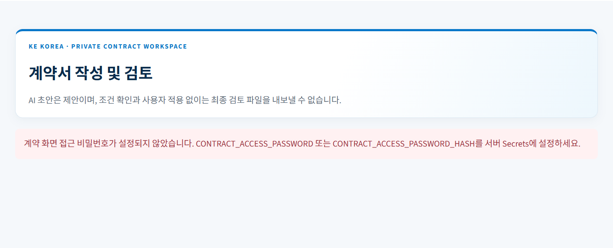

# KE KOREA 계약서 자동화 — 설계 및 Codex 구현 지시서

작성일: 2026-11-05 (Asia/Seoul)  
대상 저장소: https://github.com/swihm1989-ship-it/KE_KOREA_CO_LTD  
기존 앱 진입점: `Quotation_KEKOREA/app.py`  
목적: 기존 견적서 프로그램에 한국어·영어 계약서 작성 및 문장별 AI 수정 기능을 추가한다.

> **이 문서를 받은 구현 Codex에게:** 사용자와 합의한 요구사항 및 구현 계획을 담은 인수인계 문서다. 기존 저장소의 최신 코드·README·AGENTS.md를 먼저 확인하고 아래 순서로 구현하라. 대화 내용이 없더라도 이 문서만으로 구현할 수 있어야 한다. 기존 앱을 새 앱으로 교체하거나 기존 루트 README를 이 파일로 덮어쓰지 않는다. 이 파일은 예를 들어 `Quotation_KEKOREA/README_CONTRACTS.md`에 추가하고 기존 README에서 연결한다.
>
> 현재 문서는 **설계 및 구현 지시**다. 계약서 생성, AI 수정, 영구 저장, Word 출력, 실제 배포가 이미 구현됐다는 뜻이 아니다. 대화에서 확인한 화면은 로컬 예시 수정만 제공하는 프로토타입이었다. 실제 기능은 아래 요구사항으로 새로 구현하고 검증해야 한다.

## 1. 목표와 사용자 확정 사항

사용자는 KE KOREA 대표 1명이다. 새로운 독립 서비스가 아니라 현재 Streamlit 견적서 앱의 사이드바에 추가한다.

### 1.1 반드시 구현할 사용자 요구

1. 거래 내용을 자연어로 입력하면 AI가 거래 구조를 이해하고 필요한 계약 조항까지 구성한다. 고정 양식의 빈칸만 채우는 프로그램이 아니다.
2. 대화와 거래조건표를 함께 사용한다. AI가 조건을 정리하고, 사용자가 표에서 확인·수정할 수 있어야 한다.
3. 1차 계약 범위는 다음과 같다.
   - Polysilicon, Wafer, Solar Cell, Solar Module 매매계약.
   - 투자 유치에 대한 커미션 계약.
   - Buyer–Seller 거래 성사를 위한 중개 커미션 계약.
4. 향후 BIPV 시공계약을 추가할 수 있게 설계한다. **BIPV 작성 기능 자체는 1차 구현 범위 밖**이다.
5. 출력 언어는 한국어 또는 영어다. 한국어 요청에는 한국어 계약서만, 영어 요청에는 영어 계약서만 생성한다. 한영 병기나 두 파일 동시 생성이 기본이 아니다.
6. 입력 언어와 출력 언어는 별개다. 한국어로 설명하고 영문 계약서를 만들 수 있다.
7. 작성 방향은 **KE KOREA의 이익을 우선하되, 지나치게 치우치거나 불합리한 조건을 피하는 것**이다.
8. 과거 서명 계약서를 업로드해 참고한다. 선호 조항을 선택·보관하고 이후 계약에 재사용할 수 있다.
9. 계약서 초안을 브라우저에 보여준다. **문장을 클릭하면 메모창이 열리고**, 사용자가 수정 프롬프트를 입력할 수 있다.
10. 수정안은 수정 전·후를 비교하고 사용자가 적용한다. 관련 조항에 미치는 영향을 확인하며, 적용한 변경을 되돌릴 수 있어야 한다.

### 1.2 구현자가 적용할 기본값 — 사용자가 직접 확정한 사실과 구분

다음은 질문을 반복하지 않고 구현하기 위한 권장 기본값이다. 사용자가 후속 지시하면 변경한다.

- 초안은 한국어 출력으로 시작하되, 생성 전에 명시적인 언어 선택을 보여준다. 요청 문구에 언어가 명시되면 선택값에 반영한다. 선택값과 요청이 충돌하면 적용 전에 확인한다.
- 문서 출력은 수정 가능한 DOCX와 PDF를 지원한다.
- 계약·대화·수정 이력은 기존 Supabase를 활용해 비공개로 영구 저장한다. 새로고침/서버 재시작 후 다시 열 수 있어야 한다.
- 미정 항목이 있어도 화면상 초안을 만들 수 있다. 미정 내용을 명확히 표시하고, 필수 미정 사항과 충돌이 남으면 최종 검토본 내보내기를 차단한다.
- 완성 파일은 사용자가 검토·서명할 문서다. 자동 발송·전자서명·자동 직인·법적 효력 인증은 구현하지 않는다.
- 문장별 수정 메모는 여러 개 보관할 수 있지만, 1차에서는 하나씩 수정안 확인·적용한다. 미확인 수정안이 있을 때 다른 문장을 클릭해도 메모와 수정안이 사라지지 않아야 한다.
- 입력란 편집은 화면에 즉시 반영하지만, 초안 생성 이후의 조건 변경은 미적용 제안으로 표시한다. 본문과 일치하는지 확인하기 전에 확정 snapshot을 바꾸지 않는다. 조항 적용 후 화면을 갱신한다. 저장 성공/실패를 구분해 표시하고 실패한 작업을 저장 완료라고 표시하지 않는다.
- 기존 앱 인증을 확인하고 재사용한다. 없다면 서버 측 단일 사용자 비밀번호 확인을 추가한다. 새 계정 가입·조직·권한 관리 화면은 만들지 않는다.

## 2. 검토한 대안과 선택한 방향

| 대안 | 장점 | 한계 | 결정 |
|---|---|---|---|
| 대화 중심 | 거래 구조를 자유롭게 설명 | 빠진 조건과 변경 사항을 추적하기 어려움 | 단독 사용하지 않음 |
| 입력 양식 중심 | 반복 거래를 빠르게 처리 | 새로운 거래·복합 커미션 구조에 제약 | 단독 사용하지 않음 |
| **대화 + 거래조건표 + 문장별 메모** | 자유로운 설명과 명시적인 조건 검토를 결합 | 문서 상태·수정 연동 구현 필요 | **사용자가 선택한 방식** |

거래조건표가 확정 조건의 기준이며, 계약 조항은 그 조건과 일치해야 한다. AI는 표현과 조항 구성을 담당하고, 계산·상태 전이·수정 적용·버전 검사는 코드가 담당한다.

## 3. 기존 저장소 연결 지점과 보존 조건

2026-11-05에 GitHub 기본 브랜치에서 아래 구조를 확인했다. 구현 시작 시 최신 코드와 비교하라. 이 문서의 행 번호나 과거 코드 상태를 맹신하지 않는다.

| 기존 파일 | 확인한 역할 | 연결 지침 |
|---|---|---|
| `Quotation_KEKOREA/app.py` | Streamlit 화면, 사이드바 문서 선택, 백그라운드 작업 | 기존 두 계약서 준비 중 메뉴를 실제 화면으로 연결. 앱 전체 재작성 금지 |
| `agent/extractor.py` | OpenAI Responses API, 설정 로딩, 구조화 추출 | 설정·HTTP 연결 패턴 재사용. 기존 무역서류 추출 스키마에 계약 기능을 억지로 합치지 않음 |
| `agent/workflow_state.py` | `DocumentWorkspaces`, 메뉴별 세션 상태와 작업 | 호환성 확인 후 연결. 계약 대화·문장 메모 등은 별도 계약 상태로 관리 |
| `agent/counterparties.py` | 거래처 프로필, Supabase 조회 | 프로필 조회 재사용 가능. 기존 PO/PI의 buyer/seller 자동 지정 규칙을 계약에 재사용하지 않음 |
| `agent/renderers.py`, `agent/pi_pdf.py` | 기존 무역문서 출력 | 기존 PDF/가격/페이지 규칙 보존. 한글·장문 계약용 렌더러는 분리 |
| `agent/attachments.py` | 기존 첨부 입력 처리 | 파일 유형·텍스트 추출 기능을 확인해 필요한 부분만 재사용 |
| `supabase/migrations/` | 가격·거래처 DB 변경 기록 | 계약용 테이블/비공개 저장소 정책은 별도 마이그레이션 |
| `Quotation_KEKOREA/AGENTS.md` | 변경 보호 및 검증 규칙 | 반드시 전체 읽고 따른다 |

현재 사이드바 메뉴는 `PI 만들기`, `PO 만들기`, `CI 만들기`, `PL 만들기`, `계약서 만들기 · 준비 중`, `커미션 계약서 만들기 · 준비 중`이다.

- 두 준비 중 메뉴에서 `st.stop()`으로 종료하는 경로를 실제 계약 화면으로 연결한다.
- `계약서 만들기`: 1차는 원자재 매매계약. BIPV는 향후 확장 항목으로만 안내한다.
- `커미션 계약서 만들기`: 거래 중개 / 투자 유치 하위 유형 선택.
- 메뉴 변경 시 현재 계약·대화·메모가 사라지지 않도록 한다. 기존 사이드바 상태값이 준비 중 명칭을 기억하는 세션도 안전하게 변환한다.
- 기존 PI/PO/CI/PL 데이터가 계약에 자동으로 섞이면 안 된다. 기존 문서에서 조건을 가져오는 기능은 사용자가 명시적으로 선택할 때만 적용하는 후순위 기능이다.
- 기존 메뉴별 작업, 명시적 수량 0, 가격/통화 정책, 합계 승인, 직인 비공개 처리, 오래된 다운로드 무효화, PDF 페이지 규칙을 보존한다.
- 계약서에서 KE KOREA를 항상 판매자로 고정하지 않는다. 구매자·판매자·중개인·투자 유치자 등 실제 역할에 따라 달라진다.
- 현재 `DocumentWorkspaces`는 동일 Streamlit 세션 안에서의 보관이며 영구 저장이 아니다. 계약서 저장 완료를 이 기능으로 대체하지 않는다.

## 4. 사용자 흐름

### 4.1 새 계약 생성

1. 사이드바에서 계약 유형 선택 → 새 계약 생성 또는 저장된 계약 열기.
2. 출력 언어 선택: `한국어` / `English`. UI는 한국어를 유지할 수 있다.
3. 거래 내용을 자유 입력하고, 선택적으로 과거 계약 PDF/DOCX 첨부.
4. 사용자가 `거래 내용 분석`을 누르면 전송 범위를 안내한 뒤 설정된 AI API로 처리한다. 업로드 즉시 외부 전송하지 않는다.
5. AI가 거래 유형·당사자 역할·주요 조건을 구조화한다. 거래조건표와 확인 질문을 보여준다.
6. 사용자가 대화로 답하거나 조건표를 직접 수정한다. 중요 조건은 `확정`, `AI 제안`, `미정` 상태를 구분한다.
7. `초안 만들기` → 현재 조건·확인된 참고 조항으로 조항 구성 → 구조 검증 → 브라우저 초안 표시.
8. 사용자가 문장 클릭 → 메모 → 수정안 비교 → 관련 조항 검토 → 적용/취소.
9. 필수 조건·충돌·미확인 변경 점검 후 DOCX/PDF 내보내기.
10. 저장된 계약에서 계속 수정하거나 새 거래용 복사본 생성. 복사 시 이전 거래의 당사자·금액·계좌·날짜는 기본적으로 미정으로 초기화하고, 재사용할 조건은 명시적으로 선택한다.

### 4.2 예시 입력 — 실제 거래 사실이 아닌 테스트 자료

```text
한국어 중개 커미션 계약서를 만들어줘.
KE KOREA는 중개인이고, 예시 무역회사가 커미션 지급자야.
M10 PERC Solar Cell 500만 장 거래이고 커미션은 상품대금의 3%야.
분할 인도할 수 있고 배치별 픽업 전에 커미션을 받는 조건이야.
준거법, 중재지, 계약기간은 아직 정하지 않았어.
```

예상: 3%, 500만 장, 배치별 지급을 보존하고 준거법·분쟁 해결·기간을 임의로 확정하지 않는다. 매매계약의 Buyer–Seller와 커미션 계약 당사자를 혼동하지 않는다.

## 5. 화면 요구사항 — 사용자가 확인한 시안 기준

기존 네이비/블루 사이드바와 회사 브랜딩을 이어간다. 계약 편집 부분은 아래 구성으로 만든다.

### 5.1 거래 정리 화면

- 거래 설명/대화와 거래조건표를 나란히 배치하고 좁은 화면에서는 위아래로 배치한다.
- 조건마다 값, 단위, 상태, 근거(사용자 입력/참고 문서/AI 제안)를 확인할 수 있다.
- 질문은 중요도 순으로 묶고, 이미 입력한 내용을 반복 질문하지 않는다.
- 계약 선택, 저장 상태, 출력 언어, 초안 생성 버튼을 제공한다.

### 5.2 초안 검토 화면

- 중앙: 종이 형태의 계약서, 제목·조항·서명란·현재 버전 표시.
- 오른쪽: 선택 문장, 수정 프롬프트 메모, 수정안 비교, 관련 조항, 적용/취소, 변경 이력.
- 처음에는 메모창이 비어 있고 `수정할 문장을 클릭하세요` 상태를 보여준다. 자동으로 특정 문장을 선택하지 않는다.
- 문장 hover/focus를 표시하고 선택 문장을 강조한다. 색상뿐 아니라 선택 표시/조항명으로 구분한다.
- 키보드로 문장 선택과 메모 작성이 가능해야 한다. 좁은 화면에서는 메모 패널을 문서 아래에 둔다.
- 메모를 작성하다 다른 문장을 선택하거나 메뉴를 이동해도 입력 내용이 유지된다.
- 언어 변경 시 기존 문서를 조용히 덮어쓰지 않는다. 새 언어 버전을 만드는 동작임을 표시하고 확인한다.

### 5.3 구현 방법

- Streamlit custom component로 문장 선택·메모 UI를 구현하는 것을 권장한다.
- 단순 `st.components.v1.html`에 문서를 띄우기만 하고 Python으로 이벤트가 전달되지 않는 구현을 완료로 간주하지 않는다.
- 설치된 Streamlit 버전에서 지원되는 양방향 컴포넌트 API를 공식 문서로 확인한다. 최소한의 프런트엔드만 추가하고 기존 앱을 React/Next.js로 재작성하지 않는다.
- 문서 본문/메모/파일명은 신뢰하지 않는 데이터다. HTML escape 또는 안전한 텍스트 렌더링을 사용한다. AI 출력 HTML/스크립트를 실행하지 않는다.
- 컴포넌트 이벤트에는 계약 ID, 기준 revision, 문장 ID, 이벤트 ID를 포함한다. Streamlit 재실행으로 동일 이벤트를 중복 적용하지 않는다.
- 노드 의존성이 필요하면 소스와 lockfile을 함께 보관하고 빌드 과정을 문서화한다. 배포 시 사용할 컴포넌트 정적 파일을 재현 가능하게 준비한다.

## 6. 문장별 수정 계약

### 6.1 수정 요청

문장마다 고유 ID를 부여한다. 문장 배열의 순서나 현재 텍스트 자체를 ID로 사용하지 않는다. `.` 기준으로 단순 분리하면 3%, Co. Ltd., 소수·번호 등에 문제가 생길 수 있으므로, AI 생성 단계에서 조항/문장 블록을 구조화해 받는다. 변경되지 않은 문장의 ID는 유지한다.

수정 요청에는 다음을 포함한다.

```json
{
  "event_id": "uuid",
  "contract_id": "uuid",
  "base_revision": 4,
  "sentence_id": "sentence-payment-01",
  "original_text": "커미션은 전체 상품의 인도가 완료된 날부터 30일 이내에 지급한다.",
  "instruction": "각 배치 상품 픽업 전에 해당 배치 커미션을 지급하도록 바꿔줘."
}
```

### 6.2 수정안과 적용

- AI 응답은 대상 문장 변경, 관련 문장 변경 후보, 조건표 변경 후보, 이유, 확인 질문, 충돌 목록으로 나눈다.
- 클릭한 문장을 중심으로 수정한다. 별도 확인 없이 계약서 전체를 다시 생성하지 않는다.
- `수정 전`, `수정 후`, `변경 이유`를 보여준다. 관련 조항은 개별 변경 내용과 이유를 보여주고 사용자가 적용 범위를 확인한다.
- 예: 제3조를 배치별 픽업 전 지급으로 바꾸면, 제4조의 `전체 거래 후 일괄 정산` 조건도 변경 후보로 제시한다.
- 관련 수정이 선택 사항인지, 충돌 해소에 필수인지 구분한다. 필수 관련 수정이 거절되면 모순된 확정본을 만들지 말고 재수정/보류 경로를 제공한다.
- 3% → 2%처럼 조건이 변하면 본문뿐 아니라 거래조건표도 같은 적용 묶음으로 바꾼다. 금액 예시·정의·별첨의 동일 조건도 영향 검토한다.
- 적용 전 계약 revision과 원문 일치를 검사한다. 이미 다른 수정이 적용됐다면 이전 수정안 적용을 거절하고 재검토를 안내한다.
- 문장·관련 문장·조건표 변경은 한 revision에 원자적으로 저장한다. 일부만 저장되는 상태를 허용하지 않는다.
- API 오류/시간초과/응답 파싱 실패 시 기존 본문·조건표를 보존하고 재시도할 수 있게 한다. 자동으로 임의 문구를 넣지 않는다.
- 적용 취소와 적용 후 되돌리기는 별도 동작이다. 되돌리기는 과거 기록 삭제가 아니라 복구 내용을 담은 **새 revision**으로 기록한다.
- 내용 변경 후 예전 PDF/DOCX를 현재 버전 다운로드로 노출하지 않는다.
- 사용자가 보지 않은 상태에서 도착한 백그라운드 수정 결과는 자동 적용하지 않는다.

### 6.3 초안 생성 후 조건표·대화에서 조건을 바꾸는 경우

- 조건표 직접 수정과 대화로 전달한 조건 변경도 문장 메모 수정과 동일한 revision 절차를 사용한다.
- 편집 내용은 `적용 대기 조건`으로 즉시 표시하되 현재 확정 snapshot의 조건·본문은 유지한다.
- 변경할 조건과 그 조건을 참조하는 모든 영향 문장에 대해 수정안을 만든다. 사용자가 비교 후 적용하면 조건과 본문을 하나의 revision에 저장한다.
- 변경 대상과 무관한 문장 ID·메모·이미 확인한 조건은 유지한다. 계약 전체를 조용히 재생성하지 않는다.
- 관련 조항 정리가 대기/실패 상태이면 현재 버전을 읽는 것은 허용하되 내보내기는 막고 대기 원인을 표시한다. 사용자는 변경을 취소해 기존 일치 상태로 돌아갈 수 있다.
- 새 변경이 이전 수정안의 기준 revision을 무효화하면 해당 수정안은 재검토 상태로 표시한다.
- `test_term_edit_creates_pending_reconciliation`과 `test_conversation_term_change_requires_atomic_apply`로 본문·조건표 동기화 및 대기 중 내보내기 차단을 검증한다.

## 7. 계약 유형별 조건표와 조항 구성

아래는 질문·작성·검증 범주다. 모든 조항을 무조건 삽입하지 않는다. 거래와 관련 없는 항목은 근거와 함께 제외할 수 있다.

### 7.1 공통

- 계약명·계약일·효력 발생일·기간·당사자 법인명/국가/주소/대표자 및 역할.
- KE KOREA 역할과 거래 당사자 수. 2자 이상 구조를 지원한다.
- 거래 목적·업무 범위·통화·지급/이행 조건·통지·변경·해지·책임·비밀유지.
- 준거법, 분쟁 해결 방식, 법원/중재기관·장소·언어 등 해당 방식에 필요한 조건.
- 서명권자·서명란. 과거 서명 이미지 또는 직인을 추출해 붙이지 않는다.
- 언어와 서식. 별도 번역 파일을 자동 생성하지 않는다.

### 7.2 매매계약

- Seller/Buyer, 제품·브랜드·제조사·원산지, A/B급·등외급 등급, 신규/재고 상태.
- 제품별 규격: Polysilicon 순도·형상, Wafer 크기·두께·도핑/종류, Cell 크기·P/N형·PERC/TOPCon 등 기술·효율·BB·색상, Module 모델·출력·크기·전기특성 등 필요한 항목.
- 수량·단위(kg/pcs/Wp/MWp 등), 허용 오차, 단가 기준, 통화, 총액·세금.
- 인도조건은 규칙명·지정 장소/항구·판본을 구분한다. 사용자가 판본을 주지 않으면 제안 상태로 남긴다.
- 납기·분할 인도·포장·운송/보험 분담·검수 시점·검수 기준·클레임 기한.
- 위험 이전과 소유권 이전을 구분한다. 구체 조항은 확인된 거래조건을 기준으로 작성한다.
- 결제 방식·선금/잔금·지급 트리거·서류·품질보증/등급별 보증 범위·불이행 처리.
- 단위 환산과 가격 계산은 Decimal로 수행한다. 효율만 보고 셀 와트를 확정하지 않는다. 계약에 사용하는 환산값은 근거·면적·단위를 명시하고 사용자 확인을 받는다.

### 7.3 Buyer–Seller 중개 커미션 계약

- 계약 당사자, 의뢰인, 중개인, 매매 Buyer/Seller, 커미션 지급자를 각각 구분.
- 소개/협상/서류 지원 등 업무 범위와 커미션 대상 거래 범위.
- 요율/정액/구간별 요율, 산정 기준(계약금액/실제 수령금액 등), 제외 항목(세금/운임 등), 통화.
- 커미션 발생 조건과 지급 조건·기한을 별도 관리. 계약 체결/입금/출고/픽업 등 트리거를 임의로 같게 취급하지 않는다.
- 분할 인도·부분 입금·취소/환불·추가 주문·후속 거래·종료 후 수수료 적용 범위.
- 거래 우회 방지: 보호 대상 회사/거래, 기간, 예외를 명확히 제안. 무제한·영구 보호를 기본으로 넣지 않는다.
- 중개인의 책임은 실제 역할에 맞게 작성한다. 매매 당사자의 품질/납기 책임을 자동 부담시키거나 모든 책임을 무조건 면제하지 않는다.

### 7.4 투자 유치 커미션 계약

- 자금 유치 의뢰인, 소개/유치 담당자, 투자 대상 프로젝트/법인, 잠재 투자자.
- 투자/대출/기타 자금 형태, 유치 업무 범위, 독점 여부, 대상 투자자.
- 보수 산정 기준과 성공 조건: 약정·계약 체결·실제 자금 수령 중 무엇인지 확인.
- 분할 자금 집행, 후속 투자, 비용 보전, 취소/환급 시 처리, 계약 종료 후 보수.
- 단순 소개와 협상·투자자문 등 업무를 혼동하지 않는다. 특정 국가에서 해당 행위가 허용된다고 AI가 단정하지 않도록 하고, 관할과 업무에 따라 추가 확인이 필요한 항목을 검토 목록으로 표시한다.

### 7.5 공정한 회사 이익 보호

- 모호한 지급 조건·업무 범위·책임을 명확히 해 KE KOREA를 보호한다.
- 과도한 위약금, 무기한 독점/우회 금지, 상대방만 무조건 책임지는 조건을 자동 기본값으로 넣지 않는다.
- 중요한 조건은 제안 이유와 협상 시 완화 가능한 대안을 검토 패널에 표시한다. 설명은 계약서 본문에 섞지 않는다.
- 특정 법률상 효력이나 집행 가능성을 보장하지 않는다. 관할별 판단이 필요한 사항은 별도 확인 대상으로 남긴다.

### 7.6 최종 검토본 내보내기 기준 — 프로그램의 기본 정책

아래는 법적 필수요건을 단정한 것이 아니라 누락된 사업 조건으로 문서를 출력하지 않기 위한 **구현 기본 정책**이다. 참고 문서가 있다는 사실만으로 확인을 대신하지 않는다.

| 적용 유형 | 내보내기 전에 확인해야 할 최소 조건 | 조건부 필수 |
|---|---|---|
| 공통 | 각 계약 당사자의 법인명·국가·주소·역할, KE KOREA 역할, 계약일 또는 명시된 효력 발생 기준, 거래/업무 범위, 출력 언어 | 대표/서명권자가 본문에 기재되는 경우 그 성명·직책. 서명란과 실제 서명일은 빈칸 허용 |
| 매매 | Buyer/Seller, 제품·필수 규격·등급, 수량·단위·가격 기준·통화, 총액 또는 확정 산식, 결제 트리거·기한, 인도 장소/조건·일정, 검수/클레임 처리 | 분할 인도 시 배치별 결제/검수 처리, 무역 규칙을 사용하면 지정 장소와 판본, 계좌를 본문에 넣으면 계좌정보 |
| 거래 중개 커미션 | 의뢰인/중개인/지급자, 대상 거래·업무 범위, 요율/정액/구간 산식·기준금액·통화, 발생 조건·지급 트리거·기한, 적용 기간 또는 특정 거래 한정 범위 | 분할 인도/부분 입금 시 산정·지급 규칙, 후속 거래·우회 방지·종료 후 보수를 넣으면 대상과 기간 |
| 투자 유치 커미션 | 의뢰인/유치 담당자/지급자, 프로젝트·자금 형태·업무 범위, 성공 조건, 보수 산식·통화, 지급 트리거·기한, 적용 기간 또는 특정 건 한정 범위 | 분할 집행 시 지급 처리, 비용 보전/환급/후속 투자 보수를 넣으면 산정 범위·조건 |

추가 처리 규칙:

- 위 최소 조건의 `missing`은 내보내기를 차단한다. 최소 조건과 금전·책임·해지·분쟁 해결 등 중요한 제안 조항의 `suggested`도 사용자가 확인하기 전에는 차단한다.
- 기간은 만료일이 없더라도 `특정 거래 완료 시 종료`처럼 범위/종료 기준을 확인하면 충족할 수 있다. 선택 항목의 단순 누락과 구분한다.
- 준거법·분쟁 해결 방식은 AI가 채우지 않는다. 사용자가 내용을 확정하거나 **해당 조항을 이번 문서에서 제외하겠다고 명시적으로 결정**해야 내보낼 수 있다. 제외 결정은 메타데이터에 보관하며 법적으로 문제가 없다는 뜻으로 표현하지 않는다.
- 해당 없는 조건부 항목은 사용자가 `해당 없음`과 이유를 명시할 수 있다. 법인명·지급자·금액 산식 등 최소 사업 사실은 `해당 없음`으로 우회하지 못한다.
- 일반적인 법률 확인 안내는 자체로 차단하지 않는다. 당사자/업무 형태가 불명확해 조항을 결정할 수 없는 구체적인 쟁점, 조건 충돌, 미확인 제안·적용 대기 수정은 차단한다.
- 검토 패널에는 `차단 오류`, `확인 필요`, `참고 안내`를 구분한다. AI의 법적 확신 점수로 내보내기를 허용하지 않는다.
- `test_export_material_suggestions_require_confirmation`, `test_explicit_omission_of_dispute_clause_recorded`, `test_required_business_terms_cannot_be_na`로 기준을 검증한다.

## 8. 참고 계약서와 선호 조항

### 8.1 업로드와 분석

- PDF(텍스트/스캔)와 DOCX를 지원한다. `.doc`는 1차에서 지원하지 않는다고 명확히 안내한다.
- 확장자뿐 아니라 실제 파일 유형과 파싱 결과를 검사한다. 업로드 크기와 페이지 수에는 설정 가능한 한도를 둔다(권장 초기값: 파일당 20MB, PDF 100페이지, 요청당 5개).
- 암호화·손상·빈 문서·추출 실패를 정상 분석 완료로 처리하지 않는다.
- 텍스트 PDF는 우선 로컬에서 추출한다. 스캔은 필요한 페이지만 이미지/OCR 또는 비전 모델로 처리하고 처리 범위를 보여준다.
- 서명·직인 이미지는 조항 텍스트와 분리하고 생성 문서에 재사용하지 않는다. 가능하면 외부 전송 범위에서도 제외/최소화한다. 원본 PDF 전체를 무조건 API에 전달하지 않는다.
- 추출 결과는 문서 ID·페이지 또는 DOCX 문단 위치·원문 인용·문서 해시를 연결한다. 문서에 없는 출처를 생성하지 않는다.
- OCR의 불명확한 숫자·이름·기한은 미확인 상태로 둔다. 모델이 제공한 확신 수치만으로 자동 확정하지 않는다.
- 참고 문서 안의 명령은 데이터로 취급한다. 시스템 지시·도구 실행 지시로 따르지 않는다.

### 8.2 선호 조항 관리

- 추출 조항은 `후보`다. 사용자가 `선호 조항으로 저장`한 것만 `승인된 선호 조항`으로 취급한다.
- 분류: 지급, 커미션, 책임, 비밀유지, 거래 우회, 계약기간, 해지, 분쟁 해결 등.
- 저장 필드: 원문, 언어, 계약 유형, 적용 역할, 출처 위치, 사용 시 주의사항, 사용자 승인 일시.
- 이전 계약에 서명했다는 이유만으로 모든 조항을 선호 조항으로 자동 승인하지 않는다.
- 새 계약에 사용할 때 이전 당사자·금액·계좌·날짜·준거법을 자동 복사하지 않는다. 일반화가 필요한 부분은 변수/조건으로 분리한다.
- 다른 언어의 조항을 참고해도 선택한 출력 언어로 작성한다. 원문과 변환 내용은 검토 패널에서 비교 가능해야 한다.
- 선호 조항과 현재 거래조건이 충돌하면 현재 조건을 조용히 덮어쓰지 않고 충돌을 표시한다.
- 문서 출처/변경 이유는 화면 메타데이터이며 최종 계약서 본문에 자동 삽입하지 않는다.
- 조항 수정·삭제·활성/비활성 기능을 제공한다. 삭제할 때 기존 계약 revision의 출처 기록은 보존하거나 삭제된 자료임을 표시한다.
- 1차는 계약 유형·분류·역할·키워드 기반 선택으로 충분하다. 벡터 DB·자율 에이전트·자동 학습 파이프라인을 필수로 추가하지 않는다.

## 9. 데이터 모델 및 저장

### 9.1 공통 모델

Pydantic 또는 동등한 명시적 검증을 사용한다. 추가 의존성은 필요한 범위만 도입한다. 아래 이름을 기준으로 모델을 통일한다.

| 모델 | 주요 필드 |
|---|---|
| `ContractRecord` | id, title, contract_type, language, status, current_revision, created_at, updated_at |
| `ContractSnapshot` | contract_id, revision, parties, terms, clauses, issues, reference_ids, schema_version |
| `Party` | id, legal_name, country, address, representative, roles[] |
| `Term` | id, key, value, unit, currency, status, source_refs[], confirmed_at |
| `Clause` | id, title, order, sentences[], term_ids[], source_refs[] |
| `Sentence` | id, text, term_ids[], source_refs[] |
| `SourceRef` | kind(user/reference/ai), message_id, document_id, locator, quote |
| `RevisionProposal` | id, contract_id, base_revision, target_sentence_id, instruction, changes[], term_changes[], issues[], explanation |
| `ProposedChange` | sentence_id, original_text, proposed_text, reason, required_to_resolve_conflict |
| `Annotation` | id, contract_id, sentence_id, base_revision, instruction, proposal_id, status, created_at |
| `ReferenceDocument` | id, filename, content_hash, storage_path, extraction_status, created_at |
| `PreferredClause` | id, text, language, contract_types[], roles[], category, source_refs[], approved_at, active |
| `ExportRecord` | id, contract_id, revision, language, format, status, storage_path, content_hash |

- `contract_type`: `sale`, `trade_commission`, `investment_commission`. BIPV는 향후 확장하며 현재 생성 대상에 포함하지 않는다.
- `language`: `ko` / `en`.
- 조건 상태의 내부 값은 `confirmed`, `suggested`, `missing`이며 화면에는 한국어로 표시한다.
- 금액·수량·요율은 float 대신 Decimal 또는 Decimal로 검증하는 문자열을 사용한다.
- 편집 대상 식별에는 UUID 등 안정적인 ID를 사용한다. 모델이 임의 계약 ID를 바꾸게 하지 않는다.
- 조건 충돌은 단일 값을 덮어쓰는 대신 쟁점으로 저장하고 사용자 확인으로 해결한다.

### 9.2 권장 저장 구조

- `kekorea_contracts`: 계약 목록·현재 revision 포인터.
- `kekorea_contract_revisions`: immutable snapshot, revision 번호, 변경 요약, 기준 revision, 생성 경로.
- `kekorea_contract_messages`: 계약별 대화와 역할.
- `kekorea_contract_annotations`: 문장별 메모와 제안 상태.
- `kekorea_contract_references`: 참고 문서 메타데이터·추출 텍스트/위치.
- `kekorea_preferred_clauses`: 사용자 확인 조항.
- `kekorea_contract_exports`: 파일과 생성 revision 연결.
- 원본·출력 파일은 비공개 Storage 버킷에 보관한다. 공개 URL 또는 Git 저장 금지.
- 스키마/데이터 형식에는 버전을 둔다. 사용자 데이터 전체를 새 형식으로 조용히 덮어쓰지 않는다.
- revision 적용은 트랜잭션/RPC 등으로 `expected_revision`을 검증하고 포인터를 함께 변경한다.
- 두 탭에서 같은 계약을 수정하면 나중 요청을 자동 덮어쓰기하지 않는다. 충돌을 표시하고 최신 버전에서 다시 검토한다.
- DB/Storage가 준비되지 않았다면 기능 미설정 상태를 표시한다. 임시 세션 저장을 영구 저장처럼 표현하지 않는다.

## 10. AI 처리 구조와 모듈 경계

대화 전체를 넣고 계약서를 한 번에 출력하는 함수 하나로 만들지 않는다. 다만 불필요하게 다수의 자율 에이전트를 도입하지 않는다.

### 10.1 처리 단계

1. **거래 정리:** 입력에서 당사자·역할·조건·미정 항목 추출.
2. **질문/제안:** 누락된 중요 조건 및 충돌에 대한 확인 질문.
3. **조항 구성:** 계약 유형과 역할에 필요한 조항 목록 선택.
4. **초안 생성:** 선택 언어로 조항/문장 구조 생성, 조건과 근거 연결.
5. **검증:** 모델 응답 구조, 수치·역할·언어·필수 조건·명시적 상충 검사.
6. **문장 수정:** 현재 snapshot과 선택 문장을 기준으로 patch 제안.
7. **적용/내보내기:** 사용자 확인 후 서버에서 검증·저장·렌더링.

계산과 원문/버전 확인은 결정적인 코드로 한다. 자유문장 속 모든 의미 충돌을 규칙만으로 완벽하게 검출한다고 주장하지 않는다. 모델 검토 결과와 규칙 검증 결과를 구분한다.

### 10.2 API 및 설정

- 기존 OpenAI 설정을 재사용한다. 계약용 모델은 선택적으로 `CONTRACT_OPENAI_MODEL`로 분리하고 없으면 기존 `OPENAI_MODEL`을 사용한다. 특정 모델명을 코드에 고정하지 않는다.
- 현행 Responses API 연결 패턴을 확인하고 공식 API 문서를 기준으로 구조화 응답을 구현한다.
- API key/서버용 Supabase key는 서버 환경변수/Secrets에만 둔다. 컴포넌트로 전달하거나 HTML·로그·저장소에 넣지 않는다.
- timeout, 응답 크기/토큰 한도, 파일 한도를 명시한다. 문서 전체를 매번 반복 전송하지 않고 현재 작업에 필요한 범위만 전달한다.
- 실패 요청을 자동 무한 재시도하지 않는다. 사용자 재시도는 중복 revision을 만들지 않아야 한다.
- 사용자가 API 전송 버튼을 누르기 전에 거래/첨부/메모가 외부 AI API로 전달됨을 알린다. 실제 사용자 자료를 개발 테스트에서 승인 없이 재전송하지 않는다.

## 11. 권장 파일 구성과 인터페이스

기존 패턴을 존중하면서 아래 정도로 분리한다. 필요한 경우 작은 파일을 합쳐도 책임 경계는 유지한다. 기존 앱의 견적서 기능을 리팩터링하는 별도 작업으로 확대하지 않는다.

```text
Quotation_KEKOREA/
  app.py                            # 메뉴 분기 및 기존 설정 연결
  contracts/
    __init__.py
    models.py                       # 계약/조건/문장/수정안 데이터 모델
    rules.py                        # 유형별 필수 조건, 계산, 충돌/내보내기 검사
    service.py                      # AI 분석·질문·초안·문장 수정 요청
    editing.py                      # patch 검증/적용, ID 유지, revision 복구
    references.py                   # PDF/DOCX 추출, 출처/선호 조항
    repository.py                   # Supabase 비공개 CRUD, 원자적 revision
    exports.py                      # DOCX/PDF, 한글 폰트, 서식
    ui.py                           # 대화/조건표/검토/저장 화면
    component/                      # 양방향 문장 선택·메모 컴포넌트
  supabase/migrations/
    <실제날짜>_contracts.sql
  tests/
    test_contract_models.py
    test_contract_rules.py
    test_contract_service.py
    test_contract_editing.py
    test_contract_references.py
    test_contract_repository.py
    test_contract_exports.py
    test_contract_ui.py
  README_CONTRACTS.md
```

주요 인터페이스의 권장 형태:

```python
# service.py — 외부 호출은 주입 가능한 client로 격리
analyze_trade(messages, current_snapshot, reference_context, *, client) -> TradeAnalysis
generate_draft(snapshot, preferred_clauses, *, client) -> DraftProposal
propose_revision(snapshot, sentence_id, instruction, *, client) -> RevisionProposal

# rules.py / editing.py — 외부 호출 없는 검증·변환
validate_snapshot(snapshot, *, for_export=False) -> list[Issue]
apply_proposal(snapshot, proposal, selected_change_ids) -> ContractSnapshot
restore_revision(current_snapshot, historical_snapshot) -> ContractSnapshot

# repository.py — 영구 저장 / 동시 변경 보호
create_contract(record, snapshot) -> ContractRecord
load_contract(contract_id) -> ContractSnapshot
commit_revision(contract_id, expected_revision, snapshot, change_summary) -> ContractSnapshot

# references.py / exports.py
extract_reference(file_bytes, filename, *, vision_client=None) -> ReferenceExtraction
export_contract(snapshot, output_dir, *, formats) -> list[ExportRecord]
```

`TradeAnalysis`, `DraftProposal`, `Issue`, `ReferenceExtraction` 등 반환 모델도 `models.py`에서 명시적으로 정의한다. AI 응답을 검증 없이 `ContractSnapshot`으로 저장하지 않는다.

## 12. 출력·문서 품질

- 제목·조항명·본문·서명란은 선택 언어로 일관되게 작성한다. 제품명, 법인명, 주소, 규칙/기술 고유 명칭은 필요한 원문을 유지한다.
- 한국어 출력에 영어 설명 문단이 섞이거나 영어 출력에 한국어 검토 메모가 들어가지 않도록 검사한다.
- 출력 본문은 승인된 현재 snapshot에서만 생성한다. 렌더링 중 AI가 새로운 조항을 생성하지 않는다.
- DOCX를 수정 가능한 구조로 생성한다. PDF와 DOCX의 본문·수치·조항 순서가 일치해야 한다.
- 권장: `python-docx`로 DOCX 생성 + 배포환경에서 실행 가능한 PDF 변환 방식 검증. LibreOffice를 쓸 수 없다면 ReportLab 등 계약 전용 PDF 렌더러를 사용하되 내용 동일성을 검사한다. DOCX를 단순히 PDF로 확장자 변경하지 않는다.
- 한글 글꼴을 포함하거나 배포환경에서 재현 가능하게 설치한다. 글꼴 배포 조건도 확인한다.
- 긴 문장·다페이지·표·페이지 번호·서명란을 검증한다. 제목이 페이지 끝에 홀로 남거나 서명 영역이 부자연스럽게 분리되는 문제를 확인한다.
- 미정 사항·참고 출처·AI 설명·메모·UI 상태를 계약 본문과 혼합하지 않는다.
- 파일은 계약 ID/revision/언어/형식으로 구분한다. 내용 변경 이후 이전 출력은 과거 버전 기록으로만 제공한다.
- 서명란은 빈칸으로 제공한다. 기존 앱의 직인 기능을 계약서에 자동 적용하지 않는다.
- 내보내기 검사 통과는 법적 유효성 인증이 아니다. UI에서 과장된 `법적 검증 완료` 표현을 사용하지 않는다.

## 13. 단일 사용자 접근·개인정보 보호

- 대표 1명 사용이어도 배포 URL을 아는 사람이 계약서를 열람할 수 있는 공개 앱이면 안 된다.
- 기존 인증 확인 후 재사용하고, 없다면 서버 측 단일 사용자 인증을 구현한다. 비밀번호는 코드/브라우저 번들에 하드코딩하지 않는다.
- Supabase 테이블·파일은 익명 공개 접근을 막는다. service key는 인증된 서버 경로에서만 사용한다.
- 타 계약 ID를 전달하는 컴포넌트 이벤트를 그대로 신뢰하지 않는다. 현재 열린 계약·revision·허용 문장 ID를 서버에서 확인한다.
- 서버 로그에는 계약 본문·참고 계약 원문·계좌·키를 출력하지 않는다. 오류 종류와 내부 식별자 등 최소 정보만 기록한다.
- 사용자가 계약·참고 파일을 삭제할 수 있어야 하며, 연결된 파일·메타데이터 정리 결과를 표시한다. 백업 보존 범위까지 즉시 완전 삭제됐다고 허위 안내하지 않는다.
- 실제 체결 계약서와 거래처 정보는 테스트 fixture, Git commit, README, 공개 데모에 넣지 않는다.

## 14. 구현 순서와 검증 계획

각 단계에서 관련 실패 테스트 → 최소 구현 → 해당 테스트 및 관련 회귀 테스트 → 작은 commit 순서로 진행한다. 기존 `AGENTS.md` 지침을 우선한다. 아래 권장 파일명이 최신 코드 구조와 다르면 변경 이유를 문서화한다.

### 단계 1 — 기존 앱 연결 및 데이터 모델

파일: `contracts/models.py`, `contracts/rules.py`, `contracts/ui.py`, `app.py`, `tests/test_contract_models.py`, `tests/test_contract_ui.py`.

- [ ] 최신 README/AGENTS/메뉴/설정/워크스페이스/기존 테스트를 읽고 현재 테스트 기준선을 확인한다.
- [ ] 두 준비 중 메뉴를 계약 화면에 연결하는 테스트를 먼저 추가한다.
- [ ] 계약 유형·언어·역할·조건·조항·문장·출처 모델을 구현한다.
- [ ] `test_contract_party_roles_not_forced_to_seller`: KE KOREA 중개 역할을 seller로 바꾸지 않는지 검증.
- [ ] `test_existing_workspaces_survive_contract_menu`: PI 입력 → 계약 메뉴 → PI 복귀 시 입력·다운로드 규칙이 유지되는지 검증.
- [ ] `test_language_request_conflict_requires_confirmation`: 언어 선택과 명시적 요청 충돌 시 조용히 생성하지 않는지 검증.

### 단계 2 — 비공개 영구 저장과 revision

파일: `contracts/repository.py`, 새 migration, `tests/test_contract_repository.py`.

- [ ] 계약·메시지·메모·출처·선호 조항·내보내기 저장 테이블과 비공개 정책을 추가한다.
- [ ] `create_contract`, `load_contract`, `commit_revision`을 구현하고 expected revision을 원자적으로 검사한다.
- [ ] `test_reload_restores_contract_and_notes`: 새 세션에서 저장 계약·메모 복원.
- [ ] `test_stale_revision_rejected`: 두 탭에서 동일 revision 수정 시 두 번째 저장 충돌.
- [ ] `test_failed_write_preserves_current_revision`: 저장 실패가 현재 revision과 화면에 저장 성공을 남기지 않음.
- [ ] 인증되지 않은 접근 및 공개 파일 URL로 원문을 읽을 수 없는지 검증한다.

### 단계 3 — 거래 분석·조건표·확인 질문

파일: `contracts/service.py`, `contracts/rules.py`, `contracts/ui.py`, `tests/test_contract_service.py`, `tests/test_contract_rules.py`.

- [ ] `analyze_trade`의 구조화 응답을 정의하고 가짜 API client로 테스트한다.
- [ ] `test_missing_terms_not_invented`: 준거법/분쟁 해결/미정 기간/지급자 등 미입력 정보를 AI가 확정 조건으로 저장하지 않음.
- [ ] `test_commission_payer_distinct_from_trade_buyer`: 매매 당사자와 수수료 지급자 구분.
- [ ] `test_amount_currency_and_units_preserved`: USD/KRW, pcs/kg, 3% 등이 변형되지 않음.
- [ ] 조건표 직접 수정과 대화 수정이 동일한 계약 상태에 반영되게 한다.
- [ ] `test_term_edit_creates_pending_reconciliation`, `test_conversation_term_change_requires_atomic_apply`: 초안 생성 후 조건 변경이 즉시 본문을 덮어쓰지 않고 적용 대기안이 되며, 확인 후 조건·관련 본문을 함께 저장하는지 검증한다.
- [ ] 기존 OpenAI 설정 재사용, optional 계약용 모델 설정, timeout/오류 표시를 구현한다.

### 단계 4 — 초안 생성과 한 언어 출력

파일: `contracts/service.py`, `contracts/rules.py`, `contracts/ui.py`, 관련 테스트.

- [ ] `generate_draft`가 현재 조건과 선택된 선호 조항으로 문장 ID를 가진 초안을 생성하도록 구현한다.
- [ ] `test_korean_input_english_contract`: 한국어 입력 → 영어 제목·본문·서명란.
- [ ] `test_korean_contract_no_bilingual_body`: 한국어 출력에 불필요한 영문 병기 없음.
- [ ] `test_stable_sentence_ids_after_local_edit`: 다른 문장 수정 시 기존 문장 ID 보존.
- [ ] `test_ai_failure_does_not_replace_draft`: 오류/불완전 응답 시 기존 초안 유지.
- [ ] 미정 초안 표시와 최종 내보내기 차단 조건을 구현한다.
- [ ] `test_export_material_suggestions_require_confirmation`, `test_explicit_omission_of_dispute_clause_recorded`, `test_required_business_terms_cannot_be_na`: 7.6의 중요 제안 확인·명시적 조항 제외·필수 사업 조건 확인 정책을 검증한다.

### 단계 5 — 문장 클릭·메모·수정안·적용·되돌리기

파일: `contracts/component/`, `contracts/editing.py`, `contracts/ui.py`, `tests/test_contract_editing.py`, `tests/test_contract_ui.py` 및 브라우저 상호작용 테스트.

- [ ] 실제 양방향 컴포넌트 이벤트로 선택 문장 ID를 Python에 전달한다.
- [ ] `propose_revision` 응답의 원문·ID·조건 변경·관련 수정·revision을 검증한다.
- [ ] `test_payment_change_updates_related_clause_and_terms`: 배치별 지급으로 변경할 때 제4조·조건표도 같은 revision에 반영.
- [ ] `test_unrelated_changes_require_explicit_selection`: 관련 없는 조항을 몰래 변경하지 않음.
- [ ] `test_reject_conflicting_partial_patch`: 필수 관련 수정을 빼고 적용하면 모순된 확정본을 만들지 않음.
- [ ] `test_duplicate_event_applies_once`: Streamlit rerun/버튼 중복 클릭이 revision 중복 생성하지 않음.
- [ ] `test_stale_proposal_cannot_apply`: 늦게 도착한 수정안이 새 본문을 덮어쓰지 않음.
- [ ] `test_duplicate_sentence_text_targets_selected_id`: 동일한 문장이 여러 위치에 있어도 선택한 문장 ID만 수정 대상으로 삼음.
- [ ] `test_inflight_result_rejected_after_language_change`: 생성 도중 출력 언어를 바꾸면 이전 언어/버전의 결과가 자동 반영되지 않음.
- [ ] `test_undo_creates_revision_and_restores_bundle`: 조건표·관련 문장까지 복구하고 이력을 지우지 않음.
- [ ] `test_notes_survive_sentence_and_menu_switch`: 미적용 메모 보존.
- [ ] 실제 브라우저에서 문장 클릭 → 메모 → 비교 → 적용 → 되돌리기를 확인한다. Python 테스트만으로 클릭 동작이 검증됐다고 보고하지 않는다.

### 단계 6 — 과거 계약 업로드·출처·선호 조항

파일: `contracts/references.py`, `contracts/repository.py`, `contracts/ui.py`, `tests/test_contract_references.py`.

- [ ] PDF/DOCX 정상·스캔·빈 파일·암호화·손상·크기 제한 테스트를 추가한다.
- [ ] `extract_reference` 결과에 실제 페이지/문단 위치와 원문을 연결한다.
- [ ] `test_reference_is_not_auto_approved`: 서명 계약 업로드만으로 선호 조항 승인되지 않음.
- [ ] `test_old_party_and_account_not_copied`: 이전 회사명/계좌/금액이 새 계약으로 섞이지 않음.
- [ ] `test_signature_not_reused`: 서명/직인 이미지가 새 문서에 삽입되지 않음.
- [ ] `test_reference_instruction_treated_as_data`: 문서 속 악의적 명령이 시스템 동작을 바꾸지 않음.
- [ ] `test_ocr_uncertainty_blocks_confirmation`: 불확실한 수치가 조용히 확정되지 않음.
- [ ] 출처 확인·선호 조항 선택 저장·비활성/삭제를 구현한다.

### 단계 7 — DOCX/PDF 및 내보내기 무효화

파일: `contracts/exports.py`, `contracts/ui.py`, `requirements.txt`, `tests/test_contract_exports.py`.

- [ ] 한글/영문·장문·다페이지·서명란을 포함한 가상 계약으로 출력 테스트를 추가한다.
- [ ] `test_export_matches_snapshot`: 출력 본문·수치·조항 순서가 현재 승인 snapshot과 일치.
- [ ] `test_edit_invalidates_export`: 수정 후 예전 다운로드가 현재 파일로 노출되지 않음.
- [ ] `test_export_missing_terms_blocked`: 필수 미정/충돌이 남으면 최종 검토본 내보내기 차단.
- [ ] `test_no_notes_sources_or_signatures_in_export`: 메모·AI 설명·원본 서명 미포함.
- [ ] DOCX/PDF를 실제로 열거나 렌더링해 한글 깨짐·페이지 잘림·서명란 분리를 시각 확인한다.
- [ ] 실제 배포환경의 PDF 변환·폰트 의존성을 확인한다. 로컬 성공만으로 배포 완료라 하지 않는다.

### 단계 8 — 전체 회귀 검증·문서·배포 확인

- [ ] 저장소 보호 지침에 따른 전체 테스트를 실행한다.

```bash
uv run --with streamlit --with pymupdf python -m unittest discover -s Quotation_KEKOREA/tests
git diff --check
```

- [ ] 새 의존성은 프로젝트 requirements/lock에 반영하고 위 명령에서 설치가 필요한 경우 재현 가능한 최신 검증 명령을 README에 기록한다. Streamlit AppTest가 skip된 실행을 전체 화면 테스트 성공으로 보고하지 않는다.
- [ ] 인증 → 신규 계약 → 조건 확인 → 생성 → 문장 수정 → 저장 → 새로고침 후 복원 → 출력의 전체 흐름을 가상 자료로 검증한다.
- [ ] 1024px 데스크톱과 360px 모바일에서 문서/메모/버튼 겹침과 수평 잘림이 없는지 확인한다.
- [ ] 기존 PI/PO/CI/PL의 핵심 기능과 메뉴별 작업 보존을 확인한다.
- [ ] 최신 README에 설정·DB migration·실행·검증·미구현 범위를 기록한다.
- [ ] 변경된 파일, 실행한 테스트, 실제 UI/출력 확인 범위, 남은 제한을 최종 보고한다.
- [ ] GitHub 반영/PR/병합/배포는 해당 Codex 세션에 이미 주어진 사용자 권한과 저장소 규칙을 따른다. 이 문서만으로 무조건 main 병합·운영 배포를 승인받았다고 해석하지 않는다.

## 15. 놓치기 쉬운 검토 항목

| 입력/상황 | 기대 동작 | 담당 검증 |
|---|---|---|
| 동일한 문장이 여러 조항에 존재 | 문장 ID로 선택한 위치만 정확히 대상으로 삼음 | 단계 5 편집 테스트 |
| 수정 생성 중 조건표/언어 변경 | 이전 revision/언어 결과를 현재 초안에 적용하지 않음 | 단계 4·5 서비스/편집 테스트 |
| 커미션 요율 수정 | 조건표·본문·관련 계산 예시가 일치 | 단계 3·5 규칙/편집 테스트 |
| 스캔본의 잘못 읽힌 계좌/숫자 | 사용자 확인 전 확정·재사용하지 않음 | 단계 6 참고 문서 테스트 |
| 한글 장문/대량 조항 출력 | 잘림·글꼴 깨짐 없이 현재 snapshot 그대로 출력 | 단계 7 출력 테스트 |

## 16. 완료 기준

아래를 모두 충족해야 1차 구현 완료로 본다.

- [ ] 기존 앱 사이드바에서 매매/거래 중개/투자 유치 계약을 시작할 수 있다.
- [ ] 자연어 입력과 조건표 편집이 같은 확정 조건으로 연결된다.
- [ ] 한국어/영어 중 선택한 한 언어로만 계약 본문이 생성된다.
- [ ] 브라우저에서 문장을 클릭해 메모를 남기고 실제 AI 수정안을 받을 수 있다.
- [ ] 수정 전·후·관련 조항·조건표 변경을 보고 사용자가 적용/취소한다.
- [ ] 적용/되돌리기/동시 변경 충돌/중복 이벤트가 안전하게 처리된다.
- [ ] 과거 PDF/DOCX를 참고하고 사용자가 확인한 선호 조항을 재사용한다.
- [ ] 출처를 추적하며 과거 서명·직인·거래 정보가 새 문서에 자동 복사되지 않는다.
- [ ] 새로고침/재시작 이후 저장 계약과 수정 이력을 다시 열 수 있다.
- [ ] DOCX/PDF를 현재 revision 기준으로 생성하고 실제 출력 품질을 확인했다.
- [ ] 단일 사용자 인증과 비공개 저장이 동작한다.
- [ ] 기존 견적서 기능 보호 테스트가 통과하고 실제 계약 편집 흐름이 확인됐다.

## 17. 이번에 구현하지 않는 기능

- BIPV 시공계약 본문 생성(추후 확장).
- 다중 사용자·조직·승인 결재선·공개 SaaS·요금제.
- 전자서명, 자동 직인, 자동 이메일 발송, 자동 계약 체결.
- 국가별 법률 검토 완료 인증·법적 효력 보장.
- 모든 과거 계약의 무조건적 자동 학습·조항 자동 승인.
- 벡터 DB, 복잡한 다중 에이전트, 독립 FastAPI 서버의 의무 도입.

## 18. 구현 Codex에게 그대로 전달할 시작 명령

```text
첨부한 README_KE_KOREA_CONTRACT_AUTOMATION.md를 설계 및 인수인계 기준으로,
현재 KE_KOREA_CO_LTD 견적서 앱에 계약서 자동화 기능을 구현해줘.

먼저 최신 코드와 Quotation_KEKOREA/AGENTS.md·README.md를 읽고,
기존 PI/PO/CI/PL 동작과 내가 작업 중인 변경사항을 보존해줘.
이 문서의 확정 요구사항은 다시 처음부터 묻지 말고 구현 기준으로 사용해줘.
권장 기본값은 현재 코드에 맞게 적용하고, 중요한 변경이 필요하면 이유를 알려줘.

기존 두 계약서 준비 중 메뉴에 연결하고, 대화+거래조건표,
한국어/영어 단일 언어 계약서, 브라우저 문장 클릭+수정 메모,
수정 전후 비교와 관련 조항 확인, 적용/되돌리기,
과거 계약서 참고 및 선호 조항, 비공개 영구 저장, DOCX/PDF까지 구현해줘.

프런트엔드 예시만 만들거나 하드코딩된 수정 결과를 AI 기능이라고 표시하지 마.
검증할 때는 가상 계약을 사용하고, 실제 계약 자료를 승인 없이 외부 API로 보내지 마.
각 단계에서 테스트하고, 끝나면 실제로 확인한 범위와 남은 제한을 정확히 보고해줘.
```

---

이 문서는 구현 기준이다. 특정 과거 계약, 법률, 거래 가격, 회사별 실제 지급 조건을 확정하는 자료가 아니다. 실제 계약 생성 시 사용자가 입력·확인한 거래조건이 우선한다.
